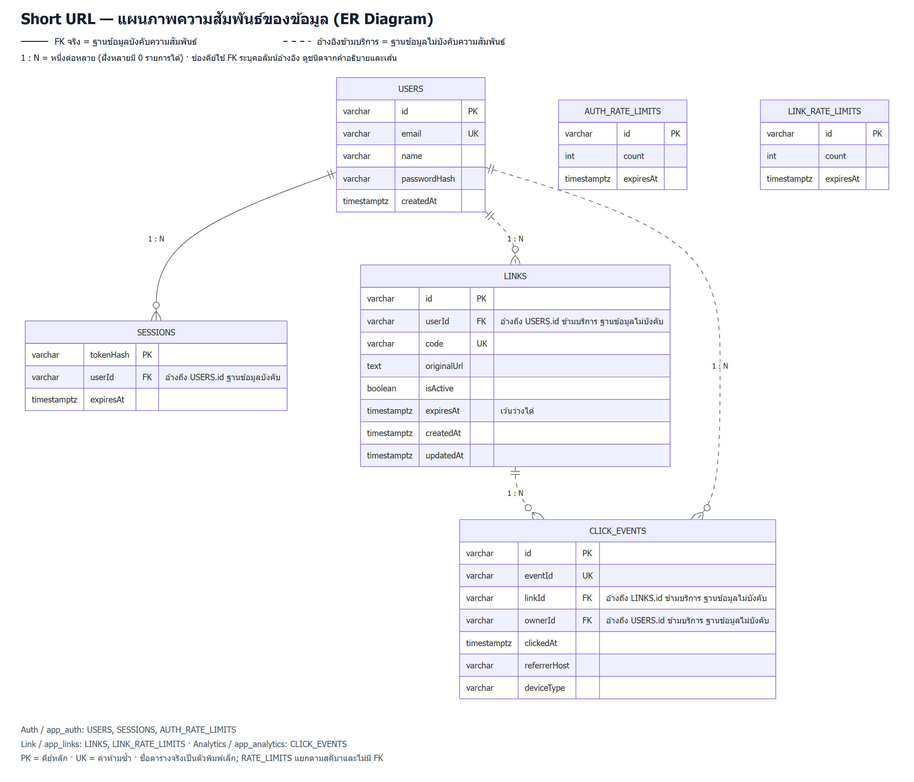

# Short URL — Microservices

ระบบย่อลิงก์และสร้าง QR Code พร้อมประวัติและสถิติการเปิดลิงก์ พัฒนาด้วย React, Node.js/Express และ PostgreSQL โดยแยกเป็น Frontend, Gateway, Auth, Link และ Analytics

## ลิงก์สำหรับตรวจแบบทดสอบ

| รายการ | ลิงก์ |
|---|---|
| Source Code Repository | [joe9856/Project_Short_URL](https://github.com/joe9856/Project_Short_URL) |
| เว็บสำหรับทดสอบออนไลน์ | [Short URL](https://project-short-url-qrrz.vercel.app) |
| Architecture Diagram และ DFD Level 0 | [เปิดแผนภาพใน Figma](https://www.figma.com/design/KWIrbon5NX18Yh3vvZBqPq/Short-URL-%E2%80%94-Microservices-architecture?node-id=0-1) |
| ER Diagram | [ดูภาพ PNG](docs/diagrams/er.png) · [ขยายภาพ SVG](docs/diagrams/er.svg) |

ผู้ตรวจสามารถสมัครบัญชีผ่านหน้า [สมัครสมาชิก](https://project-short-url-qrrz.vercel.app/register) แล้วเข้าสู่ระบบเพื่อสร้างและจัดการลิงก์ได้ การเปิด Short URL ไม่ต้องเข้าสู่ระบบ

## ฟังก์ชันของระบบ

- สร้าง Short URL จาก URL แบบ HTTP/HTTPS และเปิดไปยัง URL ต้นฉบับ
- สร้างและดาวน์โหลด QR Code ของ Short URL เป็น PNG หรือ SVG
- ดูประวัติ URL ต้นฉบับและ Short URL พร้อมยอดคลิกสะสม ค้นหา กรองสถานะ และแบ่งหน้า
- ดูแดชบอร์ดและสถิติตามช่วงวันที่ ทั้งยอดคลิก รายวัน อุปกรณ์ และแหล่งที่มา
- กำหนดชื่อย่อเอง ตั้งหรือแก้วันหมดอายุ และเปิด–ปิดการใช้งานลิงก์
- สมัครสมาชิก เข้าสู่ระบบ ออกจากระบบ และแก้ไขชื่อบัญชี โดยแต่ละบัญชีจัดการได้เฉพาะข้อมูลของตนเอง

## เทคโนโลยีและส่วนประกอบ

| ส่วน | เทคโนโลยี / หน้าที่ |
|---|---|
| Frontend | React, TypeScript, Vite — หน้าสร้างลิงก์ ประวัติ และแดชบอร์ด |
| Gateway | Node.js, Express — รับคำขอจาก Frontend และส่งต่อไปยังบริการ |
| Auth Service | สมัครสมาชิก ตรวจบัญชี จัดการ Session และข้อมูลผู้ใช้ |
| Link Service | สร้างและจัดการลิงก์ สร้าง QR และส่งต่อ URL |
| Analytics Service | บันทึกเหตุการณ์เปิดลิงก์และสรุปสถิติ |
| Database | PostgreSQL 17 และ Prisma 6.19.3 |
| Hosting | Vercel สำหรับ Frontend/Backend และ Supabase สำหรับ PostgreSQL |

ฐานข้อมูลใช้ PostgreSQL หนึ่ง instance แยกสคีมา `app_auth`, `app_links`, `app_analytics` แต่ละบริการมี Prisma schema, migrations และบัญชีฐานข้อมูลของตัวเอง การแลกข้อมูลระหว่างบริการใช้ API

## วิธีติดตั้งและรันในเครื่อง

### 1. เตรียมเครื่องมือ

- Git สำหรับดาวน์โหลด Source Code
- Node.js 22.x ตั้งแต่ 22.12 ขึ้นไป พร้อม npm
- Docker Engine หรือ Docker Desktop ที่มี Docker Compose v2 สำหรับรัน PostgreSQL ตามวิธีหลักด้านล่าง

ตรวจว่าเครื่องมือพร้อมใช้งาน และเปิด Docker ให้เรียบร้อย:

```sh
git --version
node --version
npm --version
docker compose version
```

หากไม่ใช้ Docker สามารถใช้ PostgreSQL 17 ที่ติดตั้งในเครื่อง ตามหัวข้อวิธีทางเลือกด้านล่าง

### 2. ดาวน์โหลดโปรเจกต์และติดตั้ง Dependencies

```sh
git clone https://github.com/joe9856/Project_Short_URL.git
cd Project_Short_URL
npm ci
```

รันคำสั่งทั้งหมดต่อจากนี้ที่โฟลเดอร์ `Project_Short_URL` ซึ่งมีไฟล์ `package.json` หลัก คำสั่ง `npm ci` ติดตั้ง Dependencies ของทุกส่วนผ่าน npm workspaces

### 3. สร้างไฟล์ตั้งค่าสำหรับเครื่องนี้

```sh
npm run setup
```

คำสั่งนี้สุ่มรหัสผ่านฐานข้อมูลและ Internal API Secret ให้สอดคล้องกัน แล้วสร้างไฟล์ต่อไปนี้:

| ไฟล์ | การตั้งค่าที่ใช้ |
|---|---|
| `.env` | รหัสผ่าน PostgreSQL/บัญชีของแต่ละบริการ พอร์ตฐานข้อมูล และ URL ของเว็บ |
| `gateway/.env` | พอร์ต Gateway, URL ของบริการ และ Internal API Secret |
| `services/auth-service/.env` | URL ฐานข้อมูลสคีมา `app_auth` และการตั้งค่า Auth |
| `services/link-service/.env` | URL ฐานข้อมูลสคีมา `app_links` และการตั้งค่า Link |
| `services/analytics-service/.env` | URL ฐานข้อมูลสคีมา `app_analytics` และการตั้งค่า Analytics |

Frontend ในโหมดพัฒนาใช้ Vite proxy ไปยัง Gateway ที่พอร์ต 3000 จึงไม่ต้องสร้างไฟล์ `.env` ของ Frontend

ใช้ `setup` สำหรับการติดตั้งครั้งแรก หากมี `.env` อยู่แล้ว สคริปต์จะหยุดเพื่อไม่เขียนทับค่าปัจจุบัน เก็บไฟล์เหล่านี้ไว้ในเครื่องและไม่ Push ขึ้น Git สำหรับการย้ายจาก MySQL เดิม ดู [คู่มือ PostgreSQL ในเครื่อง](docs/local-postgres.md)

### 4. เริ่ม PostgreSQL

```sh
docker compose up -d --wait postgres
docker compose ps postgres
```

คำสั่งนี้เริ่มเฉพาะฐานข้อมูล PostgreSQL 17 และรอให้พร้อมใช้งาน ครั้งแรกจะสร้างฐานข้อมูลพัฒนา `short_url`, ฐานข้อมูลทดสอบ `short_url_test` และบัญชี/สคีมาของแต่ละบริการตามไฟล์ตั้งค่า

ฐานข้อมูลเปิดให้เครื่องนี้เชื่อมต่อที่ `127.0.0.1:5544` ข้อมูลถาวรอยู่ใน Docker volume

### 5. สร้าง Prisma Client และตาราง

```sh
npm run generate
npm run migrate
```

`generate` สร้าง Prisma Client ของ Auth, Link และ Analytics ส่วน `migrate` ใช้ migrations ของแต่ละบริการเพื่อสร้างตารางในสคีมาของตนเอง

### 6. เริ่มระบบ

```sh
npm run dev
```

คำสั่งเดียวเริ่ม Frontend, Gateway และ Backend ทั้งสามบริการ เปิด Terminal นี้ค้างไว้ระหว่างใช้งาน

| ส่วน | URL / พอร์ตในเครื่อง |
|---|---|
| Frontend | [http://localhost:5173](http://localhost:5173) |
| Gateway | `http://127.0.0.1:3000` |
| Auth Service | `http://127.0.0.1:3001` |
| Link Service | `http://127.0.0.1:3002` |
| Analytics Service | `http://127.0.0.1:3003` |
| PostgreSQL | `127.0.0.1:5544` |

ตรวจความพร้อมได้ที่ [Gateway health](http://127.0.0.1:3000/healthz), [Auth readiness](http://127.0.0.1:3001/readyz), [Link readiness](http://127.0.0.1:3002/readyz) และ [Analytics readiness](http://127.0.0.1:3003/readyz)

### 7. ทดลองใช้งาน

1. เปิด [หน้าสมัครสมาชิกในเครื่อง](http://localhost:5173/register) แล้วสร้างบัญชีใหม่ ระบบไม่มีบัญชีหรือรหัสผ่านเริ่มต้นที่ฝังใน Source Code
2. กรอก URL เช่น `https://www.synerry.com` แล้วกดสร้าง Short URL จะเลือกชื่อย่อและวันหมดอายุเพิ่มเติมก็ได้
3. เปิด Short URL ในแท็บใหม่ ต้องไปยังเว็บไซต์ต้นฉบับ
4. ดาวน์โหลด QR Code และตรวจว่าเข้ารหัส Short URL เดียวกัน หากทดสอบสแกนด้วยมือถือ ให้ใช้เว็บออนไลน์ เพราะ `localhost` บนมือถือหมายถึงตัวมือถือเอง
5. เปิดหน้าประวัติและแดชบอร์ด ตรวจรายการลิงก์และยอดคลิกหลังเปิดลิงก์
6. ปิดลิงก์แล้วเปิดอีกครั้ง ต้องไม่ส่งต่อ จากนั้นเปิดใช้งานคืนและทดสอบอีกครั้ง

### วิธีทางเลือก: ใช้ PostgreSQL ในเครื่องแทน Docker

ทำขั้นตอน 1–3 ตามปกติ แล้วใช้คำสั่งต่อไปนี้แทนขั้นตอน 4:

```sh
npm run db:local
```

บน Windows ให้ตั้ง `POSTGRES_BIN` เป็นโฟลเดอร์ `bin` ของ PostgreSQL 17 ที่ติดตั้งจริง ตัวอย่างใน PowerShell:

```powershell
$env:POSTGRES_BIN = "C:\Program Files\PostgreSQL\17\bin"
npm run db:local
```

บน Linux ให้ `initdb`, `pg_ctl` และ `psql` อยู่ใน `PATH` และรันด้วยผู้ใช้ปกติ สคริปต์สร้าง instance ของโปรเจกต์ไว้ใน `.local/postgresql` ที่พอร์ต 5544 จากนั้นทำขั้นตอน 5–7 ต่อได้ ดู [รายละเอียดเพิ่มเติม](docs/local-postgres.md)

เลือกวิธีฐานข้อมูลเพียงวิธีเดียวสำหรับพอร์ต 5544

### หยุดระบบและเปิดใช้งานครั้งถัดไป

กด `Ctrl+C` ใน Terminal ที่รัน `npm run dev` แล้วหยุดฐานข้อมูลตามวิธีที่เลือก:

```sh
# กรณีใช้ Docker — เก็บข้อมูลเดิมไว้
docker compose stop postgres

# กรณีใช้ PostgreSQL ของโปรเจกต์โดยตรง
npm run db:stop
```

ครั้งถัดไปเริ่มฐานข้อมูลด้วยคำสั่งเดิมแล้วรัน `npm run dev` ไม่ต้องรัน `setup` ซ้ำ หากอัปเดตโค้ดที่มี Dependencies หรือ migrations ใหม่ ให้รัน `npm ci`, `npm run generate` และ `npm run migrate` ก่อน

### แก้ปัญหาการติดตั้งเบื้องต้น

| อาการ | วิธีตรวจและแก้ |
|---|---|
| `Existing .env found` | มีการตั้งค่าอยู่แล้ว ตรวจว่าเป็นค่าฐานข้อมูลพัฒนาของเครื่องนี้ และข้าม `setup` เมื่อจะใช้ค่าเดิม |
| Docker เชื่อมต่อไม่ได้ | เปิด Docker Desktop/Engine ให้พร้อม แล้วลองคำสั่งเริ่ม PostgreSQL อีกครั้ง |
| Prisma เชื่อมต่อฐานข้อมูลไม่ได้ | ตรวจว่าฐานข้อมูลพร้อม พอร์ต 5544 ว่าง และ `DATABASE_URL`/`DIRECT_URL` ของแต่ละบริการตรงกับฐานข้อมูลที่ใช้ |
| พอร์ต 3000–3003 หรือ 5173 ถูกใช้งาน | หยุดโปรเซสเดิมที่ใช้พอร์ตนั้นก่อนเริ่มระบบ |
| เครื่อง Windows หา `pg_ctl` หรือ `initdb` ไม่พบ | ตั้ง `POSTGRES_BIN` ให้ตรงกับโฟลเดอร์ PostgreSQL ที่ติดตั้งจริง หรือใช้วิธี Docker |

## ทดสอบโค้ด

หลังติดตั้ง Dependencies และสร้าง Prisma Client แล้ว:

```sh
npm run verify
```

คำสั่งนี้ตรวจ TypeScript, lint, unit/API tests และ build ทุก workspace โดย unit/API tests ใช้ mocks ตามไฟล์ทดสอบ

Integration tests ต้องเปิดฐานข้อมูลในเครื่องไว้ ใช้และล้างข้อมูลเฉพาะ `short_url_test`:

```sh
npm run test:integration
```

สำหรับ E2E ให้ปิด `npm run dev` ก่อน เพราะ Playwright จะเริ่มระบบให้เอง และเปิดฐานข้อมูลพัฒนาไว้:

```sh
npx playwright install chromium
npm run test:e2e
```

E2E ทดสอบ Desktop, Tablet และ Mobile ผ่านเบราว์เซอร์ โดยสร้างข้อมูลในฐานพัฒนา

## แผนภาพระบบ

### Architecture Diagram และ DFD Level 0

ดูแผนภาพทั้งสองใน [Figma — Short URL / Microservices architecture](https://www.figma.com/design/KWIrbon5NX18Yh3vvZBqPq/Short-URL-%E2%80%94-Microservices-architecture?node-id=0-1)

Architecture Diagram อธิบายส่วนประกอบและการติดต่อระหว่างบริการ ส่วน DFD Level 0 อธิบายกระบวนการหลัก การไหลของข้อมูล และแหล่งเก็บข้อมูล

### ER Diagram



[เปิดภาพ SVG เพื่อขยาย](docs/diagrams/er.svg) · [Mermaid Source](docs/diagrams/er.mmd)

ป้าย `1 : N` แสดงความสัมพันธ์หนึ่งต่อหลาย โดยฝั่งหลายมี 0 รายการได้ ชื่อบริการแบ่งเป็น **Auth / Link / Analytics**:

- เส้นทึบ `User–Session` เป็น Foreign Key ที่ PostgreSQL บังคับจริง
- เส้นประ `User–Link`, `Link–ClickEvent` และ `User–ClickEvent` อ้างอิง ID ข้ามบริการผ่าน API โดยไม่มี Foreign Key ข้ามสคีมา
- ช่อง `FK` ในภาพใช้ระบุคอลัมน์อ้างอิงทั้งสองชนิด อ่านคำอธิบายและรูปแบบเส้นประกอบ; `PK` คือคีย์หลัก และ `UK` คือค่าห้ามซ้ำ

## Deploy

ดู [คู่มือ Vercel + Supabase](docs/deployment.md) สำหรับติดตั้งระบบใหม่บน Vercel 5 projects และ Supabase PostgreSQL 1 project รวมถึง Environment Variables, migrations และ routing

Auth เก็บ Session Token แบบแฮชในฐานข้อมูลและส่ง cookie ให้เบราว์เซอร์ แต่ละบริการตรวจสิทธิ์เจ้าของข้อมูลเอง สำหรับ GET ของลิงก์ที่ใช้งานได้ ระบบยืนยันบันทึกคลิกกับ Analytics ก่อนตอบ 302 และใช้ `eventId` เดิมเมื่อ retry เพื่อป้องกันบันทึกซ้ำ HEAD ไม่บันทึกคลิก

บริการแยก deploy ได้ แต่ใช้ PostgreSQL instance ร่วมกัน และมีการพึ่งพาระหว่างบริการ เช่น Analytics ไม่พร้อมจะทำให้ GET redirect ตอบ 503 ดูรายละเอียดในเอกสาร Architecture

## เอกสารเพิ่มเติม

- [Architecture Explanation](docs/architecture.md)
- [รายละเอียด DFD และข้อมูลแต่ละเส้น](docs/dfd.md)
- [API Contract](docs/api.md)
- [คู่มืออ่านโค้ด](docs/learning-guide.md)
- [PostgreSQL ในเครื่อง](docs/local-postgres.md)
- [สิ่งที่เปลี่ยนเมื่อใช้ PostgreSQL](docs/postgres-changes.md)
- [ผลตรวจ PostgreSQL/Vercel](docs/postgres-verification.md)
