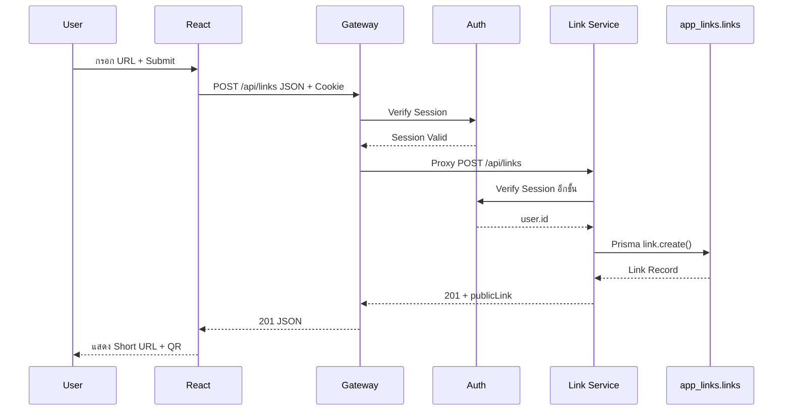
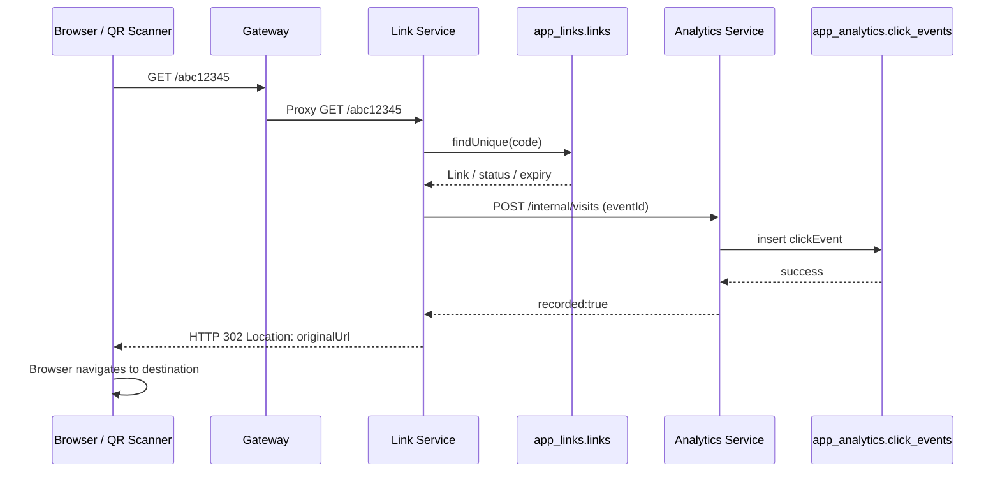

# คู่มือเรียนรู้โค้ด Short URL Microservices แบบครบระบบ — จากพื้นฐานถึงสัมภาษณ์ Developer

> **เวอร์ชันคู่มือ:** 12 ตุลาคม 2026 · **อ้างอิงโค้ด:** `D:\Project_microservices\short-url-microservices`, branch `main`, HEAD ที่ตรวจ `ede04a0` (10 ต.ค. 2026)
>
> **วัตถุประสงค์:** อ่านได้ตั้งแต่พื้นฐาน JS/TS/React/SQL แล้วไล่โค้ดจริงจนสามารถสาธิต อธิบายเหตุผลและข้อจำกัด และตอบคำถามสัมภาษณ์ Synerry ได้
>
> **เว็บไซต์ตาม README:** https://project-short-url-qrrz.vercel.app · **Repository:** https://github.com/joe9856/Project_Short_URL
>
> เอกสารนี้เป็น **คู่มือสำหรับเรียนรู้** ไม่ได้แก้ Source Code; อธิบายจากไฟล์จริงที่ตรวจได้และอธิบายหลักการเพิ่มเติมให้ชัดเจน การอ้างว่าออนไลน์อยู่/ทดสอบผ่าน ณ วันสัมภาษณ์ ต้องเปิดตรวจจริงอีกครั้ง

---

## สารบัญ

1. [รู้จักตัวเองและวิธีเรียนคู่มือนี้](#บทที่-0-พื้นฐานของคุณ-และวิธีเรียน)
2. [โจทย์ Synerry และแผนที่ความรู้](#บทที่-1-แกะโจทย์และเป้าหมายสัมภาษณ์)
3. [พื้นฐาน Web / HTTP / Client–Server](#บทที่-2-พื้นฐานเว็บและการส่งข้อมูล)
4. [JavaScript / TypeScript ที่ใช้จริง](#บทที่-3-javascript--typescript-ที่ใช้จริง)
5. [React และโครงสร้าง Frontend](#บทที่-4-react-และ-frontend-ของโปรเจกต์)
6. [อ่านโครงสร้างโฟลเดอร์และเริ่มระบบ](#บทที่-5-แผนที่ไฟล์และการเริ่มโปรเจกต์)
7. [Flow สร้าง Short URL แบบไล่ไฟล์](#บทที่-6-flow-สร้าง-short-url-แบบลงลึก)
8. [Backend, Express, Router, Controller, Service](#บทที่-7-express--api-gateway--middleware)
9. [Prisma, PostgreSQL, Database Design](#บทที่-8-prisma-orm--postgresql--er-diagram)
10. [สมัครสมาชิกและ Session Authentication](#บทที่-9-authentication--authorization)
11. [Redirect และบันทึกคลิก](#บทที่-10-redirect--click-event--idempotency)
12. [QR Code, History และ Analytics](#บทที่-11-qr-code--history--analytics)
13. [Microservices และความผิดพลาดข้ามบริการ](#บทที่-12-microservices-เหตุผล-และ-trade-offs)
14. [Architecture, DFD และ ER](#บทที่-13-architecture--dfd--er-ต้องอธิบายอย่างไร)
15. [Security และกรณีโจมตี](#บทที่-14-security-และ-ข้อจำกัดจริง)
16. [Tests, Debugging, Deployment, Git](#บทที่-15-tests--debugging--deployment--git)
17. [ฝึกพูด Demo 30 นาที](#บทที่-16-สคริปต์สาธิตระบบ-30-นาที)
18. [คลังคำถามสัมภาษณ์พร้อมแนวตอบ](#บทที่-17-คำถามสัมภาษณ์พร้อมแนวตอบ)
19. [ภารกิจฝึกอ่าน/แก้โค้ดด้วยตัวเอง](#บทที่-18-แบบฝึกหัดปฏิบัติ)
20. [แผนเรียน 7 วันและเช็กลิสต์ความเข้าใจ](#บทที่-19-แผนเรียนและประเมินตนเอง)
21. [อภิธานศัพท์และแหล่งอ้างอิงในโปรเจกต์](#บทที่-20-อภิธานศัพท์และไฟล์อ้างอิง)

---

# บทที่ 0 พื้นฐานของคุณ และวิธีเรียน

## 0.1 จุดเริ่มของคุณ

คู่มือนี้ออกแบบสำหรับผู้ที่เคยทำเว็บด้วย React/Next.js, Node.js/Express และ Prisma มาบ้าง มีพื้นฐาน HTML/CSS กับ SQL แต่ **ยังต้องการเข้าใจโค้ดด้วยตัวเอง** มากกว่าจำคำอธิบายจาก AI โดยเฉพาะ JavaScript, TypeScript, React hooks, การไหลของ Request, Middleware, ORM, Authentication และ Microservices

เราไม่เริ่มจากการท่องศัพท์ทั้งหมด แต่เริ่มจากการทำความเข้าใจสิ่งเดียวที่เห็นผลได้ทันที: **กรอก URL → กดย่อลิงก์ → PostgreSQL บันทึก → ได้ Short URL กลับมา** จากนั้นค่อยต่อ Redirect, QR, สถิติ, Security และการ Deploy

## 0.2 เกณฑ์ว่า “เข้าใจจริง” มี 5 ระดับ

| ระดับ | พฤติกรรมที่ต้องทำได้ |
|---|---|
| 1 จำชื่อได้ | บอกว่าไฟล์ `CreateForm.tsx` ใช้ทำอะไร |
| 2 อธิบายได้ | อธิบาย `useState` และ `setLink` โดยไม่ต้องดูโน้ต |
| 3 ตาม Flow ได้ | ชี้ว่า HTTP Request ผ่าน Gateway, Route, Controller, Service และ DB อย่างไร |
| 4 Debug ได้ | เจอ `401`, `409`, `410`, `503` แล้วรู้จะเปิดไฟล์ไหน |
| 5 ตอบคำถามต่อยอดได้ | อธิบาย trade-off และออกแบบทางเลือกใหม่พร้อมข้อเสียได้ |

**เป้าหมายขั้นต่ำก่อนสัมภาษณ์:** ทุกฟังก์ชันหลักไปถึงระดับ 3; การสร้าง/Redirect/QR/History/Auth ไปถึงระดับ 4; Microservices/Security/Testing ตอบ trade-off ระดับ 5 ได้ในประเด็นหลัก

## 0.3 วิธีเรียนแต่ละหัวข้อ (วงจร 5 ขั้น)

1. อ่านคำอธิบายบทนี้และวาด Flow เองบนกระดาษในเวลา 2–3 นาที
2. เปิดไฟล์จริงตามที่ระบุ ดู `import`, ฟังก์ชัน, ตัวแปร, ผลลัพธ์
3. รันหน้าเว็บ เปิด DevTools → Network ดู Method, URL, Status, Request, Response **ไม่คัดลอก Cookie/Secret ไปแชร์**
4. ปิดคู่มือแล้วอธิบายด้วยเสียงให้ตัวเองฟัง 60–120 วินาที
5. ตอบ “ทำไม?” และ “ถ้าผิดพลาดจะเกิดอะไร?” ให้ได้

> อย่าคัดลอกโค้ดทั้งโปรเจกต์มาอ่านทุกไฟล์แบบเรียงชื่อ เพราะจะจำหน้าที่ไม่ได้ ให้อ่าน **ตามเส้นทางของข้อมูล** ทีละฟีเจอร์

## 0.4 เครื่องมือที่ใช้ฝึก

- VS Code: เปิดไฟล์และใช้ `Ctrl+P`, `Ctrl+Shift+F`, `F12` (Go to Definition)
- Chrome DevTools: Network → Filter `Fetch/XHR` → ดู request/response; Application → Cookies โดยอย่าเปิดเผย token
- Terminal: `npm run dev`, `npm run verify`; ใช้คำสั่งตามเงื่อนไขที่บททดสอบระบุ
- PostgreSQL GUI หรือ `psql`: Query ข้อมูล **ฐานทดสอบ/ข้อมูลของตัวเอง** เท่านั้น
- Diagram: Architecture (องค์ประกอบ), DFD (ข้อมูลไหล), ER (ตาราง/ความสัมพันธ์)

---

# บทที่ 1 แกะโจทย์และเป้าหมายสัมภาษณ์

## 1.1 บริษัทต้องการตรวจอะไร

| ข้อสอบ | สิ่งที่ต้องสาธิต/อธิบาย | อยู่ตรงไหนในโค้ด |
|---|---|---|
| DFD Level 0 | ใครส่งข้อมูลไป Process ไหนและเก็บที่ Data Store ใด | `docs/dfd.md`, `docs/diagrams/dfd-level-0-submission.png` |
| ER Diagram | ตาราง Fields, Keys, Relationships | Prisma Schemas ทั้ง 3, `docs/diagrams/er.mmd` |
| สร้าง Short URL | กรอก Original URL → POST → Insert → Short URL | `CreateForm.tsx` → Link Service |
| Redirect ได้จริง | เปิด Short URL → ค้นรหัส → ส่ง HTTP 302 | `controllers/links.ts:redirect`, `services/links.ts:redirectDestination` |
| QR Code | สร้าง QR ของ **Short URL** และสแกนแล้ว Redirect | `LinkResult.tsx`, `generateQr` |
| ประวัติ+สถิติ | ลิงก์เดิม/ลิงก์สั้น, จำนวนคลิก, กราฟ | `History.tsx`, `Analytics.tsx`, Analytics Service |
| ฟังก์ชันพิเศษ | Alias, Expiry, Toggle, Search, Account, Device/Referrer | ไฟล์หลายบริการตามบท 11 |
| โบนัส Microservices | แยกบริการจริง พร้อม Architecture Diagram | `gateway/`, `services/{auth,link,analytics}-service/` |
| ส่งงาน | Public Repo, README ติดตั้ง, Online URL | `README.md`, `docs/testing.md` |

## 1.2 ระบบปัจจุบันใช้เทคโนโลยีใด และทำไม

- **React + Vite + TypeScript:** สร้าง SPA และจัดการ UI/State; Vite เป็น build/dev tool ไม่ใช่ Backend
- **Node.js + Express + TypeScript:** Runtime/Framework สำหรับรับ HTTP Request ที่ Backend
- **API Gateway:** Route คำขอ + การป้องกันเบื้องต้น + Proxy ไป Services
- **Auth Service:** บัญชี, รหัสผ่าน, Session, โปรไฟล์
- **Link Service:** Short Code, Original URL, Alias/Expiry, Redirect, QR, History
- **Analytics Service:** รับ Click Event และรวมข้อมูลสถิติ
- **Prisma ORM:** Type-safe client เชื่อม PostgreSQL ไม่ใช่ฐานข้อมูลเอง
- **PostgreSQL:** ฐานข้อมูลเชิงสัมพันธ์ตามโจทย์; ใน Cloud ใช้ Supabase ตาม Architecture ปัจจุบัน
- **Vercel:** Hosting ที่ README ระบุใช้ทั้ง Frontend และ Backend Projects
- **Docker/Compose:** วิธีช่วยรัน PostgreSQL/ระบบในเครื่อง ไม่ใช่ภาษาพัฒนา

## 1.3 บทพูดภาพรวม 45–60 วินาที (ฝึกพูดเอง)

> “ระบบนี้เป็นเว็บย่อลิงก์ พัฒนาด้วย React และ TypeScript ทาง Frontend กับ Node.js/Express ทาง Backend ออกแบบแยกเป็น API Gateway, Auth, Link และ Analytics Service ใช้ Prisma ติดต่อ PostgreSQL ซึ่งแบ่ง 3 Schemas ตามเจ้าของบริการ ผู้ใช้สมัครและล็อกอินเพื่อสร้าง Short URL ตั้ง Alias หรือวันหมดอายุได้ เมื่อมีคนเปิดลิงก์ ระบบจะตรวจสถานะ ส่งข้อมูลการเปิดไป Analytics ก่อนตอบ HTTP 302 และสามารถดู QR Code ประวัติและสถิติได้ ผมจะสาธิตฟังก์ชันหลักก่อน แล้วไล่โค้ดตั้งแต่ Form ผ่าน API จนถึง Database”

อย่าพูดว่าระบบ “รองรับผู้ใช้มหาศาลอย่างแน่นอน” หรือ “ไม่เคยนับคลิกซ้ำเลย” เพราะโค้ดปัจจุบันยังมีข้อจำกัดที่ต้องอธิบายตามจริง

---

# บทที่ 2 พื้นฐานเว็บและการส่งข้อมูล

## 2.1 Client / Server / Browser / Database

- **Client:** ผู้เริ่มส่งคำขอ เช่น Browser/React
- **Server:** โปรแกรมที่รับคำขอ เช่น Express ใน Link Service
- **API:** ข้อตกลงว่าคำขอหน้าตาอย่างไรและคืนอะไร ไม่ใช่ตัวฐานข้อมูล
- **Database:** ที่เก็บข้อมูลถาวร แม้ Frontend refresh หรือ Server restart ข้อมูลยังอยู่
- **Network:** ช่องทางที่โปรแกรมคุยกัน; หาก Service อื่นล่ม คำสั่ง `fetch` อาจล้มเหลวแม้โค้ดฝั่งคุณถูกต้อง

**รูปแบบ Request/Response:**

```http
POST /api/links HTTP/1.1
Content-Type: application/json
Cookie: short_session=<hidden>

{"originalUrl":"https://www.synerry.com"}
```

```http
HTTP/1.1 201 Created
Content-Type: application/json

{"link":{"id":"...","code":"abc12345","shortUrl":"https://.../abc12345","originalUrl":"https://www.synerry.com"}}
```

ตัวอย่าง Response ตัด Field อื่นออกเพื่อเน้นแนวคิด; Cookie ข้างต้นเป็นเพียง placeholder ห้ามคัดลอก Session จริง

## 2.2 HTTP Methods และความต่าง

| Method | จุดประสงค์ | โปรเจกต์นี้ |
|---|---|---|
| GET | อ่านข้อมูล | `/api/links`, `/api/stats` |
| POST | สร้าง/สั่งประมวลผล | `/api/links`, `/api/auth/login` |
| PATCH | แก้ไขข้อมูลบาง Field | `/api/links/:id`, `/api/auth/me` |
| DELETE | ลบ Resource | **ไม่ได้ใช้สำหรับลบลิงก์**; ระบบใช้ `PATCH isActive` |
| HEAD | ขอ Header ไม่รับ Body | ตรวจลิงก์ได้ แต่ **ไม่บันทึก Click Event** ตามโค้ด |

REST คือหลักการออกแบบ API แบบ Resource-oriented; **HTTP API ไม่ได้กลายเป็น RESTful โดยอัตโนมัติ** เพียงเพราะมี GET/POST

## 2.3 HTTP Status ที่ต้องตอบให้ได้

| Status | ความหมาย | ตัวอย่างจริง |
|---|---|---|
| 200 | สำเร็จ | Login/History/Stats |
| 201 | สร้างสำเร็จ | สร้าง User, สร้าง Link, บันทึก Event |
| 204 | สำเร็จ ไม่มี Response Body | Logout |
| 302 | Redirect ชั่วคราว | เปิด Short URL แล้วไป Original URL |
| 400 | Input ไม่ถูกต้อง | Zod validation, วันไม่ถูกต้อง |
| 401 | ไม่ได้ยืนยันตัวตน | Session หาย/หมดอายุ |
| 403 | ไม่ได้รับอนุญาต | Internal Secret ผิด, Origin ไม่อนุญาต |
| 404 | ไม่พบ Resource หรือไม่ใช่เจ้าของ | Short Code ไม่มี, Link ID ของคนอื่น |
| 409 | ข้อมูลขัดแย้ง | Alias/email/event ID conflict |
| 410 | Resource ใช้ไม่ได้แล้ว | Link ปิด/หมดอายุ |
| 413 | Request Body ใหญ่เกิน | Body limit |
| 429 | คำขอมากเกิน | Rate Limit |
| 503 | บริการพึ่งพาไม่พร้อม | Auth/Analytics/DB unavailable |

**302 ไม่ใช่การเปิดเว็บไซต์ต้นทางจาก Server:** Backend ตอบ Header `Location`; Browser เป็นฝ่ายนำทางไปเว็บปลายทาง

## 2.4 Endpoint Path, Params, Query, Body

ตัวอย่าง `GET /api/links/123?format=png`

- `req.params.id` คือ `123` — ระบุรายการ
- `req.query.format` คือ `png` — ตัวเลือกใน URL
- `req.body` คือ JSON body (มักใช้ POST/PATCH)
- `req.headers.cookie` เป็น Header ที่ Browser ส่งกลับตามการตั้งค่า Cookie

## 2.5 ทำไม `async/await` สำคัญ

โค้ดเรียก API หรือ Database ต้องรอ I/O:

```ts
async function loadLinks() {
  const response = await fetch('/api/links');
  if (!response.ok) throw new Error('โหลดไม่สำเร็จ');
  return await response.json();
}
```

`await` **ไม่ได้สร้าง Thread ใหม่อัตโนมัติ** แต่พักขั้นตอนปัจจุบันเพื่อรอ Promise; ทำให้จัดลำดับได้ชัดเจน

### แบบฝึกท้ายบท

1. อธิบายเหตุผลว่าทำไม Submit Link ใช้ `POST` แต่เปิด Short URL ใช้ `GET`
2. `201` กับ `302` ต่างกันอย่างไร?
3. หาก `fetch('/api/links')` ตอบ `401` คุณจะตรวจ Frontend, Cookie หรือ Backend จุดไหนก่อน?
4. ใช้ DevTools ดูตัวอย่าง Request โดยห้ามเผย Cookie และ Sensitive Data

---

# บทที่ 3 JavaScript / TypeScript ที่ใช้จริง

## 3.1 ตัวแปรและข้อมูล

```ts
const originalUrl = 'https://www.synerry.com'; // string
const clicks = 5;                         // number
const isActive = true;                    // boolean
const expiresAt = null;                   // ยังไม่มีวันหมดอายุ
const tags = ['marketing', 'demo'];        // string[]
const link = { code: 'abc12345', clicks }; // object
```

- `const` หมายถึง **ไม่ assign ตัวแปรใหม่** แต่ Property ใน Object ยังเปลี่ยนได้ (ถ้าไม่ได้ถูก freeze)
- `let` ใช้กับตัวแปรที่ต้อง assign ใหม่ เช่น ตัวนับรอบ `for` หรือ flag ใน Retry
- `undefined`: ยังไม่ได้กำหนดค่า; `null`: ตั้งใจระบุว่าไม่มีค่า
- `===` เทียบทั้งค่าและชนิด (`'5' !== 5`)
- `||` เลือกขวาถ้าซ้ายเป็น falsy; `??` เลือกขวาเฉพาะ `null`/`undefined`

โปรเจกต์มี `input.alias || generateCode()` เพราะ `alias` ว่างหรือไม่มีจะใช้รหัสสุ่ม

## 3.2 Object, Array และการเข้าถึงข้อมูล

```ts
const link = { id: 'L1', code: 'abc12345', isActive: true };
console.log(link.code); // abc12345

const links = [link, { id: 'L2', code: 'xyz12345', isActive: false }];
const codes = links.map(item => item.code);
const active = links.filter(item => item.isActive);
const chosen = links.find(item => item.id === 'L1');
const count = links.length;
```

- `map`: แปลงแต่ละรายการ → Array ใหม่; ใช้สร้าง UI/cards, รูปแบบข้อมูลสถิติ
- `filter`: เลือกเฉพาะรายการที่ตรงเงื่อนไข
- `find`: หารายการแรกที่ตรงเงื่อนไข
- `reduce`: สะสมค่าจากหลายรายการ (ต้องฝึกแม้โค้ดจริงอาจใช้ `groupBy`)

## 3.3 Functions, Scope, Arrow Function

```ts
function generateLabel(code: string): string {
  return `Short URL: ${code}`;
}
const display = (code: string) => `รหัส ${code}`;
```

ตัวแปรที่ประกาศใน `function` ไม่สามารถเรียกใช้จากนอก scope โดยตรง; callback เช่น `(event) => setOriginalUrl(event.target.value)` เป็น Function ที่ส่งให้ React เรียกเมื่อเกิด Event

## 3.4 Destructuring และ Spread Operator

```ts
const { code, originalUrl } = link;
const updated = { ...link, isActive: false };
const body = { originalUrl, ...(alias ? { alias } : {}) };
```

Spread `{...link}` สร้าง Object ใหม่แบบ **Shallow Copy**; ไม่ใช่การ Clone แบบ Deep ของทุกชั้น ตัวอย่างที่สามใช้ Conditional Spread เพื่อส่ง Field alias เฉพาะเมื่อมีค่า

## 3.5 Modules / import / export

```ts
// validation.ts
export function validDestination(value: string) { /* ... */ }
// links.ts
import { validDestination } from '../lib/validation';
```

การ `import` Function คือเรียกใช้ภายในโปรเซสเดียว ส่วนการ `fetch` Endpoint คือการสื่อสารผ่านเครือข่าย; **Microservices ที่แยกกันไม่ควร Import Database Client ข้ามกัน**

## 3.6 Promise, try/catch/finally

```ts
try {
  setLoading(true);
  const result = await api('/api/links', { method: 'POST', body: '{}' });
  console.log(result);
} catch (error) {
  setError(error instanceof Error ? error.message : 'Unknown error');
} finally {
  setLoading(false);
}
```

- `try`: โค้ดที่อาจผิดพลาด
- `catch`: รับ Error ที่ Throw หรือ Promise reject
- `finally`: ทำเสมอ ไม่ว่าผ่านหรือผิดพลาด เหมาะคืนสถานะ Loading
- `throw`: โยนความผิดพลาดให้ผู้เรียก/Global Error Handler

## 3.7 TypeScript: Type, Interface, Union, Generic

```ts
interface ShortLink {
  id: string;
  code: string;
  originalUrl: string;
  status: 'active' | 'expired' | 'disabled';
  clicks?: number;
}
function identity<T>(value: T): T { return value; }
const link = identity<ShortLink>({ id:'1',code:'a',originalUrl:'https://x.com',status:'active' });
```

- `interface` กำหนด Shape ในช่วง Type Checking; ถูกลบตอน Compile ไม่มีการตรวจ Runtime
- `status` เป็น Union Type ระบุค่าได้เฉพาะชุดที่กำหนด
- `clicks?` เป็น Optional Property
- `<T>` เป็น Generic รักษาชนิดข้อมูลตามการใช้งาน
- `api<{ link: ShortLink }>(...)` บอก TypeScript ว่าคาดหวัง Response รูปแบบนั้น **ไม่ใช่รับประกันว่าคำตอบจาก Server ถูกต้อง**
- Zod ใน Backend ตรวจข้อมูลจริงขณะรัน (`createSchema.parse(req.body)`)

## 3.8 Object ใน HTTP กับ Database ไม่ใช่อันเดียวกันเสมอ

- Frontend `ShortLink` เป็น Type ของ Response ที่ใช้งานหน้าจอ
- Prisma `Link` เป็น Model/Record จาก DB
- `publicLink(link)` เติม `shortUrl` และ `status` จาก Fields ที่มีอยู่ → เป็น DTO สำหรับ Client
- `createdAt` ใน PostgreSQL เป็น DateTime แต่เมื่อส่ง JSON ผ่าน HTTP มักกลายเป็น ISO String

## 3.9 เวลาและวันหมดอายุ

- `new Date(expiresAt).toISOString()` แปลงเวลาในช่อง `datetime-local` เป็น ISO UTC ก่อนส่ง
- `expiresAt: Date | null` แทนวันหมดอายุ ถ้า `null` คือไม่ตั้งวันหมดอายุ
- เปรียบเทียบ `expiresAt <= new Date()` เพื่อบอกว่าหมดอายุแล้ว
- สถิติรายวันแบ่งตาม **Asia/Bangkok** ไม่ใช่ UTC ตรง ๆ

### แบบฝึกท้ายบท

1. อธิบาย `input.alias || generateCode()` ถ้า alias เป็น `''`, `'abc'`, `undefined`
2. เขียน Function `isExpired(expiresAt: Date | null): boolean`
3. เขียน `links.filter()` เลือกเฉพาะ `isActive === true`
4. ความต่าง `interface ShortLink` กับ `z.object({ originalUrl: ... })` คืออะไร?
5. ถ้า Promise จาก `api()` reject `finally` ทำงานหรือไม่?

---

# บทที่ 4 React และ Frontend ของโปรเจกต์

## 4.1 จุดเริ่มโปรแกรม: `frontend/src/main.tsx`

```tsx
ReactDOM.createRoot(document.getElementById('root')!).render(
  <React.StrictMode>
    <BrowserRouter>
      <App />
    </BrowserRouter>
  </React.StrictMode>
);
```

- `index.html` มี Root Element ให้ React นำ UI มาแสดง
- `createRoot(...).render(...)` เริ่มต้น Render Component
- `StrictMode` ช่วยตรวจพฤติกรรมผิดปกติในโหมดพัฒนา อาจทำให้ Effect ทำงานซ้ำเพื่อจับบั๊ก (ไม่ใช่ผู้ใช้กด Submit สองครั้งโดยอัตโนมัติ)
- `BrowserRouter` ช่วยให้ React Router จัดการ Page Route ภายใน SPA
- `App` เป็น Component หลักที่กำหนด Routes และสถานะผู้ใช้

## 4.2 `frontend/src/App.tsx`: Routes และ Login State

```tsx
const [user, setUser] = useState<User | null>(null);
const [loading, setLoading] = useState(true);
useEffect(() => {
  api<{ user: User }>('/api/auth/me')
    .then(result => setUser(result.user))
    .catch(() => setUser(null))
    .finally(() => setLoading(false));
}, []);
```

**โค้ดนี้เป็นฉบับย่อเพื่ออธิบายแนวคิด** ไฟล์จริงมี Error Handling เพิ่มเติม

- โหลดหน้าเว็บใหม่ React State จะเริ่มต้นใหม่; จึงเรียก `/api/auth/me` เพื่อตรวจ Session จาก Cookie ที่ Browser ส่ง
- React `user` เป็น State สำหรับแสดง UI; **Backend Session คือแหล่งยืนยันตัวตนที่แท้จริง**
- `protectedPage()` ใน App ทำ Redirect ไป `/login` เพื่อ UX; **ไม่ใช่ Security Boundary** ต้องตรวจสิทธิ์ใน Backend อีกชั้น

เส้นทางสำคัญ: `/`, `/register`, `/login`, `/dashboard`, `/history`, `/analytics`, `/profile`, `/links/:id`

## 4.3 Controlled Input และ `useState` ใน `CreateForm.tsx`

```tsx
const [originalUrl, setOriginalUrl] = useState('');
<input value={originalUrl} onChange={e => setOriginalUrl(e.target.value)} />
```

ลำดับคือ 1) คนพิมพ์ 2) Browser ส่ง Event 3) `onChange` เรียก setter 4) React อัปเดต State และ Render ใหม่ตามจำเป็น การพิมพ์ไม่ใช่การบันทึก DB

`setLink(result.link)` ทำให้ `{link && <LinkResult link={link}/ >}` กลายเป็นจริงและ React แสดงผลลิงก์ใหม่ (ในไฟล์จริง JSX ไม่มีช่องว่างก่อน `/>`)

## 4.4 Submit Form

ฟังก์ชัน `submit(event)` ของจริงทำตามลำดับ:

1. `event.preventDefault()` ไม่ให้ Browser ส่ง Form แบบเดิมแล้ว Refresh ทั้งหน้า
2. `setLoading(true)` ปิดปุ่มเพื่อกันกดซ้ำในระหว่างส่ง
3. ตรวจ Alias สงวนและ URL ด้วย `new URL()` ที่ Frontend เพื่อ UX
4. `await api('/api/links', { method:'POST', body: JSON.stringify(...) })`
5. `setLink(result.link)` แสดงผล
6. `onCreated?.()` แจ้ง Dashboard ให้โหลด History/Stats ใหม่
7. `catch` แสดงข้อผิดพลาด; `finally` ตั้ง Loading เป็น `false`

**ทำไมต้องตรวจ URL ที่ Backend ซ้ำ?** เพราะ Client สามารถแก้ JavaScript หรือส่ง API ผ่านเครื่องมืออื่นโดยไม่ใช้ UI ได้

## 4.5 Props กับ State

- `Props`: ข้อมูล/Callback ที่ Parent ส่งให้ Child เช่น `CreateForm authenticated onCreated={...}`
- `State`: ข้อมูลภายใน Component เช่น `originalUrl`, `loading`, `link`
- `onCreated?.()`: Optional Chaining เรียก Callback เฉพาะเมื่อมี
- `Dashboard.tsx` ใช้ `refresh` State เพิ่มขึ้นเมื่อสร้าง/แก้ Link แล้วส่งเป็น Props ให้ `History` และ `Analytics` เพื่อ Trigger Effect ให้โหลดข้อมูลใหม่

## 4.6 `useEffect` และ Dependency Array

```tsx
useEffect(() => {
  // โหลดข้อมูลเมื่อ query/status/page เปลี่ยน
  load();
}, [query, status, page]);
```

Effect ใช้เชื่อม React กับระบบภายนอก เช่น Fetch ไม่ใช่ “หลังทุก Function ทำงาน” ตามความเข้าใจผิดที่พบบ่อย ถ้า Dependency เปลี่ยน Effect จะรันหลัง Render ที่ commit ตาม lifecycle

ใน `History.tsx` มี `current` flag ใน Cleanup เพื่อไม่ให้ Response เก่ามาแก้ State หลัง unmount/สลับเงื่อนไข; ส่วน `Analytics.tsx` ใช้ `AbortController` เพื่อยกเลิก Request ค้าง

## 4.7 `History.tsx` มี `search` ต่างจาก `query` อย่างไร?

- `search`: ข้อความที่กำลังพิมพ์ใน Input
- `query`: คำค้นที่กด Submit แล้วใช้เรียก API
- `page`: เลขหน้าปัจจุบัน
- `status`: all/active/disabled/expired

เทคนิคนี้ลดการส่ง Request ทุกครั้งที่พิมพ์ 1 ตัวอักษร และเมื่อเปลี่ยนตัวกรองจะกลับหน้า 1 เพื่อผลลัพธ์ไม่หลุดช่วง

## 4.8 `LinkResult.tsx`: QR และ Download

- `<a href={link.shortUrl}>` เปิดลิงก์สั้นในแท็บใหม่
- `` ให้ Browser ขอรูป QR จาก Backend
- ลิงก์ดาวน์โหลดเพิ่ม `download=1` และเลือกรูปแบบ `png` หรือ `svg`
- กด Copy ใช้ `navigator.clipboard.writeText(link.shortUrl)` ไม่เกี่ยวกับการสร้าง Link ใหม่หรือเพิ่มจำนวนคลิก

### แบบฝึกท้ายบท

1. Refresh หน้า Dashboard แล้วทำไมชื่อผู้ใช้ยังขึ้นมาได้ แม้ State เริ่มที่ `null`?
2. `useState` กับ `useEffect` ต่างกันอย่างไร?
3. ทำไม `onCreated` ถึงช่วยให้ประวัติอัปเดต?
4. Network tab แยกได้ไหมว่า Fetch QR เป็น Request ต่างจาก Redirect ของ Short URL?
5. ถ้า Backend คืน HTTP 409 แต่ `setLink()` ไม่ทำงาน คุณจะอธิบาย Flow อย่างไร?

---

# บทที่ 5 แผนที่ไฟล์และการเริ่มโปรเจกต์

## 5.1 โครงสร้างไฟล์สำคัญ

```text
Project_Short_URL/
├─ README.md                       # ภาพรวม, URL, Setup, Demo
├─ package.json                    # npm workspaces และ scripts
├─ frontend/
│  ├─ src/main.tsx                 # จุดเริ่ม React
│  ├─ src/App.tsx                  # Routes, Session UI
│  ├─ src/pages/                  # Home, AuthPage, Dashboard, LinkDetails, Profile
│  ├─ src/components/             # CreateForm, LinkResult, History, Analytics
│  ├─ src/services/api.ts         # fetch wrapper
│  └─ vercel.json                 # SPA / API / redirect rewrites
├─ gateway/
│  ├─ src/app.ts                  # Express middleware + proxy routing
│  ├─ src/middlewares/guards.ts   # Origin, session verify, headers
│  ├─ src/routes/proxy.ts         # Forward request to service
│  └─ vercel.json
├─ services/
│  ├─ auth-service/
│  ├─ link-service/
│  └─ analytics-service/
│     └─ (แต่ละ service มี src, prisma, tests, vercel.json)
├─ packages/                      # Shared code บางส่วน เช่น short link routing
├─ scripts/                       # setup, local DB, migrations/tests helpers
├─ tests/e2e/                    # Playwright browser tests (ตรวจ path ใน repo ก่อนใช้)
└─ docs/                          # Architecture, DFD, ER, API, Deployment, Testing
```

> เส้นทางระดับตัวอย่างด้านบนเพื่อให้อ่านง่าย; ชื่อและตำแหน่งที่ต้องเปิดจริงให้ใช้ VS Code สำรวจใน repo โดยเฉพาะโฟลเดอร์ tests/shared packages

## 5.2 แต่ละไฟล์ Backend ทำหน้าที่อะไร

| Layer / ไฟล์ | หน้าที่ | คำถามที่อาจโดนถาม |
|---|---|---|
| `app.ts` | สร้าง Express App และประกอบ middleware/route | `app.use()` ต่างจาก `router.get()` อย่างไร |
| `server.ts` | เปิด Listener สำหรับ Local | ทำไมแยก `app.ts` กับ `server.ts` |
| `routes/index.ts` | เชื่อม Path/Method กับ Controller | POST กับ GET Route ต่างกันอย่างไร |
| `controllers/*.ts` | รับ HTTP, Validate, ส่ง Status/JSON | Controller กับ Service ต่างกันอย่างไร |
| `services/*.ts` | Business Logic, Prisma, HTTP ภายใน | ตรงไหนบันทึก DB จริง |
| `middlewares/*.ts` | ตรวจเงื่อนไขก่อนเข้า Controller | `next()` ทำงานอย่างไร |
| `lib/validation.ts` | Zod, URL, Code, Device | ทำไม TypeScript อย่างเดียวไม่พอ |
| `lib/http.ts` | Internal calls, Error, Guards | 401/403/503 ต่างกันยังไง |
| `lib/prisma.ts` | Prisma Client | ทำไมแต่ละ Service มี Client ตัวเอง |
| `prisma/schema.prisma` | Models/Constraints/Indexes | Prisma Schema กับตารางจริงต่างกันอย่างไร |
| `prisma/migrations/*/migration.sql` | SQL ที่เปลี่ยนโครงสร้างจริง | migrate vs generate |

## 5.3 ติดตั้ง/รันตาม README ปัจจุบัน

เครื่องมือหลัก: Node.js เวอร์ชันตาม README (แนะนำ 22.12+), npm, Git, Docker Compose + PostgreSQL 17 หรือวิธี Local PostgreSQL ที่กำหนด

```bash
git clone https://github.com/joe9856/Project_Short_URL.git
cd Project_Short_URL
npm ci
npm run setup
# รัน PostgreSQL local ตาม README ก่อน migrate
npm run generate
npm run migrate
npm run dev
```

**สำคัญ:** `npm run setup` สำหรับติดตั้งครั้งแรก; หากเครื่องมี `.env` อยู่แล้วอย่ารันซ้ำโดยไม่อ่านผลกระทบ `npm run migrate` ทำกับ Database ที่ URL ชี้อยู่ จึงตรวจ Environment ก่อนเสมอ

| Service | Local Port |
|---|---|
| React / Vite | `5173` |
| Gateway | `3000` |
| Auth | `3001` |
| Link | `3002` |
| Analytics | `3003` |
| PostgreSQL dev | `5544` |

## 5.4 npm Workspaces และคำสั่ง

Root `package.json` มี `workspaces: ['frontend','gateway','services/*','packages/*']` และ `npm run dev` ใช้ `concurrently` เปิด 5 Processes; **ไม่ใช่ `npm run dev` เปิด Express ตัวเดียว**

- `npm run generate`: สร้าง Prisma Clients จาก Schemas
- `npm run migrate`: นำ migrations ไปใช้กับ DB ที่กำหนด
- `npm run dev`: รัน Frontend/Gateway/Services พร้อมกัน
- `npm run verify`: TypeCheck → ESLint → Vitest → Build
- `npm run test:integration`: ใช้ PostgreSQL ทดสอบจริงและมีการล้าง **เฉพาะฐานทดสอบตามสคริปต์** ต้องตรวจ URL ก่อน
- `npm run test:e2e`: ทดสอบ Browser; ทดสอบอาจสร้าง/แก้ข้อมูลในฐานพัฒนา

---

# บทที่ 6 Flow สร้าง Short URL แบบลงลึก

นี่คือ **แกนกลางของการสัมภาษณ์** ต้องเล่าให้ได้ตั้งแต่ต้นจนจบ

## 6.1 แผนภาพ Sequence แบบย่อ



## 6.2 ขั้นที่ 1: `CreateForm.tsx`

ผู้ใช้กรอก URL, Alias และวันหมดอายุ (Optional) ใน Controlled Inputs; `submit()` ตรวจ Frontend แล้วสร้าง Request:

```tsx
const result = await api<{ link: ShortLink }>('/api/links', {
  method: 'POST',
  body: JSON.stringify({
    originalUrl,
    ...(alias ? { alias } : {}),
    ...(expiresAt ? { expiresAt: new Date(expiresAt).toISOString() } : {}),
  }),
});
setLink(result.link);
```

**ความต่างระหว่างค่าที่ Frontend ส่งกับฐานข้อมูล:** Frontend ไม่ส่ง `id`, `userId`, `code` ถ้าไม่ตั้ง Alias, `createdAt` เพราะ Backend กำหนดค่าเหล่านี้เอง

## 6.3 ขั้นที่ 2: `frontend/src/services/api.ts`

```ts
response = await fetch(path, {
  ...options,
  credentials: 'same-origin',
  headers: { 'Content-Type': 'application/json', ...options.headers },
  signal: options.signal || AbortSignal.timeout(60000),
});
```

- `fetch` ส่ง HTTP Request ไม่เรียก Prisma ตรงจาก Browser
- `credentials: 'same-origin'` ให้ Browser แนบ Cookie เมื่อเรียก URL same-origin
- `!response.ok` → อ่าน JSON Error และ Throw `ApiError`
- `response.json()` แปลง JSON เป็น JavaScript Object

## 6.4 ขั้นที่ 3: Gateway `gateway/src/app.ts`

Gateway มี `helmet()`, `guards`, rate limit แบบ RAM, `verifySession` และ Proxy; สำหรับ `POST /api/links`:

1. `guards`: ตรวจ Origin (Mutation) และลบ Header ที่ Client อาจปลอมตัวตน
2. `verifySession`: เรียก Auth ภายในด้วย Cookie หากไม่มี Session → 401
3. `serviceProxy` Match `/api/links` → Link Service; แนบ `x-internal-key` และ Request ID

**ทำไม Gateway ไม่ `prisma.link.create()` เอง?** เพราะ Gateway มีหน้าที่เป็นทางเข้า/ส่งต่อ ไม่ควรเป็นเจ้าของฐานข้อมูลลิงก์

## 6.5 ขั้นที่ 4: Link Route และ `requireSession`

`services/link-service/src/routes/index.ts`:

```ts
router.use('/api/links', requireSession);
router.post('/api/links', databaseRateLimit('create', 100, 3600), controller.create);
```

จุดสำคัญ: Link Service **ตรวจ Session อีกครั้งกับ Auth** แล้วตั้ง `res.locals.user` จากผลตรวจ Server-to-Server ไม่เชื่อ `userId` ที่ Client ใส่มาเอง

## 6.6 ขั้นที่ 5: Controller และ Zod

`services/link-service/src/controllers/links.ts`:

```ts
export async function create(req: Request, res: Response) {
  res.status(201).json({
    link: service.publicLink(
      await service.createLink(
        res.locals.user.id,
        createSchema.parse(req.body),
      ),
    ),
  });
}
```

- `req.body`: JSON ที่ส่งมา
- `createSchema.parse`: ตรวจ URL, Alias, วันหมดอายุ และไม่รับ Field เกิน (`strict`)
- `res.locals.user.id`: ID จาก Session จริง
- `service.createLink`: ทำ Business Logic
- `service.publicLink`: เติม Short URL และ Status สำหรับ Response
- `res.status(201).json(...)`: สร้างสำเร็จ

## 6.7 ขั้นที่ 6: `createLink()` และ Unique Code

`services/link-service/src/services/links.ts`:

```ts
for (let attempt = 0; attempt < 8; attempt++) {
  try {
    return await prisma.link.create({
      data: {
        userId,
        createdAt: new Date(),
        code: input.alias || generateCode(),
        originalUrl: input.originalUrl,
        expiresAt: input.expiresAt ? new Date(input.expiresAt) : null,
      },
    });
  } catch (error) {
    // เมื่อ Prisma Error P2002 = unique conflict
  }
}
```

โค้ดจริงเมื่อ `P2002`:

- ถ้า User กำหนด Alias → โยน HTTP `409 ALIAS_EXISTS`
- ถ้าสุ่มรหัสมาแล้วชน → Loop ลองใหม่ สูงสุด 8 ครั้ง
- ถ้า Error ไม่ใช่ `P2002` → ส่งต่อ Error
- ถ้าสุ่มแล้วยังไม่สำเร็จ → `503 CODE_EXHAUSTED`

**ทำไมไม่เพียงเช็ก `findUnique()` ก่อน `create()`?** หากมี 2 Requests พร้อมกัน ทั้งคู่สามารถเห็นว่าว่างก่อนและพยายาม Insert รหัสเดียวกันได้; `UNIQUE` ใน Database จึงเป็นด่านสุดท้ายที่ Atomic

`generateCode()` ใช้ `crypto.randomInt` เลือกอักขระ A–Z, a–z, 0–9 ความยาว 8 ตัว และหลีกเลี่ยงชื่อที่ Router สงวนไว้; **อย่าพูดว่าใช้ UUID เป็น Short Code** เพราะ UUID ใช้เป็น Primary Key/Click Event ID คนละหน้าที่

## 6.8 ขั้นที่ 7: Prisma → PostgreSQL

`prisma.link.create()` ทำงานกับ Prisma Client ของ Link Service และบันทึก Record ลง `app_links.links` ตาม DB URL/Schema ที่ตั้งไว้

ตัวอย่าง SQL เชิงความคิด:

```sql
INSERT INTO app_links.links (id, "userId", code, "originalUrl", "createdAt", "updatedAt", "isActive")
VALUES ('...', '...', 'abc12345', 'https://www.synerry.com', NOW(), NOW(), TRUE);
```

*SQL ด้านบนเป็นตัวอย่างอธิบาย ไม่ใช่ exact SQL ที่ Prisma สร้าง และในโค้ดจริงมีค่า Default/Columns ตาม Migration*

## 6.9 ขั้นที่ 8: Response กลับ Frontend

1. PostgreSQL คืน Record ให้ Prisma
2. Service → Controller → Gateway → `api.ts` รับ JSON
3. `setLink(result.link)` เปลี่ยน React State
4. React Render `LinkResult.tsx` ให้เห็น Short URL และรูป QR ที่โหลดเพิ่มจาก API
5. Dashboard `onCreated()` เพิ่ม `refresh` เพื่อโหลด History/Stats ใหม่

### ฝึกพูด 90 วินาที

> “เมื่อผู้ใช้กดสร้างลิงก์ React ส่ง POST /api/links พร้อม Original URL ผ่าน Fetch ไป Gateway Gateway ตรวจ Origin/Session แล้ว Proxy ไป Link Service ซึ่งตรวจ Session อีกชั้น ก่อนให้ Controller ตรวจ Input ด้วย Zod และส่งต่อ Service เพื่อสร้าง Code ถ้าไม่ได้ระบุ Alias จะสุ่ม 8 ตัว โดยมี Unique Constraint ป้องกันรหัสซ้ำ จากนั้น Prisma บันทึกลง PostgreSQL app_links.links และ Backend ตอบ 201 พร้อม Short URL กลับมาที่ React ซึ่งเก็บ Response ใน State แล้วแสดงลิงก์และ QR”

### ฝึกถามต่อ

- ทำไม `req.body.userId` ไม่ควรเป็นเจ้าของลิงก์?
- ทำไม `setLink()` ไม่ใช่การ Save DB?
- เกิดอะไรขึ้นเมื่อ User ใส่ URL ไม่ใช่ `http:` หรือ `https:`?
- Prisma `P2002` แปลว่าอะไร?
- ทำไมต้องมี Route, Controller, Service แยกกัน?

---

# บทที่ 7 Express / API Gateway / Middleware

## 7.1 Express ทำหน้าที่อะไร

Express เป็น HTTP Framework ของ Node.js ใช้ประกอบ Middleware และกำหนด Routes ซึ่งเมื่อ Runtime รันแอปแล้วจะคอยรับ Request จาก Client/Service อื่น

```ts
const app = express();
app.use(helmet(), guards);
app.get('/healthz', (_req, res) => res.json({ status: 'ok' }));
```

- `app.use()` ติดตั้ง Middleware; อาจทำงานกับหลาย Routes ตามตำแหน่ง
- `app.get()` Register Handler สำหรับ GET Path นั้น
- `req`: สิ่งที่เข้ามา, `res`: สิ่งที่ส่งกลับ, `next`: ให้ Middleware/Handler ถัดไปทำต่อ
- `res.status(201).json(body)` กำหนด HTTP Status และ Response JSON
- ถ้า Error ถูก Throw ใน Async Handler Express เวอร์ชันที่โปรเจกต์ใช้จัดการผ่าน Error Middleware (เปิดตรวจ package และ build จริงก่อนอธิบายว่าเป็น Express 5 หรือ 4)

## 7.2 Gateway ทำหน้าที่จริง ไม่ใช่แค่ Proxy

อ่าน `gateway/src/app.ts`, `middlewares/guards.ts`, `routes/proxy.ts` ตามลำดับ

```text
HTTP Request
  ↓
helmet + guards               (headers, origin, request ID, body-size)
  ↓
Gateway rate limit            (RAM, per instance)
  ↓
verifySession                (เฉพาะเส้นทาง protected ที่กำหนด)
  ↓
serviceProxy                 (Auth / Analytics / Link)
  ↓
Response กลับ Client
```

**สังเกตคำว่า per instance:** Memory Rate Limiter ของ Gateway ไม่ได้แชร์โควตาทุก Vercel Instance ส่วน Rate Limiter สำหรับ Auth/Create ที่อยู่ใน DB ใช้ shared counters ได้กว่า

## 7.3 Router เลือกส่งไปไหน

Gateway จับกลุ่มเส้นทางสำคัญ:

```ts
(path) => path.startsWith('/api/auth/')       // Auth Service
(path) => path === '/api/stats' || ...          // Analytics Service
(path) => path === '/api/links' || ...          // Link Service
```

เส้นทาง `/api/links/:id/stats` ต้องตรวจและ Proxy ไป Analytics **ก่อน** `/api/links/:id` ที่ Link Service เพราะถ้า Match แบบกว้างก่อนจะส่ง Request ผิดบริการ

## 7.4 Security Check ระดับ Gateway

จาก `guards.ts`:

- ลบ Header `x-user-id`, `x-internal-key` และ Forwarding Headers ที่ผู้ใช้พยายามส่งเอง เพื่อไม่ให้ปลอมตัวเป็น Internal Service
- ตรวจ Header `Origin` สำหรับ `POST/PATCH/PUT/DELETE`
- ตรวจ Request Size (Content-Length)
- สร้าง `X-Request-Id` เพื่อเชื่อมเหตุการณ์ระหว่างบริการ
- `verifySession` เรียก `/internal/sessions/verify` กับ Auth Service; หาก Auth ไม่พร้อม Protected API ตอบ 503

**คำถามเชิงลึก:** ทำไมไม่ใช้ `x-user-id` จาก Frontend โดยตรง? เพราะ Browser/HTTP Client สามารถกำหนดค่า Header เองและอ้างว่าเป็นคนอื่นได้!

## 7.5 Proxy ไม่ใช่ Redirect

- **Proxy:** Gateway ส่ง Request ไป Backend แบบ Server-to-Server; Browser ยังคุยกับ Gateway URL เดิม
- **Redirect:** Link Service ส่ง HTTP 302 + `Location`; Browser เป็นฝ่ายไป URL ใหม่

เช่น `GET /api/links` ทำงานผ่าน Proxy; แต่ `GET /abc12345` เมื่อ Link Service ตอบ `302` Browser จะออกไปยัง `https://www.synerry.com`

## 7.6 Error Handler

ไฟล์ `services/link-service/src/lib/http.ts` แยก:

- `ZodError` → 400 + `VALIDATION_ERROR`
- `HttpError` → สถานะที่ระบุเอง เช่น 404, 409, 410
- Body ใหญ่เกิน → 413
- JSON ผิด Syntax → 400
- Error ที่ไม่รู้จัก → Log ชนิด Error และ Request ID แต่ **ไม่ส่ง Stack/SQL/Secret** กลับ Browser, ตอบ 503

การแสดง Error บน Frontend เกิดจาก `api.ts` ตรวจ `response.ok` และแปลง Error เป็นข้อความไทย

### แบบฝึกท้ายบท

1. `Route`, `Middleware`, `Controller`, `Service` ต่างกันตรงไหน ยกจากโปรเจกต์ทุกข้อ
2. การส่ง Cookie ผ่าน Gateway ไป Auth ต่างจากการเชื่อ Header `x-user-id` จาก Client อย่างไร?
3. อธิบายความต่าง `Proxy` กับ `302 Redirect` ด้วยตัวอย่างจริง
4. สถิติรายลิงก์อยู่ที่ Service ไหน? Gateway รู้ได้อย่างไร?
5. ทำไม `X-Request-Id` มีประโยชน์ตอน Debug Microservices?

---

# บทที่ 8 Prisma ORM / PostgreSQL / ER Diagram

## 8.1 SQL ที่เคยเรียนยังใช้ได้เต็มที่

Prisma ช่วยให้เขียนโค้ด Query ผ่าน JavaScript/TypeScript แต่ SQL ยังเป็นพื้นฐานสำคัญในการเข้าใจ PK, FK, UNIQUE, JOIN, Transaction, Index และ Query Performance

| SQL Concept | Prisma Equivalent |
|---|---|
| `SELECT` | `findMany`, `findUnique`, `findFirst` |
| `INSERT` | `create` |
| `UPDATE` | `update`, `updateMany` |
| `DELETE` | `delete`, `deleteMany` |
| `COUNT(*)` | `count` |
| `GROUP BY` | `groupBy` |
| `BEGIN...COMMIT` | `$transaction` |
| `WHERE` | `where` |
| `ORDER BY` | `orderBy` |
| `LIMIT/OFFSET` | `take` / `skip` |

**อย่าสับสน:** ORM ไม่ได้ยกเลิก SQL; Prisma Generated Client แปล/จัดการ Query ให้เหมาะกับ Provider และยังสามารถใช้ `$queryRaw` ได้ตามจำเป็น

## 8.2 PostgreSQL Instance เดียว แต่มี 3 Schemas

```text
Supabase / PostgreSQL database
├─ app_auth
│  ├─ users
│  ├─ sessions
│  └─ rate_limits
├─ app_links
│  ├─ links
│  └─ rate_limits
└─ app_analytics
   └─ click_events
```

- **Instance/Server:** สภาพแวดล้อมที่รัน PostgreSQL
- **Database:** ชุดข้อมูลภายใน Server
- **Schema:** Namespace ของตารางภายใน Database, เช่น `app_auth.users`
- **Table:** ตารางข้อมูลจริง เช่น `links`
- **Row/Record:** ข้อมูลลิงก์หนึ่งรายการ
- **Column/Field:** คุณสมบัติ เช่น `code`, `originalUrl`

จึงตอบกรรมการว่า **“PostgreSQL หนึ่ง Instance แยกสาม Schemas ตาม Service พร้อม Prisma Client และ Role แยก”** ไม่ใช่มีเซิร์ฟเวอร์ฐานข้อมูลสามตัว

## 8.3 Prisma Schema vs Generated Client vs Migration

- `schema.prisma`: กำหนด Model, Field, Constraints, Relations ในระดับแอป
- `prisma generate`: สร้าง TypeScript Prisma Client ตาม Schema (ไม่ได้แปลว่าตารางใน DB ถูกสร้าง)
- `prisma migrate`: นำ SQL Migration ไปสร้าง/เปลี่ยนตารางจริง
- `DATABASE_URL`: Connection ที่แอปใช้ Query Runtime
- `DIRECT_URL`: Connection สำหรับงานที่ต้องเข้าฐานโดยตรง/เหมาะกับ Migration ตามสภาพแวดล้อม

ในโค้ดจริงแต่ละ Service มี `datasource db { provider = "postgresql" ... }` และ `prisma/schema.prisma` เป็นของตัวเอง

## 8.4 ER Model ของจริง: 6 ตาราง

### app_auth

| Model / Table | Field สำคัญ | Constraint |
|---|---|---|
| `User` → `users` | `id`, `email`, `name`, `passwordHash`, `createdAt` | `id` PK, `email` UNIQUE |
| `Session` → `sessions` | `tokenHash`, `userId`, `expiresAt` | `tokenHash` PK, `userId` Physical FK → users.id |
| `RateLimit` → `rate_limits` | `id`, `count`, `expiresAt` | `id` PK |

### app_links

| Model / Table | Field สำคัญ | Constraint |
|---|---|---|
| `Link` → `links` | `id`, `userId`, `code`, `originalUrl`, `isActive`, `expiresAt`, `createdAt`, `updatedAt` | `id` PK, `code` UNIQUE, Index `(userId,createdAt)` |
| `RateLimit` → `rate_limits` | `id`, `count`, `expiresAt` | `id` PK |

### app_analytics

| Model / Table | Field สำคัญ | Constraint |
|---|---|---|
| `ClickEvent` → `click_events` | `id`, `eventId`, `linkId`, `ownerId`, `clickedAt`, `referrerHost`, `deviceType` | `id` PK, `eventId` UNIQUE; Index `(linkId,clickedAt)` และ `(ownerId,clickedAt)` |

**หมายเหตุ:** มี `rate_limits` ชื่อซ้ำสอง Schema แต่เป็นคนละตาราง ข้อมูลแยกกัน

## 8.5 Physical FK vs Logical Reference

- `users.id` ↔ `sessions.userId`: **Physical FK** มี `@relation(... onDelete: Cascade)` ใน Auth Schema; ลบ User แล้ว Session ที่เกี่ยวข้องถูกลบตามใน DB
- `users.id` ↔ `links.userId`: **Logical Reference** ข้าม Service ไม่มี Constraint FK ใน Link DB
- `links.id` ↔ `click_events.linkId`: **Logical Reference** ไม่มี FK ข้าม Service
- `users.id` ↔ `click_events.ownerId`: **Logical Reference** ไม่มี FK ข้าม Service

เหตุผล: Service ต้องเป็นเจ้าของข้อมูลของตนเอง และไม่พึ่ง JOIN/FK ข้าม Service อย่างแน่นหนา; ข้อเสียคือหากสร้างข้อมูลผิดหรือลบข้อมูลอาจเกิด orphan references ต้องคุมผ่าน API/นโยบาย Application

## 8.6 PK, UNIQUE, Index, FK ต่างกันอย่างไร?

- **Primary Key:** ระบุ Row ไม่ซ้ำและไม่เป็น NULL (`links.id`)
- **Unique:** ห้ามค่าซ้ำใน Column/Combination (`links.code`)
- **Index:** เพิ่มความเร็วค้นหา/Sort บางแบบ แลกพื้นที่และภาระตอน Write
- **Foreign Key:** บังคับว่า Reference ไปยัง Row ที่มีอยู่จริงใน DB
- **Transaction:** จัดการหลายการเปลี่ยนแปลงเป็นหน่วยตาม ACID; ช่วยให้ Query ชุดเดียวกันคงความสอดคล้อง

**คำถามยอดฮิต:** `code` ควร UNIQUE หรือไม่? ใช่ เพราะหาก Short Code ซ้ำ Lookup จะกำกวมและนำทางผิดปลายทาง

## 8.7 ตัวอย่าง Prisma กับ SQL

```ts
// Link Service
const link = await prisma.link.findUnique({ where: { code: 'abc12345' } });
const list = await prisma.link.findMany({
  where: { userId: 'owner-id', isActive: true },
  orderBy: { createdAt: 'desc' },
  skip: 0,
  take: 10,
});
const count = await prisma.link.count({ where: { userId: 'owner-id' } });
```

SQL แนวคิด (Field ตัวพิมพ์ใหญ่ใน PostgreSQL ต้องใส่ Double Quote ตามชื่อจริง):

```sql
SELECT * FROM app_links.links WHERE code = 'abc12345';
SELECT * FROM app_links.links
WHERE "userId" = 'owner-id' AND "isActive" = TRUE
ORDER BY "createdAt" DESC
LIMIT 10 OFFSET 0;
SELECT COUNT(*) FROM app_links.links WHERE "userId" = 'owner-id';
```

ตัวอย่างเหล่านี้แสดงแนวคิด; ในฐานที่เปิด Connection ด้วย Role/`search_path` อาจใช้ชื่อ table โดยไม่ระบุ Schema ได้

## 8.8 Data ของ QR, Short URL และ Click Count อยู่ใน Table ไหม?

- `shortUrl`: **คำนวณ** จาก Public Base URL + Code, ไม่ใช่ Column `shortUrl` ใน `links`
- QR PNG/SVG: **สร้างเมื่อถูกขอ** ผ่าน Library `qrcode`, ไม่ใช่ตาราง `qr_codes`
- `clicks`: **นับจาก `click_events`** ไม่ใช่ Column `clicks` ใน `links`
- `status`: **คำนวณ** จาก `isActive` + `expiresAt`; ไม่มี Column `status`
- `alias`: ไม่ได้เป็นอีก Column แต่ใช้ `links.code`

### แบบฝึกท้ายบท

1. `@unique` กับ `@@index` ต่างกันอย่างไร?
2. ถ้าคุณเปลี่ยน `schema.prisma` อย่างเดียว แต่ไม่ Migrate จะเกิดอะไรได้?
3. อธิบาย `One Instance / Three Schemas` ให้คนไม่รู้ DB ฟัง
4. ทำไม `links.userId` จึงไม่ใช่ Physical FK ทั้งที่มีความสัมพันธ์กับ `users.id`?
5. ทำไม ER ไม่ควรเพิ่มตาราง QR Code หรือ Click Count ทั้งที่มีฟีเจอร์นี้ในหน้าเว็บ?

---

# บทที่ 9 Authentication / Authorization

## 9.1 Authentication กับ Authorization

- **Authentication (AuthN):** “คุณเป็นใคร?” ตรวจชื่อบัญชี/รหัสผ่าน/Session
- **Authorization (AuthZ):** “คุณมีสิทธิ์ทำสิ่งนี้ไหม?” เช่น User A ไม่ควรแก้ Link ของ User B

มี Session ถูกต้อง **ไม่ได้หมายความว่ามีสิทธิ์ดูทุก Link** จึงต้องกรอง `userId` ใน Query ด้วย

## 9.2 Flow สมัครสมาชิก

`AuthPage.tsx` → `POST /api/auth/register` → Gateway → Auth Route → `controllers/auth.ts:register` → `services/auth.ts:registerUser` → `argon2.hash(password)` → `prisma.user.create`

- Validation: Email, Password 8–128 Characters, ชื่อ 1–80 Characters
- Email ถูก Normalize เป็น Lowercase (ที่ Controller)
- Password ถูก Hash ด้วย **Argon2id** ไม่เก็บ Password Plaintext
- Unique Email หากซ้ำ → `P2002` → `409 EMAIL_EXISTS`
- Response ของ `register` คืนข้อมูล User ที่เลือกมา (`id`, `name`, `email`) ไม่ส่ง Hash กลับ

**ข้อเฉพาะในโปรเจกต์:** สมัครสำเร็จแล้ว Frontend เรียก Login ต่อให้เอง จึงเข้าระบบได้หลังสมัคร

## 9.3 Flow Login

```text
Browser POST /api/auth/login
    ↓
Gateway → Auth Controller
    ↓
findUnique(email)
    ↓
argon2.verify(passwordHash,password)
    ↓
randomBytes(32) สร้าง session token
    ↓
SHA-256(token) เก็บใน sessions.tokenHash
    ↓
Set-Cookie: short_session=<token>; HttpOnly; SameSite=Lax; Secure(Production)
    ↓
Browser เก็บ Cookie, UI ได้ข้อมูล User
```

ใน `services/auth.ts` มี `sessionSeconds = 7 วัน` ตามค่าที่คำนวณในโค้ด

## 9.4 ทำไม Password ใช้ Argon2id แต่ Token ใช้ SHA-256?

- Password มนุษย์คาดเดาได้ มี Entropy ต่ำ → ต้องใช้ Password Hash ที่ช้า/ปรับ Cost ได้ เช่น Argon2id
- Session Token สุ่มแบบ Cryptographically Secure (`randomBytes(32)`), Entropy สูง → SHA-256 สำหรับหา Token Hash ใน DB เพียงพอในโมเดลนี้
- เก็บ **Hash ของ Session Token** ใน DB เพื่อจำกัดความเสียหายหากฐานข้อมูลหลุด; Cookie ยังต้องป้องกันการขโมย Token จริง

## 9.5 `HttpOnly`, `Secure`, `SameSite`

- `HttpOnly`: JavaScript ฝั่งหน้าเว็บอ่าน Cookie นี้โดยตรงไม่ได้ ช่วยลดการถูกนำออกโดย Script บางรูปแบบ
- `Secure`: ส่ง Cookie ผ่าน HTTPS เท่านั้นเมื่อ Production
- `SameSite=Lax`: จำกัดการแนบ Cookie ในหลายกรณีของ Cross-Site Request แต่ไม่ทดแทนการป้องกัน CSRF ทุกกรณี
- `Path=/`: ส่ง Cookie กับ Path ภายใต้ Domain ตามขอบเขต

## 9.6 ตรวจ Session และ Logout

`getUserFromSession(cookie)`:

1. อ่าน Cookie `short_session`
2. ตรวจว่า Token เป็น Hex 64 ตัวอักษร
3. Hash Token แล้ว Query `sessions` ด้วย `tokenHash`
4. ตรวจ `expiresAt` แล้วคืน User (ไม่ส่ง Password Hash)

`logoutSession()` ลบ Session Row จาก DB แล้ว Controller ตอบ `Set-Cookie` เพื่อล้าง Cookie และ Status `204`

**ทำไมลบ Cookie อย่างเดียวไม่พอ?** Token ที่เคยมีอาจยังถูกใช้งานได้จนหมดอายุหาก Session Row ยังอยู่; การ Revoke ฝั่ง Server ป้องกันได้ดีกว่า

## 9.7 ตรวจสิทธิ์เจ้าของ Link

ใน `services/links.ts`:

```ts
const link = await prisma.link.findFirst({ where: { id, userId } });
if (!link) throw new HttpError(404, 'NOT_FOUND', 'ไม่พบลิงก์');
```

`userId` มาจาก Auth Session; Query ผูก `id` และ `userId` เพื่อจำกัดให้เห็นเฉพาะข้อมูลของตัวเอง ถ้า User B ใช้ `linkId` ของ User A จะได้ 404 แทนการเผยว่า Link นั้นมีอยู่จริง

## 9.8 ตรวจหลายชั้นทำไม?

Gateway เรียก Auth เพื่อป้องกัน Request ตาม Route; Link/Analytics Service ก็มี Middleware/Internal Checks เพื่อไม่เชื่อผลจาก Client Header การป้องกันนี้ช่วยลดการแอบอ้าง แต่เพิ่ม HTTP Calls และ Dependency ต่อ Auth

### แบบฝึกท้ายบท

1. Session-Based Auth ต่างจาก JWT อย่างไร?
2. Login สำเร็จแล้ว Refresh หน้า ทำไมยัง Login อยู่?
3. ทำไม Frontend `protectedPage()` อย่างเดียวไม่เพียงพอ?
4. ถ้า User B ส่ง `PATCH /api/links/:id` ของ User A เกิดอะไร?
5. ถ้า Auth Service ล่ม ขณะผู้ใช้ขอสร้างลิงก์ควรได้อะไร?

---

# บทที่ 10 Redirect / Click Event / Idempotency

## 10.1 Redirect ต่างจาก Create อย่างไร?

การสร้างลิงก์ต้อง Login เพราะเป็นการสร้างข้อมูลบัญชี; การเปิด Short URL เป็น **Public** ไม่ต้อง Login จึงต้อง Match `GET /:code` และรองรับ `/s/:code` เดิมโดยไม่ให้หน้า React ชื่อ `login`/`dashboard` โดนชนกับ Alias

## 10.2 Flow เปิด Short URL



## 10.3 อ่าน Controller จริง

```ts
export async function redirect(req: Request, res: Response) {
  const code = String(req.params.code);
  // validate code/reserved route...
  const destination = await service.redirectDestination(
    code,
    req.method === 'HEAD',
    req.get('user-agent') || '',
    req.get('referer'),
    String(res.getHeader('X-Request-Id')),
  );
  res.redirect(302, destination);
}
```

จาก `services/links.ts:redirectDestination`:

1. `findUnique({ where: { code } })`; ไม่พบ → `404`
2. `linkUnavailable(link)` ถ้า `!isActive` หรือ `expiresAt` ผ่าน → `410`
3. `validDestination(originalUrl)` ตรวจ Scheme ก่อนส่งต่อ; ผิด → `410`
4. หากเป็น `GET` (ไม่ใช่ `HEAD`) สร้าง Click Event และส่งไป Analytics
5. รอ `recorded:true` จาก Analytics แล้วจึง Return Original URL
6. Controller ตอบ `302` พร้อม Header Location

**เหตุผลใช้ 302:** เป็น Redirect ชั่วคราวและโค้ดยังคงตรวจสถิติก่อนนำทางทุกครั้งตามแนวทางที่เลือก ไม่ใช่ Permanent Redirect ที่ Browser อาจ Cache ยาวจนเลี่ยงระบบ

## 10.4 เหตุการณ์คลิกหนึ่งรายการเก็บอะไร?

```ts
const event = {
  eventId: randomUUID(),
  linkId: link.id,
  ownerId: link.userId,
  clickedAt: new Date().toISOString(),
  deviceType: getDevice(userAgent),
  referrerHost: getReferrer(referrer),
};
```

ใน Analytics Service, `recordClick(event)` → `prisma.clickEvent.create()`. ฟิลด์ `eventId` เป็น UNIQUE; ข้อมูล referrerHost/deviceType มาจาก HTTP Headers จึงเป็น **ข้อมูลประมาณการ ไม่ใช่ความจริงแน่นอนของอุปกรณ์หรือบุคคล**

## 10.5 ทำไมต้อง Idempotency?

สมมติ:

1. Link ส่ง Event ID `E123` ไป Analytics
2. Analytics INSERT สำเร็จ แต่ Network Response หาย
3. Link Timeout แล้ว Retry
4. ถ้า Retry สร้าง ID ใหม่ จะนับการเปิดครั้งเดียวเป็นสองครั้ง

โค้ดจริงสร้าง `eventId` **หนึ่งครั้งก่อน Loop** และ Retry ได้สูงสุด 3 ครั้งด้วย **ID เดิม**

Analytics เมื่อเจอ `P2002` จะ Query Event เดิมแล้วเทียบ Payload ทั้งหมด ถ้าเหมือนกันถือว่าได้รับแล้ว; ถ้า `eventId` เดิมแต่ข้อมูลต่างกันจะตอบ `409 EVENT_CONFLICT`

**อย่าอธิบายว่า “Exactly-Once ทั้งระบบ”** เพราะในสถานการณ์ Network Failure บางแบบเราอาจไม่ทราบผล Commit แน่นอน; กล่าวให้แม่นว่า **ใช้ Idempotent Event Processing สำหรับ Retry แบบ Event เดิม ไม่ให้เพิ่ม Record ซ้ำ**

## 10.6 ถ้า Analytics Service ล่ม?

Link จะ Retry การบันทึกสูงสุด 3 ครั้งในกรณี HTTP dependency 503 ตามเงื่อนไข; ถ้าไม่ได้รับ `recorded:true` จะตอบ `503 CLICK_NOT_CONFIRMED` และ **ไม่ตอบ 302**

- **ข้อดี:** ป้องกัน Redirect ที่ไม่ได้ยืนยันการเก็บคลิก (เน้นความถูกต้องของสถิติ)
- **ข้อเสีย:** ผู้เปิดลิงก์อาจเปิดปลายทางไม่ได้ทั้งที่ลิงก์ยังใช้ได้ เพราะ Analytics ไม่พร้อม
- **ทางเลือกในระบบ Production ใหญ่:** Queue/Outbox แบบ Asynchronous, Dead-Letter Queue, Retry Worker; แต่เพิ่มความซับซ้อนและ Eventual Consistency

## 10.7 ทำไม `HEAD` ไม่เพิ่มคลิก?

โค้ดตรวจ `req.method === 'HEAD'` แล้วข้ามการเรียก Analytics เพื่อไม่ให้งานตรวจสถานะ Link ล่วงหน้า/Metadata บางชนิดเพิ่มยอดเปิดลิงก์ (ต้องระวัง GET จาก Bot/Preview ยังเพิ่มยอดตามระบบปัจจุบัน)

## 10.8 นับอะไรจริง: Click, Visit หรือ Unique Visitor?

ระบบนับ **เหตุการณ์ GET ที่ผ่านการบันทึกสำเร็จ** ไม่ได้แยก Unique People และไม่ได้ยืนยันว่าหน้าเว็บปลายทางโหลดเสร็จจริง; การ Refresh/เปิดซ้ำอาจเพิ่มยอดอีกครั้ง

### แบบฝึกท้ายบท

1. `GET` กับ `HEAD` ต่างกันในโค้ด Redirect อย่างไร?
2. ทำไม Redirect ตอบ `302` ไม่ใช่ `201`?
3. ถ้า URL ถูกปิด ใช้ Status อะไร? ถ้ารหัสไม่มี ใช้ Status อะไร?
4. Retry แบบ Event ID เดิมช่วยอะไร?
5. หากกรรมการถาม “ถ้า Analytics ล่ม ควรให้คนเปิดเว็บได้ก่อนหรือไม่?” ให้เสนอทั้งสองทางเลือกพร้อม trade-off

---

# บทที่ 11 QR Code / History / Analytics

## 11.1 QR Code ของระบบนี้เก็บอะไร?

`services/link-service/src/services/links.ts:generateQr`:

```ts
const shortUrl = config.appUrl + shortLinkPath(link.code);
const options = { margin: 4, width: 512, errorCorrectionLevel: 'M' as const };
if (format === 'svg') return QRCode.toString(shortUrl, { ...options, type: 'svg' });
return QRCode.toBuffer(shortUrl, { ...options, type: 'png' });
```

- QR เข้ารหัส **Short URL** ไม่ใช่ Original URL
- สแกน → เปิด Short URL → Redirect → Click Event เพิ่ม (เมื่อเป็น GET)
- ขอ/ดาวน์โหลดรูป QR เอง **ไม่เพิ่ม Click** เพราะยังไม่ได้เปิด `/code`
- `PNG` เป็นภาพ Raster, `SVG` เป็น Vector ขยายไม่แตกง่าย
- `errorCorrectionLevel: 'M'` ช่วยทนต่อความเสียหายของ QR ระดับหนึ่ง; `margin` เป็น Quiet Zone รอบ QR เพื่อช่วย Scanner

## 11.2 ประวัติลิงก์: Frontend → Link → Analytics

Frontend `History.tsx` เรียก:

```text
GET /api/links?page=1&pageSize=10&search=...&status=all
```

Link Service ใช้ `linkFilter(userId,search,status)` แล้ว:

```ts
const [links,total] = await prisma.$transaction([
  prisma.link.findMany({ where, orderBy:[{createdAt:'desc'},{id:'desc'}], skip:(page-1)*pageSize, take:pageSize }),
  prisma.link.count({ where }),
]);
```

- `skip/take` = Pagination
- `count` = จำนวน Record ที่เข้าเงื่อนไข เพื่อคำนวณจำนวนหน้า
- `where.userId` ป้องกันอ่านข้อมูลของคนอื่น
- `orderBy` 2 Field ช่วยให้ลำดับเสถียรแม้เวลาสร้างเท่ากัน
- `contains + mode:'insensitive'` ใช้กับ Original URL (PostgreSQL)

หลังได้รายการ Link แล้ว Link Service **ส่ง List ของ Link IDs ไป Analytics ครั้งเดียว** ที่ `/internal/click-counts`; Analytics `groupBy` นับคลิกของหลายลิงก์แล้วส่งกลับเป็น Map (`{linkId: count}`)

**ทำไม Batch Counts แทน Query ทีละ Link?** ถ้าหน้าแสดง 10 Links แล้วส่ง 10 HTTP Calls จะเกิดปัญหา N+1 และมี Network Latency มากกว่าแบบ Batch

## 11.3 Dashboard กับ History ต่างกัน

`Dashboard.tsx` ประกอบ `CreateForm`, `Analytics`, `History` และแชร์ `refresh` State ให้รีโหลดเมื่อสร้าง/แก้ลิงก์; `HistoryPage` เป็นหน้าแสดง History แยก

`History.tsx` มี Search, Status Filter, Pagination, Toggle `isActive`; `LinkDetails.tsx` แก้ Expiry/Status ของลิงก์ที่เป็นเจ้าของและแสดงสถิติรายลิงก์

## 11.4 Analytics Service สรุปสถิติอย่างไร?

`statistics(ownerId,start,end,linkId?)` ทำ:

1. ถ้าเจาะ Link เดียว ตรวจ Ownership กับ Link Service ผ่าน HTTP
2. ขอ Summary จำนวน Link และ Active Links จาก Link Service
3. Query Click Events ที่ `ownerId` ตรงและ `clickedAt >= start && clickedAt < end`
4. Aggregate Click Count, Daily Counts, Device Types, Referrer Hosts
5. เติมวันที่ไม่มีคลิกเป็น `0` เพื่อให้กราฟต่อเนื่อง
6. คืน JSON `stats` ไป React ให้ Recharts แสดง

API: `GET /api/stats?from=YYYY-MM-DD&to=YYYY-MM-DD` และ `GET /api/links/:id/stats?...`

## 11.5 `groupBy`, `$queryRaw`, `$transaction`

ใน `services/analytics-service/src/services/analytics.ts`:

- `clickEvent.count({ where })`: ยอดรวมคลิกในช่วงนั้น
- `clickEvent.groupBy({ by:['deviceType'],... })`: จำนวนคลิกแยก Device
- `clickEvent.groupBy({ by:['referrerHost'], ... take:20 })`: 20 แหล่งที่มาหลัก
- `$queryRaw` แบบ Tagged Template ใช้ SQL PostgreSQL `AT TIME ZONE 'Asia/Bangkok'` เพื่อ Group รายวันตามเวลาไทย
- `$transaction(async ..., { isolationLevel:'RepeatableRead' })` ช่วยให้ยอดรวมและกราฟเห็น Snapshot เดียวกันใน Analytics DB ระหว่างคำขอ

**ระวัง:** Snapshot ครอบคลุม Query ภายใน Transaction นั้น ไม่ได้ทำให้การขอ Summary ข้าม Link Service อยู่ใน Distributed Transaction เดียวกัน

## 11.6 ช่วงวันที่: `[start,end)`

`clickedAt: { gte: start, lt: end }` หมายถึง **รวมเวลาเริ่มต้น แต่ไม่รวมเวลาสิ้นสุด**; ถ้าผู้ใช้เลือกถึงวันที่ 10 ระบบคำนวณ end เป็นต้นวันวันที่ 11 ตามเวลาไทย จึงรวมวันที่ 10 ได้ทั้งวัน

- ป้องกันความผิดพลาดจากการใช้ `23:59:59.999` ที่ Precision ไม่ตรงกัน
- `dateRange` จำกัดช่วงไม่เกิน 366 วันตาม Controller/Lib
- สถิติแสดงวันที่โดยใช้ `Asia/Bangkok`

## 11.7 Device / Referrer มีข้อจำกัดอะไร

- `getDevice(userAgent)` ใช้ Regex จำแนก `tablet`, `mobile`, `desktop` แบบง่าย ๆ; ไม่ใช่ Hardware Detection 100%
- `getReferrer` ดึง Hostname ของ Referer ถ้าไม่มีให้ `direct`; Header อาจไม่ถูกส่งเพราะ Browser Privacy/Policy
- ยอดคลิกรวม Bot/Preview ที่ใช้ GET ตาม Note ใน Frontend และ README Testing; ไม่ใช่ Unique Human Traffic

### แบบฝึกท้ายบท

1. หากสแกน QR 3 ครั้งจะได้กี่ Click Events (สมมติแต่ละครั้งส่ง GET และบันทึกสำเร็จ)?
2. ทำไม QR ไม่ได้เก็บใน Table?
3. ถ้า `search` เป็น `abc` แต่ยังไม่กดปุ่มค้นหา API ใช้ `search` หรือ `query` State?
4. ทำไมต้องเติมวันที่คลิกเป็น 0 ให้กราฟ?
5. จะเกิดอะไรขึ้นกับสถิติรายวันเมื่อใกล้เที่ยงคืนไทยถ้า Group ด้วย UTC แทน?

---

# บทที่ 12 Microservices: เหตุผลและ Trade-offs

## 12.1 Microservices คืออะไรในโปรเจกต์นี้?

เป็นชุด Application Services ที่แยกหน้าที่/โปรเซส/การ Deploy และคุยกันผ่าน HTTP; แต่ละ Service มี Prisma Client และ Schema Owner ของตัวเอง

**ไม่ใช่** “แค่แยก Controller เป็นสามไฟล์” หรือ “มีสามตารางแปลว่า Microservices”

## 12.2 เปรียบเทียบ Monolith / Modular Monolith / Microservices

| แบบ | ข้อดี | ข้อเสีย |
|---|---|---|
| Monolith | พัฒนาและ Deploy ง่าย | เมื่อโตอาจผูกกันมาก |
| Modular Monolith | โค้ดแยก Module เป็นระบบ แต่ Run/Deploy เดียว | Scale/Deploy ยังร่วมกัน |
| Microservices | Deploy/Ownership/Scale แต่ละบริการได้ | Network Calls, Failure Modes, Secrets, Monitoring, Cost เพิ่ม |

**ทำไมใช้ Microservices ในข้อสอบ?** เป็นคะแนนพิเศษ และช่วยแสดงความสามารถออกแบบแยกขอบเขต เช่น Auth/Link/Analytics แม้สำหรับระบบ Short URL เล็ก ๆ Modular Monolith อาจประหยัดและดูแลง่ายกว่า

## 12.3 Service Contract ต้องชัด

```text
Gateway → Auth:       /api/auth/*
Gateway → Link:       /api/links/*, /:code, /s/:code
Gateway → Analytics:  /api/stats, /api/links/:id/stats
Link → Auth:          /internal/sessions/verify
Link → Analytics:     /internal/visits, /internal/click-counts
Analytics → Link:     /internal/links/:id/ownership, /internal/links/summary
Analytics → Auth:     /internal/sessions/verify
```

- Public Routes ผ่าน Gateway เป็นหลัก
- Internal API ถูกป้องกันด้วย Shared Internal Secret (`x-internal-key`) และฝั่ง User ไม่มีสิทธิ์เห็น Secret
- `userId` ข้าม Service เป็น Logical Reference ไม่ใช่ JOIN/FK จริง

## 12.4 Failure Scenarios

| สิ่งที่ล่ม | ผลที่อาจเห็น | เหตุผล |
|---|---|---|
| Auth Service | Login/Create/Protected Stats ล้มเหลว | ต้อง Verify Session ก่อนจัดการข้อมูล |
| Link Service | สร้าง/แก้/เปิดลิงก์ไม่ได้ | เป็นเจ้าของ Short Link Routing |
| Analytics Service | GET Redirect อาจตอบ 503, History Counts/Stats ไม่พร้อม | Redirect ต้องยืนยันบันทึก Event, History ต้องขอ Counts |
| PostgreSQL Instance | ทุกบริการที่ต้องใช้ DB กระทบ | 3 Schemas แชร์ Instance/Fault Domain |
| Frontend Deploy | หน้าเว็บ UI ใช้ไม่ได้ | Browser โหลด SPA ไม่ได้; ต้องตรวจ routing แยก |
| Gateway | API/Short Link ที่ผ่าน Gateway ไม่พร้อม | เป็นจุดผ่านหลักของ Request |

## 12.5 ทำไมไม่มี Cross-Service Transaction ง่าย ๆ

ถ้า Auth/Link/Analytics ใช้คนละ Owner และคุยกันผ่าน API การบันทึก DB A แล้ว DB B ไม่สามารถ `BEGIN/COMMIT` เดียวครอบคลุมทุก Service ได้ง่าย ๆ การส่ง Click Event จึงต้องออกแบบ Retry/Idempotency หรือใช้ Outbox/Queue ในอนาคต

## 12.6 Observability และ Resilience

- `X-Request-Id` ช่วยไล่ Request จาก Gateway ไป Service
- `/healthz`: ตรวจว่า Application ตอบได้
- `/readyz`: Service ทดสอบเชื่อมต่อ Database `SELECT 1`
- Timeout/503: ถ้า Dependency ไม่ตอบ ต้องมี Error ที่สื่อความหมาย
- Rate Limit: Gateway Memory เป็นชั้นต้น; Auth/Create มี DB-backed counters
- การเพิ่มจำนวน Vercel Instances ไม่ได้ทำให้ Message Delivery เป็น Exactly-Once หรือแก้ปัญหา Shared PostgreSQL Outage อัตโนมัติ

### แบบฝึกท้ายบท

1. ถ้ากรรมการถามว่า “ทำไมไม่ใช้ Monolith?” ตอบโดยพูดข้อเสีย Microservices ด้วย
2. Auth DB `app_auth` ล่ม แต่ Link DB ยังอยู่ การเปิด Public Short URL จะเกิดอะไรตาม Logic ปัจจุบัน?
3. ถ้า Analytics ช้า 10 วินาที ผู้เปิดลิงก์ได้รับผลกระทบอย่างไร?
4. ทำไมการมีสาม Schemas ยังไม่เท่ากับความทนทานของฐานข้อมูลสาม Instances?

---

# บทที่ 13 Architecture / DFD / ER ต้องอธิบายอย่างไร

## 13.1 ทั้งสามภาพไม่ได้ทำหน้าที่เดียวกัน

| Diagram | ถามว่าอะไร | สิ่งที่ต้องเห็น |
|---|---|---|
| Architecture Diagram | โปรแกรมแต่ละส่วนอยู่ตรงไหน คุยกันอย่างไร | Browser, React, Gateway, Auth/Link/Analytics, PostgreSQL และ Deployment |
| Context Diagram | ใครติดต่อ “ระบบรวม” และรับส่งข้อมูลอะไร | External Entities + Process 0 + Data Flows |
| DFD Level 0 แบบ Process Decomposition | ข้อมูลเดินผ่าน **กระบวนการย่อยหลัก** ไหนบ้าง | E1/E2, Processes หมายเลข 1.0 เป็นต้น, D1–D3 |
| ER Diagram | ตาราง Fields และความสัมพันธ์ทางข้อมูล | PK/UNIQUE/FK, 1:N, Logical IDs |

**ระวังชื่อระดับ DFD:** ตำรา/องค์กรบางแห่งเรียก Context Diagram ว่า DFD Level 0; แต่หลายแห่งเรียก Context Diagram แยก และเรียกภาพแยก Process เป็น Level 0 ดังนั้นส่ง/อธิบายให้เห็นทั้งสองแบบได้จะลดความกำกวม

## 13.2 ของโปรเจกต์จริงมี Diagram หลายฉบับ อย่าสับสน

- `docs/diagrams/architecture-submission.png`: Architecture ที่ใช้ส่ง
- `docs/diagrams/dfd-context.*`: Context Diagram
- `docs/diagrams/dfd-level-0-submission.png`: ภาพส่งที่ README เชื่อมไว้ อธิบายใน `docs/dfd.md` เป็น **5 Processes** แบบ DeMarco & Yourdon
- `docs/diagrams/dfd-level-0.mmd`: ไฟล์ Mermaid ประกอบเชิง Logical ที่ตรวจพบมี **6 Processes** (1.0–6.0) และชื่อ/การแตกฟังก์ชันต่างจากภาพส่ง
- `docs/diagrams/dfd-detail-*.png/.svg`: ภาพขยาย Flow รายฟังก์ชัน
- `docs/diagrams/er.mmd`, `er.png`, `er.svg`: ER รวม

**คำตอบสัมภาษณ์ที่ปลอดภัย:** “ผมใช้ภาพ `dfd-level-0-submission.png` เป็น DFD ฉบับนำเสนอ ซึ่งสรุป 5 กระบวนการ; ไฟล์ Mermaid และเอกสารบางชุดเป็น Logical/Detail View ที่แตกกระบวนการต่างระดับกัน ตัวระบบจริงยังอธิบายด้วย Flow ของ API ตามโค้ดได้” ควรตรวจให้ README กับไฟล์ภาพส่งตรงกันก่อนวันสัมภาษณ์

## 13.3 สัญลักษณ์ DeMarco & Yourdon

- **Rectangle:** External Entity เช่น E1 User/E2 Visitor
- **Circle:** Process เช่น 1.0 จัดการบัญชี
- **Parallel Lines:** Data Store D1–D3; ไม่ใช่รูปทรงกระบอกตามที่ใช้ใน Architecture ทั่วไป
- **Directed Arrow:** Data Flow ต้องมีชื่อข้อมูล ไม่ใช่เพียง “ทำงานต่อ”
- ไม่มี Direct Arrow จาก External Entity ไป Data Store โดยข้าม Process

## 13.4 DFD Level 0 ของฉบับนำเสนอ 5 Processes

1.0 จัดการบัญชีผู้ใช้ — E1 ↔ P1 ↔ D1

2.0 สร้าง/จัดการ Short URL — E1 ↔ P2 ↔ D2

3.0 สร้าง QR Code — E1 ↔ P3 ← D2

4.0 Redirect และบันทึกคลิก — E2 ↔ P4, P4 ← D2, P4 → D3

5.0 ประวัติและสถิติ — E1 ↔ P5, P5 ← D2 และ D3

> หากต้องอธิบายละเอียดลงไป เช่น 4.0 “Redirect/บันทึกคลิก” ภายใน Service มีการส่ง Event ไป Analytics และรอ ACK ซึ่ง DFD ระดับสูงอาจไม่แสดงย่อยทุก Function

## 13.5 DFD ต้องเป็น Data Flow ไม่ใช่ Flowchart

- ชื่อลูกศรควรเป็น **คำนาม/ข้อมูล**: `ข้อมูลสมัคร`, `Short URL`, `Click Event`, `ข้อมูลสถิติ`
- อย่าเชื่อม 1.0 → 2.0 → 3.0 → 4.0 → 5.0 เพื่อแค่ให้เหมือนลำดับขั้น ถ้าไม่มีข้อมูลส่งจริง
- ไม่ต้องใส่ React/Express/Prisma ใน DFD; สิ่งเหล่านั้นอยู่ใน Architecture
- Data Store คือกลุ่มข้อมูลเชิงตรรกะ D1–D3 แม้ใช้ PostgreSQL Instance เดียว

## 13.6 ER Relationship ที่ถูกต้อง

```text
users 1 ---- N sessions             Physical FK (app_auth)
users 1 .... N links                Logical userId (cross-service)
links 1 .... N click_events         Logical linkId (cross-service)
users 1 .... N click_events         Logical ownerId (cross-service)
```

เส้นทึบแทน Physical FK เฉพาะ `Session.userId → User.id`; เส้นประสำหรับ Logical References (PostgreSQL ไม่บังคับ Constraint ข้าม Service ใน Schema ปัจจุบัน) 1:N หมายถึงผู้ใช้หนึ่งคนมีได้หลายลิงก์ แต่ **ฝั่งหลายเป็นศูนย์รายการได้**

## 13.7 คำอธิบาย Architecture ภายใน 90 วินาที

> “ผู้ใช้เข้าหน้า React บน Vercel เมื่อกดสร้างลิงก์ Frontend เรียก Same-origin API ซึ่ง Rewrite ไป API Gateway ที่ใช้ Express ทำ Routing และ Check Security แล้วส่งไปยัง Service เฉพาะงาน Auth, Link หรือ Analytics แต่ละ Service มี Prisma Client และสิทธิ์ฐานข้อมูลของตัวเอง ภายใน PostgreSQL บน Supabase ใช้หนึ่ง Instance แยก app_auth, app_links, app_analytics ติดต่อข้ามบริการด้วย HTTP/Internal Key โดย Link ส่ง Click Event ไป Analytics ก่อน HTTP 302 ส่วนหน้า History ดึงลิงก์จาก Link แล้ว Batch นับคลิกจาก Analytics”

### แบบฝึกท้ายบท

1. นั่งวาด Context Diagram จากความจำโดยไม่มีชื่อเทคโนโลยี
2. นั่งวาด Architecture จากความจำ โดยต้องมี Gateway และลูกศรข้ามบริการ
3. เขียน 3 ความสัมพันธ์ Logical กับ 1 Physical FK ของ ER ให้ครบ
4. ถ้า DFD รายงาน “6 Processes” แต่ Figma ภาพส่ง “5 Processes” จะตอบกรรมการอย่างไรโดยไม่อ้างว่าเหมือนกัน?

---

# บทที่ 14 Security และข้อจำกัดจริง

## 14.1 Threat Model แบบเข้าใจง่าย

**คนที่ไม่หวังดีทำอะไรได้?** ส่ง Input ไม่ผ่าน UI, ตั้ง Alias ทับ Endpoint ระบบ, เดา Link ID ของคนอื่น, โยน Header ปลอม, ยิง API จำนวนมาก, ขโมย Cookie, ใช้ URL ปลายทางหลอกลวง, เปิดลิงก์ซ้ำเพิ่มสถิติ

| จุดเสี่ยง | สิ่งที่โค้ดปัจจุบันทำ | ข้อจำกัดที่ควรยอมรับ |
|---|---|---|
| URL แปลก | Zod ตรวจ HTTP/HTTPS, ปฏิเสธ Username/Password ใน URL | ไม่ได้เป็นระบบตรวจเว็บไซต์ปลอดภัย/โดเมนอันตรายครบวงจร |
| Code/Alias ชน | DB `UNIQUE`, Retry สุ่ม, ชื่อสงวน | ยังต้องคิดเรื่อง Abuse/Enumeration/วัตถุประสงค์ไม่ดี |
| ขโมย/ปลอม identity | Cookie Auth + Backend Ownership + Internal Key | หาก Session Token จริงถูกขโมยก่อนหมดอายุยังเสี่ยง |
| Password Storage | Argon2id | รหัสผ่านอ่อนของผู้ใช้ยังเป็นความเสี่ยง |
| CSRF | SameSite Lax + Origin Check ใน Mutations | ไม่ใช่หลักประกันป้องกันทุกแบบในทุกสภาพแวดล้อม |
| ความถี่ Request | Gateway Memory Rate Limit + DB Rate Limit สำหรับ Auth/Create | Gateway Counter ไม่แชร์ทุก Vercel Instance |
| เข้าถึง Service โดยตรง | Internal Guard และ Secret สำหรับ Internal API | Secret เป็น Shared Credential ต้องไม่รั่ว/ต้องหมุนเวียนเมื่อจำเป็น |
| Error เปิดเผยข้อมูล | Error Handler ไม่ส่ง Stack/SQL/Secret | ต้องตรวจ Log/Monitoring เพิ่มใน Production |
| นับคลิกซ้ำ | Unique `eventId`, Retry ID เดิม | แยก Unique Humans ไม่ได้; Bot GET อาจนับ |

## 14.2 Input Validation ทำไมมีหลายชั้น

`CreateForm` ตรวจ URL เพื่อแจ้งผู้ใช้เร็ว แต่ Backend `createSchema` ตรวจด้วย Zod อีกชั้น เพราะ Client เชื่อถือไม่ได้

- `originalUrl`: String, Trim, สูงสุด 8192, URL scheme HTTP/HTTPS, ไม่มี Embedded Credentials
- `alias`: 3–32 Character รูปแบบ `[A-Za-z0-9_-]`, ไม่ใช้ชื่อ Route ที่สงวน
- `expiresAt`: ISO DateTime พร้อม Offset และต้องอยู่อนาคต
- `.strict()`: ไม่รับ Field ที่ไม่ได้ประกาศ เช่น `userId` แอบแทรกมาใน Request

## 14.3 Cookie และ Internal Secret

**อย่าเอา Internal Secret ไปใส่ React** เพราะ React Bundle อยู่ใน Browser ผู้ใช้ดูได้; Secret มีไว้ระหว่าง Gateway/Services เท่านั้น

ห้ามใส่ค่า `.env`, `DATABASE_URL`, `DIRECT_URL`, Session Token, API Secret ลง Markdown, Screenshot, Chat หรือ Commit ใน Git

## 14.4 Security เรื่อง Redirect

เว็บ Short URL ทุกเว็บมีความเสี่ยงว่าอาจถูกใช้ส่งต่อไปเว็บไซต์หลอกลวง; โค้ด `validDestination()` ตรวจรูปแบบ HTTP/HTTPS และ Credentials แต่ไม่ได้พิสูจน์ว่าปลายทางเชื่อถือได้ทั้งหมด

กรณีระบบเติบโตอาจเสริม Abuse Reporting, Blocklist, Safe Browsing, Anti-Phishing และ Rate Limit ที่เหมาะสม (เป็นแนวทางอนาคต **ไม่ใช่ฟังก์ชันที่ยืนยันว่ามีแล้ว**)

## 14.5 สิ่งที่ต้องพูดอย่างซื่อตรง

- “ใช้ Microservices เพื่อแยก Service Ownership/Deploy ได้ แต่การเรียก HTTP เพิ่ม Latency และ Failure Modes”
- “มี Idempotency สำหรับ Retry ของ Click Event แต่ไม่รับประกัน Unique Person หรือ Exactly-Once Network Delivery”
- “ทำ Rate Limit สองชั้น แต่ Gateway Memory Limit ไม่แชร์กันทุก Instance”
- “Auth Link Analytics แยก Schema แต่แชร์ PostgreSQL Instance จึงยังมีจุดพึ่งพาร่วม”
- “มี Automated Tests และรายงานผล ณ วันที่ในเอกสาร แต่ควรยืนยัน Production Health/Live URLs ก่อน Demo”

### แบบฝึกท้ายบท

1. ถ้าผู้ใช้ปลอม `x-user-id` เป็นของผู้อื่น ระบบควรเชื่อไหม?
2. ถ้าคนร้ายเรียก API ด้วย Postman ข้าม Frontend Validation จะเกิดอะไร?
3. `HttpOnly` ป้องกัน CSRF ได้ทั้งหมดหรือไม่?
4. URL `javascript:alert(1)` ผ่าน Validation หรือไม่? ทำไม?
5. ถ้าคุณต้องอธิบาย Open Redirect Abuse ให้กรรมการฟังโดยไม่อวยระบบเกินจริง จะพูดอย่างไร?

---

# บทที่ 15 Tests / Debugging / Deployment / Git

## 15.1 Test Pyramid ของโปรเจกต์

| ประเภท | สิ่งที่ทดสอบ | ใช้อะไร |
|---|---|---|
| Unit | Logic ส่วนเล็ก ๆ เช่น Validation, Alias, Auth | Vitest |
| API / Component Integration | Route/Controller/Middleware และ Error Responses | Vitest, Supertest |
| Database Integration | PostgreSQL จริง, UNIQUE, Concurrency, Retry, Ownership, Migration | `scripts/integration.mjs` |
| End-to-End | Browser คลิก UI จริงบน Desktop/Tablet/Mobile, QR, Redirect, Stats | Playwright |
| Type Check / Lint / Build | ปัญหา Compile/Static Analysis/Build | TypeScript, ESLint, Vite/build |

ใน `docs/postgres-verification.md` มีหลักฐานวันที่ 10 ต.ค. 2026: TypeScript + ESLint ผ่าน, Vitest 42, Frontend+4 Backends Builds 5, PostgreSQL Integration 15 Scenarios, Browser E2E 9, Vercel JSON 5 Configs — **เป็นผลที่บันทึกไว้ในเอกสาร ไม่ใช่หลักฐานยืนยันว่ารันทดสอบผ่านใหม่ ณ เวลาอ่านคู่มือนี้**

## 15.2 คำสั่งตาม Root Package

```bash
npm run typecheck
npm run lint
npm test
npm run build
npm run verify
npm run test:integration
npm run test:e2e
```

**ระวัง Test Database:** ก่อน `test:integration` ตรวจ `DATABASE_URL`/Test Config ว่าชี้ `short_url_test` จริง เพราะ Integration Script อาจล้าง/สร้าง Fixture ในฐานทดสอบ; E2E อาจสร้างข้อมูลในฐานพัฒนา อย่ารันกับ Production DB

## 15.3 Unit vs Integration vs E2E

- Unit มัก Mock Dependency เพื่อทดสอบเส้นทาง Logic แยกเดี่ยว ทำเร็วแต่ไม่ได้พิสูจน์ DB/Network จริง
- Integration ใช้ PostgreSQL จริงและ Service Processes/HTTP จริง จับปัญหา Constraint/Concurrency ได้
- E2E ให้ Browser คลิก UI จริง ยืนยันว่า Frontend, API, Backend, DB ต่อกันได้

**ประโยคที่ถูก:** “มีการทดสอบหลายชั้นตามรายงานใน Repo”; ไม่ควรพูดว่า “ไม่มีบั๊กแน่นอน” เพราะ Tests ไม่ครอบคลุมทุก Edge Case

## 15.4 Debug ตัวอย่าง 5 สถานการณ์

### A. สร้าง Link แล้วขึ้น 401

1. Network `POST /api/links` ได้ 401 หรือไม่?
2. เช็ก Login แล้ว `GET /api/auth/me` คืน User หรือไม่?
3. ตรวจ Cookie Domain/SameSite/Secure โดยไม่แชร์ Token จริง
4. ดู Gateway `verifySession` → Auth `/internal/sessions/verify`
5. ตรวจ Auth DB `sessions` ว่ามี/ไม่หมดอายุ

### B. Alias ซ้ำ ได้ 409

1. ที่ UI ชื่อ Alias ถูกต้องหรือไม่?
2. Backend `createSchema` ผ่าน แต่ `prisma.link.create` เจอ Unique Constraint?
3. `P2002` ถูกแปลงเป็น `ALIAS_EXISTS` ตามที่เขียนหรือไม่?
4. พิจารณา Retry เฉพาะกรณีสุ่ม Code ไม่ใช่ Alias ที่คนกำหนด

### C. Short URL 404 หรือ 410

1. URL Path เป็น `/:code` หรือ `/s/:code`?
2. Frontend `vercel.json` Rewrite ส่ง Path ไป Gateway หรือ SPA?
3. Link Service Route match แล้วหรือยัง?
4. `findUnique(code)` พบ Record หรือไม่?
5. `isActive` / `expiresAt` เป็นอย่างไร?

### D. เปิด Short URL ได้ 503

1. ดูว่ามี `CLICK_NOT_CONFIRMED` หรือ Dependency Unavailable
2. Link Service เรียก Analytics Internal API ได้หรือไม่?
3. Internal Secret ตรงกันหรือไม่?
4. Analytics พร้อม DB หรือไม่?
5. Retry และ Unique Event ID มีปัญหาหรือไม่?

### E. ประวัติมีลิงก์ แต่ยอดคลิกไม่เพิ่ม

1. เปิด **Short URL** จริงหรือแค่ Request QR/HEAD?
2. Browser ได้ 302 หรือ 404/410/503?
3. Data ถูกบันทึกลง `app_analytics.click_events` หรือไม่?
4. History เรียก `/internal/click-counts` แล้ว Owner/Link IDs ตรงหรือไม่?
5. Frontend โหลดข้อมูลใหม่หรือยัง? กราฟ Date Range ครอบคลุมเวลาคลิกหรือไม่?

## 15.5 Deployment และ Rewrites

ตาม `docs/architecture.md`: Vercel Projects 5 ส่วน (Frontend, Gateway, Auth, Link, Analytics), Supabase PostgreSQL หนึ่ง Instance แยก 3 Schemas

```text
https://project-short-url-qrrz.vercel.app
  /api/*   → Frontend Rewrite → Gateway Vercel URL → Service
  /:code   → Frontend Rewrite → Gateway → Link → 302
  /s/:code → รองรับ Legacy Short URL
  /login   → React SPA Route (ต้องไม่ชน Short Code)
```

- `frontend/vercel.json` เป็นตัวกำหนด Rewrites ของ Host ฝั่ง Frontend
- Vercel Backend แต่ละตัว Import Express App จาก `app.ts` ส่วน `server.ts` สำหรับ Listen Port ในเครื่อง
- `APP_URL` ต้องเป็น Public Frontend Origin ที่ถูกต้อง (https ใน Production)
- ใช้ Environment Variables บน Hosting แทนการ Hardcode Secrets
- Prisma Runtime อาจใช้ Transaction Pooler ส่วน Migration ใช้ Direct/Session Connection ตาม Config
- เช็ก Route reserved names เพราะ Short Code อยู่ Root Path (`/:code`)
- `/healthz` ดู App Alive, `/readyz` query DB `SELECT 1`, แต่ **ไม่ได้รับประกันว่าทุก Dependencies พร้อม**

## 15.6 Git / README / Submission

Repo: https://github.com/joe9856/Project_Short_URL

README ปัจจุบันระบุ Website, Architecture, DFD, ER, Setup, Run, วิธีสมัครบัญชีทดสอบ (ไม่มี Demo Credentials ฝังไว้), และ Features เพิ่มเติม

คำสั่งพื้นฐาน:

```bash
git status
git log --oneline -5
git remote -v
git add docs/SHORT_URL_COMPLETE_STUDY_GUIDE_TH.md
git commit -m "docs: add full Thai study guide"
git push origin main
```

**สามคำสั่งท้ายเป็นตัวอย่างหากตั้งใจเผยแพร่คู่มือ** ไม่จำเป็นต้องรันเพื่อเรียน/ส่งข้อสอบ และไม่ควร Push จนกว่าจะตรวจว่าไม่มีข้อมูลส่วนตัว/Secret

## 15.7 ไม่ต้องอ่านทุกไฟล์ก่อน Demo

หากมีเวลาจำกัด ให้รู้เส้นทางต่อไปนี้ก่อน:

```text
CreateForm → api.ts → gateway/app → Link/routes → Link/controllers → Link/services → Prisma
AuthPage   → Gateway → Auth/routes → Auth/controllers → Auth/services → sessions/users
Short URL  → Gateway → Link/redirectDestination → Analytics/recordClick → 302
History    → Link/listLinks → Analytics/clickCounts
Analytics  → Analytics/statistics → Query/GroupBy/DateRange
```

จากนั้นจึงอ่านไฟล์ Helpers, Config, Testing, Deployment ตามที่กรรมการเจาะ

---

# บทที่ 16 สคริปต์สาธิตระบบ 30 นาที

## 16.1 เตรียมก่อน Video Call

- เปิดหน้า Website จาก README และตรวจว่า Login/Register/สร้างลิงก์ใช้ได้
- เตรียม URL ตัวอย่าง `https://www.synerry.com` และหนึ่ง URL ที่มี Query String
- เปิด GitHub README, Architecture, DFD, ER ในแท็บแยก
- เปิด VS Code ค้างที่ `CreateForm.tsx`, `gateway/src/app.ts`, `controllers/links.ts`, `services/links.ts`, `schema.prisma`
- ถ้าสแกน QR ด้วยมือถือ ให้ทดสอบด้วย Production Short URL ไม่ใช่ localhost
- เปิด DevTools Network ไว้หรือเปิดได้เร็วเพื่อแสดง POST/302/Stats
- ใช้บัญชีทดลองที่สร้างเอง ไม่โชว์ Password/Session Token/Secret ผ่าน Screen Share
- ระวังเปิดลิงก์ตัวอย่างมาก่อนหลายรอบทำให้ Click Count ไม่ใช่ศูนย์; จดยอดเดิมแล้วดูเพิ่มเป็น **Delta**

## 16.2 ลำดับนำเสนอแนะนำ

| นาที | ทำอะไร | เน้นให้กรรมการเห็น |
|---|---|---|
| 0–3 | แนะนำปัญหา + Stack + Features | เข้าใจ Objective และ Requirements |
| 3–6 | Architecture + Diagram | Gateway, Microservices, DB 3 Schemas |
| 6–9 | Register/Login | Session-based Auth, User Ownership |
| 9–14 | สร้าง Short URL | กรอก Original URL, Alias Optional, Result |
| 14–18 | เปิด Short URL + QR | HTTP 302 และ Scan ได้จริง |
| 18–22 | History/Statistics | Click Count เพิ่ม, Search, Device, Date |
| 22–26 | เปิด Source ไล่ Create/Redirect | Controller-Service-Prisma / Event Flow |
| 26–30 | Testing, Trade-offs, Q&A | พูดข้อจำกัดและแนวทางพัฒนาต่อ |

ถ้ากรรมการเริ่มถามกลางทาง ให้ตอบคำถามก่อน ไม่จำเป็นต้องฝืนแผนให้ครบเป๊ะ

## 16.3 บทพูดเปิด 1 นาที

> “โจทย์ให้สร้าง Short URL และ QR Code พร้อมเก็บประวัติและสถิติคลิก ผมทำเว็บด้วย React + Vite + TypeScript ส่วน Backend ใช้ Express บน Node.js โดยแยก Auth, Link และ Analytics Service และมี API Gateway ให้ติดต่อผ่านจุดกลาง Database เป็น PostgreSQL ผ่าน Prisma มี 3 Schemas เพื่อแยก Ownership ของข้อมูล การทำงานหลักคือเมื่อผู้ใช้กรอก Original URL ระบบสร้าง Code ที่ไม่ซ้ำ บันทึกลงฐานข้อมูลและคืน Short URL ส่วนการเปิดจะตรวจสถานะ บันทึกคลิกที่ Analytics แล้วตอบ 302 ครับ”

## 16.4 บทพูดตอนเปิด Source Code

> “จาก `CreateForm.tsx` ผมเก็บค่าฟอร์มใน React State แล้วใช้ `api.ts` ส่ง JSON ไป Gateway ครับ Gateway ตรวจ Session กับ Auth แล้ว Route ไป Link Service ใน Route จะผ่าน Middleware จากนั้น Controller ตรวจ Input ด้วย Zod ก่อนเรียก Service ที่ใช้ Prisma สร้าง Row ใน `app_links.links` เมื่อบันทึกสำเร็จ Service คืน Link Object และ Controller ตอบ 201 กลับมาที่ React ซึ่งใช้ `setLink` แสดงผลบนหน้าจอ”

## 16.5 บทพูดเรื่อง Redirect และ Click Count

> “ผู้เปิดลิงก์ไม่ต้อง Login เมื่อ GET Short Code ระบบค้นหา `links` ตรวจสถานะและวันหมดอายุ ถ้าใช้ได้จะสร้าง Event ID และส่งเหตุการณ์คลิกไป Analytics ที่มี UNIQUE Event ID ป้องกัน Retry บันทึกซ้ำ เมื่อ Analytics ยืนยัน `recorded:true` Link Service จึงตอบ HTTP 302 พร้อม Location ให้ Browser ไปยัง Original URL ครับ”

## 16.6 บทพูดข้อจำกัดเพื่อแสดงความเข้าใจ

> “ข้อจำกัดที่ผมทราบคือการออกแบบ Microservices เพิ่ม Network Calls, Analytics เป็น Dependency ของ Redirect แบบ GET, Rate Limit ที่ Gateway เป็น Memory ต่อ Instance และฐานข้อมูล 3 Schemas ยังอยู่บน Instance เดียวกัน หากพัฒนาต่อในระบบที่มี Traffic สูง อาจใช้ Queue/Outbox สำหรับ Click Events พร้อม Monitoring และ Abuse Detection เพิ่มครับ”

## 16.7 ถ้าโดนถามแล้วตอบไม่ได้ ให้ทำอย่างไร

อย่าเดาหรืออ้างสิ่งที่ไม่มีใน Code: “จากที่ผมตรวจในระบบ ตอนนี้ใช้วิธี X เพราะ Y ครับ ส่วนกรณี Z ผมยังไม่ได้ Implement/ทดสอบจริง แต่ผมจะตรวจจากไฟล์ ... และทดสอบด้วย ... ก่อนสรุปครับ”

---

# บทที่ 17 คำถามสัมภาษณ์พร้อมแนวตอบ

> อ่านแนวตอบแล้ว **ปิดตาราง** ฝึกตอบเป็นคำของตัวเอง; ไม่ควรท่องเป็นประโยคทุกคำ เพราะกรรมการมักถาม “ทำไม?” ต่อ

## A. ภาพรวมและการออกแบบ (Q01–Q12)

| # | คำถาม | แนวตอบกระชับ |
|---|---|---|
| 01 | ระบบคุณทำอะไร? | สร้าง Short URL, QR, Redirect, History, Click Statistics และฟังก์ชันจัดการลิงก์/บัญชี |
| 02 | ใช้ Stack อะไร? | React/Vite/TS, Node/Express, Prisma, PostgreSQL, Vercel/Supabase ตาม README |
| 03 | ทำไมเลือก React? | UI แบบ Component, State, Routing และการนำผล API มา Render ได้สะดวก |
| 04 | ทำไมต้อง Node.js/Express? | ใช้ TS/JS ร่วมกับ Frontend และเขียน HTTP Routes/Middleware ได้ตรงไปตรงมา |
| 05 | Gateway มีไว้ทำไม? | จุดรับ Request, ตรวจ Security และ Proxy ไป Service ที่รับผิดชอบ |
| 06 | Microservices คืออะไร? | แยกแอปเป็น Services ที่ Deploy/Owner ข้อมูลเอง ติดต่อผ่าน HTTP |
| 07 | ทำไมแบ่ง Auth/Link/Analytics? | หน้าที่ข้อมูลและ Logic แตกต่างกัน; แยกการรับผิดชอบและปรับบริการได้ |
| 08 | ข้อเสีย Microservices? | Network Latency, Deployment, Dependencies, Monitoring, Cost มากขึ้น |
| 09 | Monolith ทำงานนี้ได้ไหม? | ได้ และสำหรับงานเล็กอาจเรียบง่ายกว่า; เลือก Microservices เพื่อแสดง Architecture Bonus |
| 10 | Database ใช้อะไร? | PostgreSQL ผ่าน Prisma, หนึ่ง Instance แยก 3 Schemas/DB Roles |
| 11 | Cloud Deploy อยู่ที่ไหน? | ตาม README เป็น Vercel Frontend/Services และ Supabase PostgreSQL; ยืนยัน Live อีกครั้งก่อน Demo |
| 12 | ทำไมไม่ให้ Frontend ติดต่อ DB ตรง? | Credential และสิทธิ์ DB จะเสี่ยง, ต้องมี Backend คุม Validation/Business Logic |

## B. React / JS / TS (Q13–Q24)

| # | คำถาม | แนวตอบกระชับ |
|---|---|---|
| 13 | `useState` คืออะไร? | Hook เก็บ State และสั่งให้ React Update UI เมื่อค่าเปลี่ยน |
| 14 | `setLink()` Save DB ไหม? | ไม่; เปลี่ยน React State หลัง Backend Save DB สำเร็จ |
| 15 | `useEffect` ทำงานเมื่อไร? | หลัง Render/Commit ตาม Dependencies เพื่อ Sync กับภายนอก เช่น Fetch |
| 16 | `useEffect([])` หมายถึงอะไร? | รันตอน Mount; Dev StrictMode อาจมีรอบตรวจเพิ่มเติม |
| 17 | Props ต่างจาก State? | Props รับจาก Parent; State เป็นข้อมูลที่ Component บริหารเอง |
| 18 | Controlled Input คืออะไร? | Input ที่ value มาจาก State และ onChange Update State |
| 19 | `preventDefault()` ทำไม? | ป้องกัน Default Form Submit/Refresh Browser |
| 20 | `async/await` คืออะไร? | เขียน Promise Flow แบบอ่านเป็นลำดับและรอ I/O |
| 21 | `try/catch/finally` ทำอะไร? | รัน/จับ Error/ทำ Cleanup เสมอ เช่นตั้ง Loading false |
| 22 | `JSON.stringify` ใช้ทำอะไร? | แปลง Object เป็น JSON String เพื่อส่ง HTTP Body |
| 23 | Interface ตรวจ Runtime ได้ไหม? | ไม่ได้; TypeScript เป็น Compile-time; ใช้ Zod ตรวจ Request จริง |
| 24 | ทำไม History แยก `search` กับ `query`? | ให้พิมพ์ก่อนแล้วค่อย Submit ลด Request ทุก Keypress |

## C. HTTP / Gateway / Backend (Q25–Q36)

| # | คำถาม | แนวตอบกระชับ |
|---|---|---|
| 25 | REST API คืออะไร? | API ออกแบบ Resource/HTTP Semantics; ในระบบใช้ Path+Method กับ JSON |
| 26 | GET/POST/PATCH ต่างกัน? | อ่าน/สร้างหรือส่งการกระทำ/แก้ Field บางส่วน |
| 27 | Controller vs Service? | Controller จัด HTTP/Input/Response; Service จัด Business Logic |
| 28 | Route vs Middleware? | Route เลือก Path/Method; Middleware ตรวจ/ปรับ Request ก่อน Handler |
| 29 | `req.body` / `params` / `query`? | JSON Body / ค่าจาก Path / Query String |
| 30 | API Gateway ตรวจ Session ไหม? | ตรวจสำหรับ Protected Routes โดยเรียก Auth ภายใน |
| 31 | ทำไม Link ยังตรวจ Session อีก? | Defense-in-depth; ไม่เชื่อ Identity Header จาก Client |
| 32 | Proxy vs Redirect? | Proxy Server ส่งต่อภายใน; Redirect ส่ง HTTP 302 ให้ Browser ไป URL ใหม่ |
| 33 | ทำไมต้อง Check Origin? | ช่วยลดคำขอ Mutation ที่มาจาก Origin ที่ไม่อนุญาต |
| 34 | Internal Secret คืออะไร? | Shared Credential ที่ใช้ยืนยันการเรียก API ระหว่าง Services; ห้ามส่งให้ Browser |
| 35 | ทำไมสถิติ Route ต้องอยู่ก่อน Link Route? | Path `/api/links/:id/stats` ไม่ควรถูก Proxy กว้างของ Link จับก่อน |
| 36 | `next()` คืออะไร? | บอก Express ให้ทำ Middleware/Handler ถัดไป |

## D. Short URL / Prisma / DB (Q37–Q49)

| # | คำถาม | แนวตอบกระชับ |
|---|---|---|
| 37 | Short Code สร้างอย่างไร? | เลือก Alias ที่กำหนด หรือสุ่ม 8 ตัวด้วย crypto.randomInt |
| 38 | ถ้า Code ซ้ำ? | DB UNIQUE ทำให้ P2002; สุ่ม Retry หรือ Alias ซ้ำตอบ 409 |
| 39 | ทำไมต้อง UNIQUE ที่ DB? | ป้องกัน Race Condition เมื่อ Requests พร้อมกันมากกว่าการเช็กก่อน Insert |
| 40 | ทำไม ID กับ Code แยกกัน? | ID ใช้ภายใน/Relation; Code เป็นส่วน URL สั้นที่เปิดได้และ Unique |
| 41 | Prisma ORM คืออะไร? | เครื่องมือ Query/จัดการข้อมูลผ่าน TS/JS บน PostgreSQL |
| 42 | Prisma Schema คืออะไร? | แม่แบบ Models, Types, Indexes, Constraints สำหรับ Client/Migrations |
| 43 | Generate vs Migrate? | Generate สร้าง Client; Migrate เปลี่ยนโครงสร้าง DB จริง |
| 44 | Index vs Unique ต่างกัน? | Index ช่วย Query; Unique เพิ่มเงื่อนไขห้ามข้อมูลซ้ำ |
| 45 | 3 Schemas คือ 3 Databases ไหม? | ไม่ใช่ 3 Servers; เป็น 3 Namespaces ใน PostgreSQL Instance เดียว |
| 46 | ER Physical/Logical แตกต่าง? | Physical มี DB FK บังคับ; Logical อ้างอิง ID ผ่าน Service Contract |
| 47 | ทำไม Click Count ไม่มีใน `links`? | คำนวณจาก Click Events; ลดข้อมูลยอดรวมซ้ำซ้อน |
| 48 | `status` เป็น DB Column ไหม? | ไม่; คำนวณจาก isActive และ expiresAt ใน publicLink |
| 49 | ไม่ใส่ Alias จะเกิดอะไร? | generateCode() สร้างรหัส 8 ตัวอักษร |

## E. Authentication / Redirect / QR / Analytics (Q50–Q68)

| # | คำถาม | แนวตอบกระชับ |
|---|---|---|
| 50 | Password เก็บอย่างไร? | Hash ด้วย Argon2id, ไม่เก็บ Plaintext |
| 51 | ทำไม Session Token Hash ด้วย SHA-256? | Token มาจาก CSPRNG Entropy สูง ใช้ Hash Lookup/ลดความเสียหาย DB รั่ว |
| 52 | JWT ใช้อยู่ไหม? | ไม่; โค้ดปัจจุบันใช้ Server-Side Sessions + Cookie |
| 53 | Logout ทำอะไร? | Revoke Session ใน DB และล้าง Cookie, ตอบ 204 |
| 54 | `HttpOnly` คืออะไร? | Cookie ที่ JavaScript ฝั่ง Browser อ่านโดยตรงไม่ได้ |
| 55 | User A อ่าน Link ของ B ได้ไหม? | ไม่; Backend กรองเจ้าของด้วย userId จาก Session |
| 56 | เปิด Short URL ต้อง Login ไหม? | ไม่; Public Redirect แยกจาก Protected Management API |
| 57 | Redirect ใช้ 302 เพราะอะไร? | Temporary Redirect และขอผ่านระบบเพื่อเช็ก/นับคลิกทุกครั้ง |
| 58 | 404 กับ 410 ต่างกันยังไง? | ไม่พบ Link vs มี Link แต่ปิด/หมดอายุ |
| 59 | GET กับ HEAD เปิด Link ต่างกัน? | HEAD ไม่บันทึกคลิกตาม Logic ปัจจุบัน |
| 60 | QR Code เก็บข้อมูลอะไร? | เข้ารหัส Short URL ไม่ใช่ Original URL |
| 61 | ขอรูป QR เพิ่มคลิกไหม? | ไม่; คลิกเพิ่มเมื่อเปิด Short URL ผ่าน GET และบันทึก Event |
| 62 | เหตุใด Retry Event เดิมต้องใช้ eventId เดิม? | กัน INSERT เดิมซ้ำเมื่อ ACK หาย |
| 63 | Idempotent = Exactly-Once ไหม? | ไม่; หมายถึงซ้ำคำขอเดิมแล้วผลด้านข้อมูลไม่เพิ่มซ้ำตามเงื่อนไข |
| 64 | Analytics ล่ม Redirect เป็นอย่างไร? | GET อาจตอบ 503 เพราะต้องได้ recorded:true ก่อน 302 |
| 65 | History รวมจำนวนคลิกอย่างไร? | Link List → Analytics Batch Click Counts → รวม Response |
| 66 | ทำไมไม่ Join ข้าม DB Schema ตรง? | Service Ownership; ใช้ HTTP API Contract แทน |
| 67 | ทำไม `RepeatableRead` ใน Analytics? | ให้หลาย Aggregation เห็น Snapshot เดียวกันใน Transaction นั้น |
| 68 | ทำไมวันในกราฟต้อง Asia/Bangkok? | ให้ตรงวันที่ผู้ใช้ไทย ไม่เลื่อนวันเมื่อ UTC ข้ามเที่ยงคืน |

## F. Testing / Performance / Production (Q69–Q80)

| # | คำถาม | แนวตอบกระชับ |
|---|---|---|
| 69 | ทดสอบอะไรบ้าง? | Unit/API, PostgreSQL Integration, Browser E2E, Type/Lint/Build ตามรายงาน |
| 70 | Mock Unit Test vs DB Integration? | Mock คุม Dependency; Integration ตรวจ DB/Constraint/Concurrency จริง |
| 71 | E2E มีไว้ทำไม? | ตรวจการใช้งานผ่าน Browser ตั้งแต่ UI ไปถึง Backend/DB |
| 72 | อะไรคือ Race Condition? | Requests พร้อมกันเห็น State เดิมและแย่งแก้ข้อมูล; UNIQUE ช่วย Code Collision |
| 73 | Rate Limit อยู่ไหน? | Gateway Memory ต่อ Instance, Auth/Create ใช้ DB-backed counters |
| 74 | ตอบอะไรเมื่อ DB ล่ม? | Protected/DB Queries ล้มเหลว ส่วนใหญ่ผ่าน Error Handler เป็น 503; ดู Flow เฉพาะ |
| 75 | `/healthz` vs `/readyz`? | App ยังตอบ HTTP ได้ vs Query DB `SELECT 1` ผ่าน |
| 76 | Vercel Rewrite คืออะไร? | Map Frontend Origin Path ไป Gateway โดย Browser ใช้โดเมนเว็บเดิม |
| 77 | Short Code ชน `/login` ทำยังไง? | มี Reserved Names/Route Validation ป้องกัน Root Path ชน SPA Routes |
| 78 | ถ้า Service ใหม่เพิ่มต้องแก้อะไร? | API Contract/Route/Gateway Proxy/Env/Deploy/Tests/Docs ตามการออกแบบ |
| 79 | จะรองรับ Traffic สูงขึ้นอย่างไร? | พิจารณา Caching, Queue/Outbox, Observability, Rate Limits Distributed, DB Index/Scale และวัด Bottleneck ก่อน |
| 80 | คุณจะพัฒนาต่ออะไร? | Monitoring, Abuse Detection, Outbox/Queue Click Events, Performance/Load Tests พร้อมเหตุผลและ Trade-offs |

## 17.1 คำถามเจาะลึกที่ควรตอบให้เต็ม 1–2 นาที

**Q: ถ้า 100 คนสร้าง Alias เดียวกันพร้อมกันจะเกิดอะไร?**

A: Input ผ่าน Validation รูปแบบ Code; Database มี UNIQUE Constraint ที่ `links.code`, จึงสร้างสำเร็จได้สูงสุดหนึ่งรายการสำหรับ Alias นั้น คำขออื่นเมื่อเจอ `P2002` และเป็น Custom Alias จะได้ 409 ไม่ Retry เป็น Code อื่น เพราะต้องเคารพ Alias ที่ผู้ใช้กำหนด ถ้าเป็น Code สุ่มจึง Retry ด้วย Code ใหม่ได้

**Q: ทำไม HTTP GET Redirect ถึงต้องรอ Analytics?**

A: โค้ดเลือกนโยบายความถูกต้องของ Click Event ก่อนเปลี่ยนหน้า เมื่อหา Link และตรวจเงื่อนไขสำเร็จจะส่ง Event ไป Analytics และรอ `recorded:true` ก่อนส่ง 302 ข้อเสียคือ Availability ของ Redirect ผูกกับ Analytics; หากเป็น Production ที่รองรับ Traffic สูงอาจเปลี่ยนเป็น Queue/Outbox ให้ส่ง Redirect ก่อนและเก็บ Event แบบ Eventual Consistency แต่ยอมรับความเสี่ยงจำนวนคลิกหน่วง/บางช่วงขาดหาย

**Q: ทำไมใช้ Prisma ทั้งที่เรียน SQL มา?**

A: Prisma ช่วยให้ Query ใน TS มี Type Safety ลด Boilerplate CRUD และแยก Schema/Clients แต่ผมยังต้องเข้าใจ SQL เรื่อง Index, Constraints, Joins, Transaction และ Migration โดยเฉพาะคำสั่ง Analytics ที่ใช้ `$queryRaw` กับ PostgreSQL จริง

**Q: ทำไมใช้ Microservices แต่ DB Instance เดียว?**

A: โครงการนี้แยกความรับผิดชอบ ขอบเขต Schema/Role และ API ของแต่ละบริการเพื่อสาธิตสถาปัตยกรรมโดยคุมต้นทุน Cloud แต่ต้องยอมรับว่าแชร์ PostgreSQL Instance จึงแชร์ Failure Domain; การแยกเป็น 3 Instances จริงเพิ่มค่าใช้จ่ายและงานบริหาร

**Q: ทำไม Timezone มีผลกับ Click Charts?**

A: DB เก็บ `clickedAt` เป็น Timestamp; การแปลงเป็น “วัน” ถ้าใช้ UTC คนเปิดลิงก์ใกล้เที่ยงคืนไทยจะถูกนับเป็นวันก่อนหน้า ระบบจึง Group Date ด้วย `AT TIME ZONE 'Asia/Bangkok'` และ Query ช่วงวันที่แบบ `[start,end)`

---

# บทที่ 18 แบบฝึกหัดปฏิบัติ

> ภารกิจออกแบบให้ **อ่านก่อน–ทดลองด้วยเครื่องก่อน–อธิบายเอง–ค่อยดูเฉลย** หากต้องทดลองเปลี่ยนโค้ด ให้สร้าง Git Branch ใหม่และอย่าทดสอบกับ Production Database

## Lab 01: Trace การสร้าง Short URL (20–30 นาที)

**ภารกิจ:** เปิดไฟล์ `CreateForm.tsx`, `api.ts`, Gateway `app.ts`, `routes/index.ts`, `controllers/links.ts`, `services/links.ts`, `schema.prisma`

- [ ] เขียนว่าแต่ละไฟล์รับอะไร ส่งอะไร
- [ ] วงจุดที่เกิด HTTP Request จริง
- [ ] วงจุดที่เกิด DB INSERT จริง
- [ ] วงจุดที่ React Re-render ผลลัพธ์
- [ ] อธิบายว่าถ้า Alias ซ้ำ ใครเป็นคนตอบ 409

**เฉลยย่อ:** Fetch เกิดที่ `api.ts`; Gateway Forward; Controller Validate; `createLink` ใช้ `prisma.link.create()` Insert; Controller ส่ง 201; `setLink` ทำให้ Result แสดง; Unique Collision ถูกแปลงใน Service

## Lab 02: Network Inspection (10–20 นาที)

1. เปิด Dashboard ในเว็บทดสอบ
2. DevTools → Network → Fetch/XHR
3. สร้าง URL ใหม่และจด Method/Status ของ `/api/links`
4. เปิด QR Image Request แล้วดูว่าเป็น Image Response ต่างจาก JSON อย่างไร
5. เปิด Short URL ในแท็บใหม่และดู Document Request กับ 302/Location

**ต้องตอบได้:** `/api/links` เป็น POST, QR ใช้ GET Image API, Short URL เป็น Navigation GET, Redirect ตอบ 302 ไม่ใช่ JSON link object

## Lab 03: Alias Validation (15 นาที)

ทดลอง (ด้วยบัญชีทดสอบ):

| Input | คาดหวัง |
|---|---|
| ไม่กรอก Alias | ระบบสุ่ม Code |
| `marketing_2026` | รับได้ถ้าไม่ซ้ำ/ไม่สงวน |
| `a` | ไม่ผ่านความยาว 3–32 |
| `login` | Reserved Name ถูกปฏิเสธ |
| Alias เดิมซ้ำ | HTTP 409 |

**คำถามเพิ่ม:** Alias Case-sensitive หรือไม่? ตรวจจริงจาก Validation + PostgreSQL Unique + Tests แล้วจึงตอบ อย่าเดา

## Lab 04: Expiry และ Toggle (15–20 นาที)

1. สร้าง Link ที่หมดอายุในอนาคต
2. เปิดก่อนหมดอายุ ต้อง Redirect ได้
3. ปิด Link ผ่าน History แล้วเปิดอีกครั้ง → 410
4. เปิด Link คืน ถ้ายังไม่หมดอายุ Redirect ได้
5. รอให้หมดอายุ แล้วเปิดอีก → 410
6. ดูว่าคลิกเพิ่มหรือไม่เมื่อ Response 410

**Concept:** Link Status จาก `isActive` และ `expiresAt`; ไม่ได้มี Column `status`

## Lab 05: สองบัญชี A/B (20 นาที)

- สร้าง Link ด้วยบัญชี A
- เปิดอีก Browser/Incognito ล็อกอินบัญชี B
- ส่งคำขอดู/แก้ QR/Stats ของ Link A ด้วย Account B (เฉพาะข้อมูลทดลอง)
- ผลที่คาด: Protected API คืน 404 หรือปฏิเสธตาม Contract ไม่รั่วข้อมูล

**จุดอ่านโค้ด:** `res.locals.user.id`, `ownedLink`, Analytics ownership call

## Lab 06: QR Code and Count (15 นาที)

- ก่อนโหลด QR จดยอด Click
- โหลดภาพ PNG/SVG → ยอดยังไม่เพิ่มจากการโหลดภาพเฉย ๆ
- สแกน QR ด้วยมือถือที่เข้าถึงเว็บออนไลน์ → Browser เปิด Short URL
- ตรวจว่า Count เพิ่มหลัง GET และ Refresh History/Stats

**Concept:** QR เป็นตัวเก็บ URL, ไม่ใช่เก็บข้อมูลการคลิกหรือ Direct Destination

## Lab 07: อธิบาย Prisma Query เป็น SQL (20 นาที)

แปลงให้เป็น SQL แนวคิด:

```ts
prisma.link.findMany({
  where: { userId: 'U1', isActive: true },
  orderBy: { createdAt: 'desc' }, skip: 10, take: 10,
});
```

**เฉลยย่อ:** `SELECT ... FROM links WHERE userId=U1 AND isActive=true ORDER BY createdAt DESC LIMIT 10 OFFSET 10` โดยใน PostgreSQL ชื่อ Field CamelCase ต้อง Quote ตาม DDL จริง

## Lab 08: อธิบาย Session ด้วยภาพ (15 นาที)

วาด: Login Password → Argon2 Verify → Create Random Token → SHA256 DB → Set-Cookie → Protected Request Cookie → Hash Lookup → Authenticated User ID

**ถามตัวเอง:** ถ้า Token หายจาก Browser แต่ Session ยังอยู่จะเป็นอย่างไร? ถ้าลบ Session DB แต่ Browser ยังมี Token จะเป็นอย่างไร?

## Lab 09: จำลองสถานการณ์ Analytics Down (ทฤษฎี 15 นาที)

ไม่ต้องจงใจปิด Production Service; ใช้ Test/Mock หรืออ่าน `redirectDestination` ว่า:

- Error Type ไหนทำให้ Retry?
- Retry กี่ครั้ง?
- Event ID ถูกสร้างตอนไหน?
- ทำไมสุดท้าย Response 503?
- มีแบบออกแบบที่ให้ Redirect ได้แม้ Analytics Down ไหม? ข้อแลกเปลี่ยนอะไร?

**เฉลย:** Retry เฉพาะ 503 จาก HTTP Dependency ตาม Logic, สูงสุด 3 รอบ, UUID สร้างก่อน Retry, ไม่มี `recorded:true` ไม่ส่ง 302

## Lab 10: ประวัติและสถิติ (15–20 นาที)

อ่าน `listLinks()` แล้วตอบ:

- `skip` = ? `take` = ?
- ทำไมใช้ `where.userId`?
- ทำไม `list` ขอ Batch Count จาก Analytics แทน Query DB ข้าม Schema?
- `total` กับ `links.length` ต่างกันอย่างไร?

**เฉลย:** Skip จำนวนข้าม, Take จำนวนรายการต่อหน้า, `total` จำนวนทั้งหมดที่ Filter ได้ ส่วน `links.length` เฉพาะหน้าที่โหลด

## Lab 11: สถิติช่วงเวลา (15 นาที)

สมมติ Event เกิด `2026-10-10 00:15` เวลาไทย จะตรง UTC วันก่อนหน้า ลองแปลงและอธิบายว่า Query Raw `AT TIME ZONE 'Asia/Bangkok'` สำคัญเพราะอะไร

**Concept:** วันที่รายงานของผู้ใช้ต้องไม่เลื่อนเมื่อ Group ด้วย UTC ตรง ๆ

## Lab 12: แก้บั๊กสมมติด้วย File Map (15 นาที)

รับ Ticket เหล่านี้แล้วเขียนเส้นทาง Debug:

1. `POST /api/links` ตอบ 403 — เริ่ม `guards.ts`, `originGuard`, Secret/Origin
2. เปิด Link ใหม่เจอหน้า React “404” — เริ่ม `frontend/vercel.json` Rewrite/Reserved Route
3. Click Count ไม่ขึ้น — เริ่ม Redirect Event → Analytics → History Batch Count
4. Profile แก้ชื่อแล้วไม่อัปเดต — เริ่ม `ProfilePage`, Auth PATCH, `updateUserName`, `App` Login State
5. Graph ข้ามวันที่ — เริ่ม `lib/dates.ts`, SQL `AT TIME ZONE`

## Lab 13: อธิบาย DFD vs Architecture vs ER ใน 2 นาที

ปิดทุกภาพแล้วบอก:

- DFD: **ข้อมูลอะไรไหลผ่านกระบวนการอะไร**
- Architecture: **บริการ/โปรแกรมอะไรสื่อสารกันผ่านอะไร**
- ER: **ข้อมูลเก็บตารางไหน มีความสัมพันธ์/Key อะไร**

แล้วเปิดภาพจริงตรวจว่าไม่มี `React` ไปปรากฏเป็น Process ของ DFD โดยไม่จำเป็น และไม่มี Table ที่ไม่มีจริงใน ER

## Lab 14: ทดสอบอัตโนมัติอย่างปลอดภัย (20–45 นาที)

1. `git status` ต้องรู้ว่ากำลังอยู่ Branch ไหน และไม่มี Changes ที่ไม่ตั้งใจ
2. `npm run verify` ตรวจ Type/Lint/Tests/Build
3. เปิด `gateway/tests/*`, `services/link-service/tests/*` อ่าน Test Case ที่เกี่ยวกับ Alias/Redirect
4. อ่าน `scripts/integration.mjs` โดยไม่รันก่อนจนรู้ว่า DB ที่ถูกล้างคือ DB ไหน
5. เลือก 1 Test แล้วอธิบาย Arrange–Act–Assert: เตรียมสถานะ → กระทำ → ตรวจผล

## Lab 15: ซ้อมสัมภาษณ์ 10 คำถามต่อเนื่อง (15–20 นาที)

จับเวลาไม่เกิน 90 วินาที/คำถาม และห้ามเปิดคู่มือ:

1. Architecture มีอะไรบ้าง?
2. กด Create Link → DB เกิดอะไร?
3. `useState` ต่างจาก Prisma `create()`?
4. ทำไม Gateway?
5. Session ทำงานอย่างไร?
6. QR เก็บอะไร?
7. ทำไม HTTP 302?
8. ทำไม Event ต้อง Idempotent?
9. PostgreSQL มีกี่ Schemas และ FK แบบไหน?
10. จุดอ่อนของระบบปัจจุบันและแนวทางปรับปรุงคืออะไร?

---

# บทที่ 19 แผนเรียนและประเมินตนเอง

## 19.1 แผนเร่งรัด 7 วัน (วันละประมาณ 2–3 ชั่วโมง ปรับตามเวลาจริง)

| วัน | เนื้อหาหลัก | สิ่งที่ต้องส่งให้ตัวเอง |
|---|---|---|
| Day 1 | บท 0–3: HTTP, JS, TS, async | อธิบาย POST/GET/302 และ Promise; ฝึก Code Array/Object |
| Day 2 | บท 4–6: React + End-to-End Create | วาด Flow 8 จุด และพูดสร้าง Link 90 วินาที |
| Day 3 | บท 7–8: Express, Gateway, Prisma, PostgreSQL | ตอบ Controller/Service, PK/UNIQUE/FK, SQL ↔ Prisma |
| Day 4 | บท 9–10: Auth/Session/Redirect/Idempotency | วาด Login+Redirect Sequence และตอบ Error Scenarios |
| Day 5 | บท 11–13: QR, History, Stats, Microservices, Diagrams | อธิบายสาม Diagram และ Cross-Service Calls |
| Day 6 | บท 14–15: Security, Tests, Cloud, Git | รัน Verify ถ้าพร้อม; ตรวจ Live Demo และข้อจำกัด |
| Day 7 | บท 16–18: Mock Interview 30 นาที + Labs | นำเสนอครบด้วยตัวเอง/แก้คำตอบที่สะดุด |

ถ้าเหลือเพียง **1 วัน** ให้เรียนตามลำดับ: บท 6 → 10 → 9 → 11 → 8 → 12 → 16 → 17 แล้วค่อยเติม JavaScript/React เฉพาะจุดที่สะดุด

## 19.2 Skill Checklist (ติ๊กเมื่อ “อธิบายโดยไม่ดู” ได้จริง)

### พื้นฐานภาษาและเว็บ

- [ ] บอกได้ว่า JavaScript, TypeScript, Node.js, React, Express, Prisma, PostgreSQL เป็นอะไร/ไม่ใช่อะไร
- [ ] อธิบาย HTTP Request/Response, JSON, Cookie, Status 201/302/401/404/410/503
- [ ] ใช้ `const`, `let`, Object/Array, map/filter/find, Arrow Function, destructuring/spread ได้
- [ ] อธิบาย Promise, `async/await`, try/catch/finally ได้
- [ ] อธิบาย TS Interface/Union/Optional vs Zod Runtime Validation ได้

### Frontend

- [ ] ตาม `main.tsx → App.tsx → CreateForm.tsx → api.ts` ได้
- [ ] อธิบาย State, Props, Effect, Controlled Input, React Router ได้
- [ ] อธิบาย `setLink()` กับ `prisma.link.create()` ต่างกันได้
- [ ] อธิบาย Loading/Error, Fetch, QR Image Request, History Refresh ได้

### Backend / DB

- [ ] บอกหน้าที่ Gateway, Middleware, Route, Controller, Service, Prisma ได้
- [ ] ไล่ Create Flow ทั้ง 8 จุดได้ครบ
- [ ] อธิบาย Zod Validation, Reserved Alias, Unique Constraint, Retry P2002 ได้
- [ ] อธิบาย Prisma Schema, Migration, PK/FK/Index/Transaction ได้
- [ ] อธิบาย PostgreSQL 1 Instance / 3 Schemas / 6 Tables ได้
- [ ] บอก 1 Physical FK + 3 Logical Relationships ได้

### Feature / Security

- [ ] อธิบาย Register → Login → Session Cookie → Logout ได้
- [ ] อธิบาย Public Redirect, HTTP 302, HEAD, 404 vs 410 ได้
- [ ] อธิบาย Click Event, Retry/Idempotency และ 503 เมื่อ Analytics Down ได้
- [ ] อธิบาย QR Code ของ Short URL และสถิตินับอย่างไรได้
- [ ] อธิบาย Batch Counts, Filter/Pagination, Thai Timezone, Referrer/Device ได้
- [ ] อธิบาย CSRF/Origin, Secret, Ownership, Rate Limit และข้อจำกัดได้

### System Design / Submission

- [ ] อธิบาย Architecture, DFD, ER ต่างกันอย่างไร
- [ ] เปิด Repo/README/Live URL/Diagrams ได้เร็ว
- [ ] อธิบายเหตุผล Microservices พร้อมข้อเสียได้
- [ ] พูด Demo 10 นาทีและ 30 นาทีด้วยตัวเองได้
- [ ] เมื่อตอบไม่ได้ สามารถชี้ว่าควรตรวจไฟล์/ทดสอบอะไรต่อ

## 19.3 ประเมินตัวเองด้วยคะแนน 0–4

| คะแนน | ระดับความเข้าใจ |
|---|---|
| 0 | ยังไม่เคยเรียน/อ่าน |
| 1 | อ่านแล้วพอจำศัพท์ได้ |
| 2 | อธิบายได้เมื่อเปิดโน้ต |
| 3 | อธิบายได้เอง พร้อมยกตัวอย่างจากโค้ดจริง |
| 4 | ตอบคำถาม “ทำไม?” “ถ้าล่ม?” “มีทางเลือกอื่นไหม?” ได้ |

ทุกวันให้เลือก 3 หัวข้อที่ได้ 0–2 กลับไปอ่านไฟล์จริง แล้วขยับขึ้นทีละระดับ ไม่จำเป็นต้องจำทุก Utility Function ก่อนสัมภาษณ์

## 19.4 บันทึกการเรียน (คัดลอกตารางนี้เติมเองทุกวัน)

| วันที่ | หัวข้อ/ไฟล์ที่อ่าน | อธิบายได้เอง? | จุดที่ยังสงสัย | งานที่ต้องฝึกต่อ |
|---|---|---|---|---|
| | | | | |
| | | | | |
| | | | | |

---

# บทที่ 20 อภิธานศัพท์และไฟล์อ้างอิง

## 20.1 ศัพท์พื้นฐาน 50 คำที่ควรรู้

| ศัพท์ | อธิบายสั้น ๆ |
|---|---|
| Client | ผู้ส่ง Request เช่น Browser |
| Server | โปรแกรมรับ Request/ตอบ Response |
| Node.js | JavaScript Runtime ฝั่ง Server |
| Express | Framework สร้าง HTTP/API Server |
| React | Library ทำ UI แบบ Component |
| Vite | Frontend Build/Dev Tool |
| TypeScript | JavaScript + Type System |
| SPA | Single Page Application ที่จัดการ UI ใน Browser |
| Route | กติกา URL/Method → Handler |
| Middleware | ฟังก์ชันกลางใน Request Pipeline |
| Controller | ประสาน HTTP Input/Output กับ Logic |
| Service Layer | จัดการ Business Rules/Operations |
| API Contract | ข้อตกลง Path, Input, Output, Error |
| REST | แนวทางออกแบบ API แบบ Resource-oriented |
| HTTP | Protocol รับส่งข้อความเว็บ |
| HTTPS | HTTP ที่เข้ารหัสผ่าน TLS |
| Endpoint | Path + Method ที่ Client เรียก |
| Request | คำขอที่ส่งเข้าระบบ |
| Response | ผลตอบกลับจาก Server |
| Status Code | รหัสผล HTTP เช่น 201/302/404 |
| JSON | รูปแบบข้อมูลข้อความ Key–Value |
| Header | ข้อมูลกำกับ HTTP Request/Response |
| Cookie | ข้อมูลที่ Browser เก็บและส่งตามเงื่อนไข |
| Session | สถานะการเข้าสู่ระบบที่ Server ตรวจสอบได้ |
| AuthN | พิสูจน์ว่าเป็นใคร |
| AuthZ | พิสูจน์ว่ามีสิทธิ์อะไร |
| Hash | แปลงข้อมูลทางเดียวเชิง Crypto ตาม Algorithm |
| Argon2id | Password Hashing Algorithm |
| SHA-256 | Hash Function ที่ใช้ Hash Session Token ในโค้ดนี้ |
| CSRF | หลอก Browser ผู้ใช้ให้ส่งคำขอที่ไม่ได้ตั้งใจ |
| XSS | การฉีด Script ที่ไม่ปลอดภัยในเว็บ |
| ORM | เครื่องมือเชื่อม Object/Code กับ Relational DB |
| Prisma | ORM ที่ใช้ในโปรเจกต์ |
| PostgreSQL | Relational Database ที่รองรับ SQL |
| Schema | Namespace/โครงสร้าง Table ใน DB |
| Primary Key | คีย์ระบุ Row อย่างไม่ซ้ำ |
| Foreign Key | Constraint อ้างอิงตารางอื่นใน DB |
| Unique | ห้ามค่าซ้ำใน Column/Group |
| Index | โครงสร้างช่วยค้นหา/Sort บาง Query |
| Migration | ชุดคำสั่งเปลี่ยนโครงสร้าง DB |
| Transaction | หน่วยการทำงาน DB ภายใต้ ACID |
| ACID | Atomicity, Consistency, Isolation, Durability |
| Race Condition | คำสั่งพร้อมกันทำให้ผลขึ้นกับจังหวะ |
| Idempotency | ประมวลผลคำขอเดิมซ้ำแล้วไม่เพิ่มผลกระทบซ้ำตามนิยาม |
| Microservices | หลายบริการอิสระด้านการพัฒนา/Deploy ติดต่อผ่าน API |
| Gateway | จุดรับ Route/Proxy ไป Backend Services |
| Proxy | Server ส่ง Request ไปอีก Server |
| Redirect | Server สั่ง Client ไป URL ใหม่ผ่าน HTTP Response |
| Webhook | การแจ้ง HTTP จากระบบหนึ่งเมื่อเหตุการณ์เกิดขึ้น (ไม่ได้เป็นแกนของโปรเจกต์นี้) |
| Rate Limit | จำกัดจำนวน Request ภายในช่วงเวลา |
| E2E Test | ทดสอบตั้งแต่ UI ไปถึง Backend/DB ตามสถานการณ์ |
| Observability | ความสามารถดูสภาพระบบผ่าน Logs, Metrics, Traces |
| Referrer | แหล่งที่มาก่อนเปิด URL ตาม Header ที่รับได้ |
| UTC | มาตรฐานเขตเวลาสำหรับ Timestamp |
| Timezone | กฎการแสดง/แปลงเวลา เช่น Asia/Bangkok |

## 20.2 เอกสารจริงที่อ่านต่อได้ใน Repo

| เอกสาร | ใช้ทำอะไร |
|---|---|
| `README.md` | ภาพรวม, URL, วิธีติดตั้ง |
| `docs/learning-guide.md` | คู่มือสรุป Source Flow และคำถามเดิมใน Repo |
| `docs/architecture.md` | Service Ownership, Failure/Deploy Trade-offs |
| `docs/dfd.md` | คำอธิบาย Flow ตาม DFD ฉบับส่ง |
| `docs/api.md` | API Contract และ Error/Status |
| `docs/testing.md` | เช็กลิสต์ทดสอบด้วยมือ/คำสั่ง Test |
| `docs/deployment.md` | ขั้นตอน Vercel + Supabase |
| `docs/postgres-verification.md` | ผลการตรวจที่บันทึกวันที่ 10 ต.ค. 2026 |
| `docs/security-audit.md` | การตรวจ Security และข้อจำกัด |
| `docs/diagrams/architecture-submission.png` | ภาพ Architecture |
| `docs/diagrams/dfd-level-0-submission.png` | ภาพ DFD ฉบับส่ง |
| `docs/diagrams/er.png` | ER Diagram |

## 20.3 ลำดับการเปิดไฟล์จริงอีกครั้ง (สรุปหนึ่งหน้า)

**ลำดับเรียน Frontend:**

`frontend/src/main.tsx` → `App.tsx` → `pages/Home.tsx` → `pages/AuthPage.tsx` → `components/CreateForm.tsx` → `services/api.ts` → `components/LinkResult.tsx` → `components/History.tsx` → `components/Analytics.tsx` → `pages/LinkDetails.tsx`

**ลำดับเรียน Backend Create:**

`gateway/src/app.ts` → `gateway/src/middlewares/guards.ts` → `gateway/src/routes/proxy.ts` → `services/link-service/src/routes/index.ts` → `middlewares/session.ts` → `controllers/links.ts` → `lib/validation.ts` → `services/links.ts` → `prisma/schema.prisma`

**ลำดับเรียน Auth:**

`services/auth-service/src/routes/index.ts` → `controllers/auth.ts` → `services/auth.ts` → `prisma/schema.prisma`

**ลำดับเรียน Redirect/Analytics:**

`services/link-service/src/controllers/links.ts:redirect` → `services/links.ts:redirectDestination` → `services/analytics-service/src/routes/index.ts` → `controllers/analytics.ts:visit` → `services/analytics.ts:recordClick/statistics` → `lib/dates.ts` → `prisma/schema.prisma`

**ลำดับเรียน Deployment/Testing:**

`package.json` → `frontend/vercel.json` → `gateway/vercel.json` → `services/*/vercel.json` → `docs/deployment.md` → `docs/testing.md` → `scripts/integration.mjs` → Tests

---

## บทส่งท้าย: สูตรตอบให้เข้าใจ ไม่ใช่แค่จำ

เมื่อกรรมการถามถึง Function ใด ให้ตอบ 6 ขั้นในใจ:

**(1) ผู้ใช้ทำอะไร → (2) Frontend ส่ง Request อะไร → (3) Gateway/Route เลือกส่งไหน → (4) Controller/Service ตรวจและทำอะไร → (5) Prisma/DB เก็บหรืออ่านอะไร → (6) ได้ Response อะไรและมี Error/ข้อจำกัดใด**

ตัวอย่าง: “เมื่อผู้ใช้สร้าง Short URL, React ส่ง POST /api/links, Gateway ตรวจ Session แล้วส่งไป Link, Controller ตรวจ URL ด้วย Zod, Service สร้าง Code ไม่ซ้ำผ่าน Prisma บันทึก PostgreSQL, คืน HTTP 201 ให้ React แสดงผล; ถ้า Alias ซ้ำจะคืน 409 ครับ”

**คุณไม่จำเป็นต้องตอบได้ทุกคำถามที่โลกมี** แต่ควรตอบทุก Function หลักของโปรเจกต์ด้วยหลักฐานจากโค้ดเอง และรู้วิธีตรวจสอบข้อที่ยังไม่ทราบ นี่คือความสามารถที่ผู้สัมภาษณ์ Developer ต้องการเห็น

> **เริ่มเรียนจริง:** เริ่มจากบท 6 และ `CreateForm.tsx` ทำ Lab 01 ให้จบด้วยตัวเอง แล้ววนกลับไปเติมบท 2–4 ทุกครั้งที่พบ syntax ไม่เข้าใจ การเรียนแบบเดินตาม Data Flow ทำให้รู้ทั้งระบบได้เร็วกว่าอ่านทุกไฟล์แบบแยกส่วน
