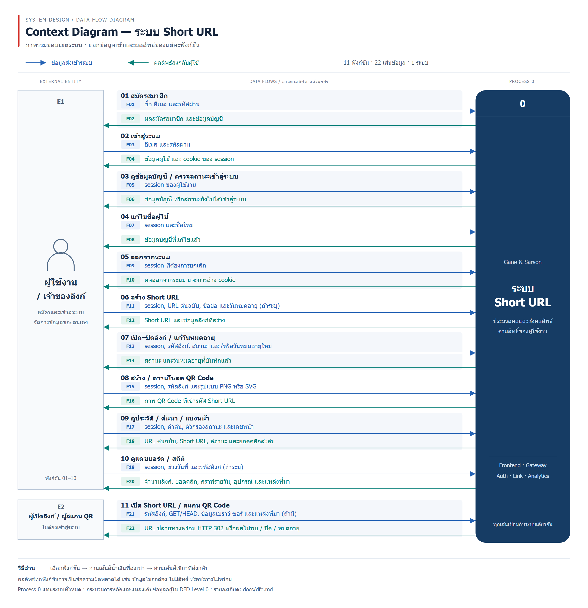
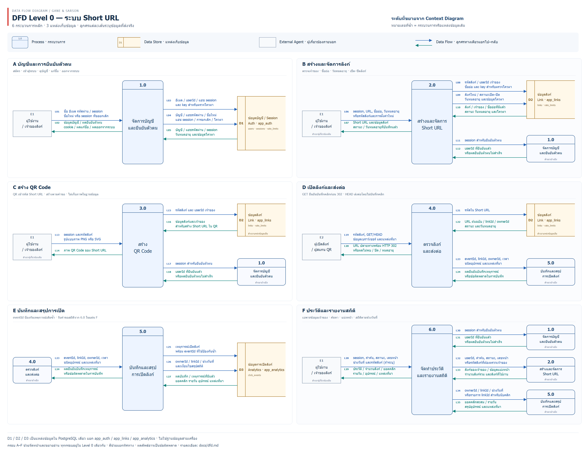

# DFD — ระบบ Short URL

เอกสารนี้อธิบายการไหลของข้อมูลตามโค้ดปัจจุบัน ครอบคลุมสมัครสมาชิก เข้าสู่ระบบ แก้ชื่อ ออกจากระบบ สร้างลิงก์ ตั้งชื่อเอง ตั้งวันหมดอายุ ปิด/เปิดลิงก์ สร้าง QR เปิดลิงก์ ประวัติ ค้นหา แบ่งหน้า และสถิติ

## 1. Context Diagram — ขอบเขตระบบ

[เปิด SVG เพื่อขยาย](diagrams/dfd-context.svg) · [Mermaid topology](diagrams/dfd-context.mmd)

เอกสารชุดนี้ใช้สัญลักษณ์ **Gane & Sarson** และแยกระดับเป็น **Context Diagram → DFD Level 0 → DFD Level 1**: Context แทนระบบทั้งหมดด้วย Process 0; Level 0 แสดงกระบวนการหลัก 1.0–6.0 พร้อมแหล่งเก็บข้อมูล; Level 1 ใช้เมื่อขยายรายละเอียดของกระบวนการหลัก เช่น 2.1/2.2 ภาพแยก A–F ด้านล่างเป็นส่วนขยายเพื่ออ่านของ Level 0 เดิม ไม่ใช่ Level 1 และไม่มีการเพิ่มระดับเพียงเพราะแบ่งหน้ากระดาษ

Frontend, Gateway, Auth, Link และ Analytics ทั้งหมดอยู่ภายใน Process 0; PostgreSQL เป็นข้อมูลภายในระบบ จึงแสดงใน DFD Level 0 แผนภาพนี้เน้นข้อมูลเข้า/ออก ไม่ใช่ลำดับขั้นตอนหรือผังการ deploy

### ผู้เกี่ยวข้องภายนอก

| รหัส | ผู้เกี่ยวข้อง | บทบาท |
|---|---|---|
| E1 | ผู้ใช้งาน / เจ้าของลิงก์ | ผู้ที่สมัครและเข้าสู่ระบบเพื่อสร้างและจัดการข้อมูลของตนเอง |
| E2 | ผู้เปิดลิงก์ / ผู้สแกน QR | ผู้ที่ได้รับ Short URL หรือ QR แล้วเปิดใช้งาน ไม่ต้องมีบัญชี |

คนเดียวกันเป็นได้ทั้งสองบทบาท เช่น เจ้าของเปิดทดสอบลิงก์ของตนเอง แต่แยกบทบาทในภาพเพื่อให้เห็นว่าเส้นทางเปิดลิงก์เป็นสาธารณะ ส่วนการจัดการลิงก์ต้องยืนยันตัวตน

### ข้อมูลบนลูกศรแต่ละเส้น

| เส้น | ทิศทาง | ฟังก์ชัน | ข้อมูลที่ไหล |
|---|---|---|---|
| F01 | E1 → ระบบ | สมัครสมาชิก | ชื่อ อีเมล และรหัสผ่าน |
| F02 | ระบบ → E1 | สมัครสมาชิก | ผลสมัครสมาชิก และข้อมูลบัญชี |
| F03 | E1 → ระบบ | เข้าสู่ระบบ | อีเมล และรหัสผ่าน |
| F04 | ระบบ → E1 | เข้าสู่ระบบ | ข้อมูลผู้ใช้ และ cookie ของ session |
| F05 | E1 → ระบบ | ดูข้อมูลบัญชี / ตรวจสถานะเข้าสู่ระบบ | session ของผู้ใช้งาน |
| F06 | ระบบ → E1 | ดูข้อมูลบัญชี / ตรวจสถานะเข้าสู่ระบบ | ข้อมูลบัญชี หรือสถานะยังไม่ได้เข้าสู่ระบบ |
| F07 | E1 → ระบบ | แก้ไขชื่อผู้ใช้ | session และชื่อใหม่ |
| F08 | ระบบ → E1 | แก้ไขชื่อผู้ใช้ | ข้อมูลบัญชีที่แก้ไขแล้ว |
| F09 | E1 → ระบบ | ออกจากระบบ | session ที่ต้องการยกเลิก |
| F10 | ระบบ → E1 | ออกจากระบบ | ผลออกจากระบบ และการล้าง cookie |
| F11 | E1 → ระบบ | สร้าง Short URL | session, URL ต้นฉบับ, ชื่อย่อ และวันหมดอายุ (ถ้าระบุ) |
| F12 | ระบบ → E1 | สร้าง Short URL | Short URL และข้อมูลลิงก์ที่สร้าง |
| F13 | E1 → ระบบ | เปิด–ปิดลิงก์ / แก้วันหมดอายุ | session, รหัสลิงก์, สถานะ และ/หรือวันหมดอายุใหม่ |
| F14 | ระบบ → E1 | เปิด–ปิดลิงก์ / แก้วันหมดอายุ | สถานะ และวันหมดอายุที่บันทึกแล้ว |
| F15 | E1 → ระบบ | สร้าง / ดาวน์โหลด QR Code | session, รหัสลิงก์ และรูปแบบ PNG หรือ SVG |
| F16 | ระบบ → E1 | สร้าง / ดาวน์โหลด QR Code | ภาพ QR Code ที่เข้ารหัส Short URL |
| F17 | E1 → ระบบ | ดูประวัติ / ค้นหา / แบ่งหน้า | session, คำค้น, ตัวกรองสถานะ และเลขหน้า |
| F18 | ระบบ → E1 | ดูประวัติ / ค้นหา / แบ่งหน้า | URL ต้นฉบับ, Short URL, สถานะ และยอดคลิกสะสม |
| F19 | E1 → ระบบ | ดูแดชบอร์ด / สถิติ | session, ช่วงวันที่ และรหัสลิงก์ (ถ้าระบุ) |
| F20 | ระบบ → E1 | ดูแดชบอร์ด / สถิติ | จำนวนลิงก์, ยอดคลิก, กราฟรายวัน, อุปกรณ์ และแหล่งที่มา |
| F21 | E2 → ระบบ | เปิด Short URL / สแกน QR Code | รหัสลิงก์, GET/HEAD, ข้อมูลเบราว์เซอร์ และแหล่งที่มา (ถ้ามี) |
| F22 | ระบบ → E2 | เปิด Short URL / สแกน QR Code | URL ปลายทางพร้อม HTTP 302 หรือผลไม่พบ / ปิด / หมดอายุ |

แต่ละฟังก์ชันแยกลูกศรข้อมูลเข้าและผลลัพธ์คนละเส้น รวม **22 เส้น** ทุกเส้นเชื่อมกับ Process 0 เดียวกัน หมายเลขฟังก์ชัน 01–11 เป็นหัวข้อช่วยอ่าน ไม่ใช่กระบวนการย่อยหรือขั้นตอนที่ต้องทำตามลำดับ ผลลัพธ์ทุกฟังก์ชันอาจเป็นข้อความผิดพลาดตามข้อมูลและสิทธิ์ของผู้ใช้

ใน Context สีฟ้า = ข้อมูลเข้าระบบ; สีเขียว = ผลลัพธ์ส่งกลับ สี่เหลี่ยมทางซ้ายคือผู้เกี่ยวข้องภายนอก กล่องมนสีน้ำเงินเข้มที่มีช่องหมายเลขด้านบนคือ Process 0 ชื่อบริการใช้ภาษาอังกฤษ ภาพ SVG/PNG ใช้สัญลักษณ์ Gane & Sarson ส่วน Mermaid เป็นโครงสร้างการเชื่อมต่อประกอบ ซึ่งรูปทรงและตำแหน่งอาจแตกต่าง สร้าง Context ซ้ำได้ด้วย `node scripts/render-dfd-context.mjs` หลังติดตั้ง dependencies และ Chromium ของ Playwright แล้ว

ระบบส่ง **URL ปลายทาง** กลับให้เบราว์เซอร์ ไม่ได้ดาวน์โหลดหรือให้บริการหน้าเว็บปลายทางเอง หลังรับ 302 เบราว์เซอร์เป็นฝ่ายเปิดเว็บไซต์นั้น ซึ่งอยู่นอกขอบเขตระบบ Short URL

## 2. DFD Level 0 — กระบวนการหลักและแหล่งเก็บข้อมูล

[SVG สำหรับขยายหรือพิมพ์](diagrams/dfd-level-0.svg) · [ข้อมูลโครงสร้าง](diagrams/dfd-level-0.json) · [Mermaid topology](diagrams/dfd-level-0.mmd)

ภาพรวมแยกเป็นกรอบ A–F เพื่อให้เห็นแต่ละเส้นชัด โดยทุกกรอบอยู่ใน Level 0 เดียวกัน สัญลักษณ์ที่กำกับ **สำเนาอ้างอิง** หรือใช้รหัสเดิมซ้ำหมายถึงรายการเดียวกัน ไม่ใช่กระบวนการหรือฐานข้อมูลใหม่ ตัวอย่าง 5.0 ในกรอบ D และ E คือกระบวนการเดียวกัน เส้น L23/L24 จึงปรากฏซ้ำเพื่อให้อ่านได้จากทั้งสองฝั่ง ไม่ใช่การส่งเหตุการณ์ซ้ำ

| แผ่น | รายละเอียด | ภาพขยาย |
|---|---|---|
| A | บัญชีและการยืนยันตัวตน | [PNG](diagrams/dfd-detail-account.png) · [SVG](diagrams/dfd-detail-account.svg) |
| B | สร้างและจัดการลิงก์ | [PNG](diagrams/dfd-detail-links.png) · [SVG](diagrams/dfd-detail-links.svg) |
| C | สร้าง QR Code | [PNG](diagrams/dfd-detail-qr.png) · [SVG](diagrams/dfd-detail-qr.svg) |
| D | เปิดลิงก์และส่งต่อ | [PNG](diagrams/dfd-detail-redirect.png) · [SVG](diagrams/dfd-detail-redirect.svg) |
| E | บันทึกและสรุปการเปิด | [PNG](diagrams/dfd-detail-analytics.png) · [SVG](diagrams/dfd-detail-analytics.svg) |
| F | ประวัติและสถิติ | [PNG](diagrams/dfd-detail-reports.png) · [SVG](diagrams/dfd-detail-reports.svg) |

### สัญลักษณ์ตาม Gane & Sarson

- **Process**: กล่องมุมมน แบ่งช่องหมายเลขด้านบนและชื่อกระบวนการด้านล่าง
- **Data Store**: กล่องเปิดด้านขวา มีช่องรหัส D1/D2/D3 ทางซ้าย ใช้แทนแหล่งข้อมูลถาวร
- **External Agent**: สี่เหลี่ยม แสดงผู้ส่งหรือผู้รับข้อมูลที่อยู่นอกระบบ
- **Data Flow**: ลูกศรหัวเดียว ระบุชื่อข้อมูล แยกเส้นไปและกลับ ไม่ใช้ลูกศรสองหัวหรือแทนลำดับขั้นตอน

Level 0 ใช้สีฟ้าสำหรับลูกศรที่ชี้ไปทางขวา และสีเขียวสำหรับลูกศรที่ชี้กลับซ้าย สีเป็นเพียงตัวช่วยอ่าน ไม่ได้แทนชนิดข้อมูล ทุกเส้นต้องอ่านตามหัวลูกศร ข้อมูลผู้ใช้ไม่ติดต่อ Data Store โดยตรง และแหล่งข้อมูลไม่เชื่อมถึงกันโดยไม่มี Process คั่น

### รายการข้อมูลทุกเส้นใน Level 0

<!-- LEVEL0-FLOWS -->
| เส้น | จาก → ไป | ข้อมูลที่ไหล |
|---|---|---|
| L01 | E1 → 1.0 | ชื่อ อีเมล รหัสผ่าน / session ชื่อใหม่ หรือ session ที่ขอยกเลิก |
| L02 | 1.0 → E1 | ข้อมูลบัญชี / ผลยืนยันตัวตน cookie / ผลแก้ชื่อ / ผลออกจากระบบ |
| L03 | 1.0 → D1 | อีเมล / userId / แฮช session และ key สำหรับตรวจโควตา |
| L04 | 1.0 → D1 | บัญชี / แฮชรหัสผ่าน / ชื่อใหม่ แฮช session / การยกเลิก / โควตา |
| L05 | D1 → 1.0 | บัญชี / แฮชรหัสผ่าน / session วันหมดอายุ และข้อมูลโควตา |
| L06 | E1 → 2.0 | session, URL, ชื่อย่อ, วันหมดอายุ หรือรหัสลิงก์และการตั้งค่าใหม่ |
| L07 | 2.0 → E1 | Short URL และข้อมูลลิงก์ สถานะ / วันหมดอายุที่บันทึกแล้ว |
| L08 | 2.0 → D2 | รหัสลิงก์ / userId เจ้าของ ชื่อย่อ และ key สำหรับตรวจโควตา |
| L09 | 2.0 → D2 | ลิงก์ใหม่ / สถานะเปิด–ปิด วันหมดอายุ และข้อมูลโควตา |
| L10 | D2 → 2.0 | ลิงก์ / เจ้าของ / ชื่อย่อที่มีแล้ว สถานะ วันหมดอายุ และโควตา |
| L11 | 2.0 → 1.0 | session สำหรับยืนยันตัวตน |
| L12 | 1.0 → 2.0 | userId ที่ยืนยันแล้ว หรือผลยืนยันตัวตนไม่สำเร็จ |
| L13 | E1 → 3.0 | session และรหัสลิงก์ รูปแบบภาพ PNG หรือ SVG |
| L14 | 3.0 → E1 | ภาพ QR Code ของ Short URL |
| L15 | 3.0 → D2 | รหัสลิงก์ และ userId เจ้าของ |
| L16 | D2 → 3.0 | ข้อมูลลิงก์และเจ้าของ สำหรับสร้าง Short URL ใน QR |
| L17 | 3.0 → 1.0 | session สำหรับยืนยันตัวตน |
| L18 | 1.0 → 3.0 | userId ที่ยืนยันแล้ว หรือผลยืนยันตัวตนไม่สำเร็จ |
| L19 | E2 → 4.0 | รหัสลิงก์, GET/HEAD ข้อมูลเบราว์เซอร์ และแหล่งที่มา |
| L20 | 4.0 → E2 | URL ปลายทางพร้อม HTTP 302 หรือผลไม่พบ / ปิด / หมดอายุ |
| L21 | 4.0 → D2 | รหัสใน Short URL |
| L22 | D2 → 4.0 | URL ต้นฉบับ / linkId / ownerId สถานะ และวันหมดอายุ |
| L23 | 4.0 → 5.0 | eventId, linkId, ownerId, เวลา ชนิดอุปกรณ์ และแหล่งที่มา |
| L24 | 5.0 → 4.0 | ผลยืนยันบันทึกเหตุการณ์ หรือข้อผิดพลาดในการบันทึก |
| L25 | 5.0 → D3 | เหตุการณ์เปิดลิงก์ พร้อม eventId ที่ใช้ป้องกันซ้ำ |
| L26 | 5.0 → D3 | ownerId / linkId / ช่วงวันที่ และเงื่อนไขสรุปสถิติ |
| L27 | D3 → 5.0 | ผลบันทึก / เหตุการณ์ที่มีแล้ว ยอดคลิก รายวัน อุปกรณ์ แหล่งที่มา |
| L28 | E1 → 6.0 | session, คำค้น, สถานะ, เลขหน้า ช่วงวันที่ และรหัสลิงก์ (ถ้าระบุ) |
| L29 | 6.0 → E1 | ประวัติ / จำนวนลิงก์ / ยอดคลิก รายวัน / อุปกรณ์ / แหล่งที่มา |
| L30 | 6.0 → 1.0 | session สำหรับยืนยันตัวตน |
| L31 | 1.0 → 6.0 | userId ที่ยืนยันแล้ว หรือผลยืนยันตัวตนไม่สำเร็จ |
| L32 | 6.0 → 2.0 | userId, คำค้น, สถานะ, เลขหน้า หรือรหัสลิงก์ที่ต้องตรวจเจ้าของ |
| L33 | 2.0 → 6.0 | ลิงก์ของเจ้าของ / ข้อมูลแบ่งหน้า จำนวนลิงก์รวม และลิงก์ที่ใช้งาน |
| L34 | 6.0 → 5.0 | ownerId / linkId / ช่วงวันที่ หรือรายการ linkId สำหรับนับคลิก |
| L35 | 5.0 → 6.0 | ยอดคลิกสะสม / รายวัน สรุปอุปกรณ์ และแหล่งที่มา |
<!-- /LEVEL0-FLOWS -->

ข้อมูลเข้า/ออกจาก Context F01–F10 รวมใน 1.0; F11–F14 ใน 2.0; F15–F16 ใน 3.0; F17–F20 ใน 6.0; F21–F22 ใน 4.0 ส่วน 5.0 เป็นงานภายในระบบ ผลลัพธ์ทุกกระบวนการอาจเป็นข้อความผิดพลาด ข้อมูลที่ย้ายจากเส้นหนึ่งไปอีกระดับต้องมีความหมายตรงกัน (balancing)

สร้างภาพรวมและภาพย่อยซ้ำด้วย `node scripts/render-dfd.mjs` ใช้ SVG/PNG เป็นภาพอ้างอิงสัญลักษณ์ Gane & Sarson โดย Mermaid เป็นโครงสร้างประกอบเท่านั้น

### หน้าที่ของกระบวนการ

| รหัส | กระบวนการ | ข้อมูลเข้า | การทำงานและข้อมูลออก |
|---|---|---|---|
| 1.0 | จัดการบัญชีและยืนยันตัวตน | ชื่อ อีเมล รหัสผ่าน หรือ session/ชื่อใหม่ | สมัครบัญชี ตรวจรหัสผ่าน ออก/ตรวจ session แก้ชื่อและออกจากระบบ ส่งข้อมูลผู้ใช้/ผลยืนยันตัวตน หรือข้อผิดพลาด |
| 2.0 | สร้างและจัดการลิงก์ | ID ผู้ใช้ที่ยืนยันแล้ว URL ชื่อย่อ วันหมดอายุ รหัสลิงก์ สถานะ หรือเงื่อนไขค้นหา | ตรวจ URL ชื่อสงวน ชื่อซ้ำ โควตาและเจ้าของ สร้างรหัสหรือใช้ชื่อที่กำหนด บันทึกและอ่านลิงก์ แก้สถานะ/วันหมดอายุ ส่ง Short URL หรือข้อมูลลิงก์ของเจ้าของ |
| 3.0 | สร้าง QR Code | session รหัสลิงก์และรูปแบบ PNG/SVG | ตรวจผู้ใช้และอ่านข้อมูลลิงก์ของเจ้าของจาก D2 แล้วสร้างภาพ QR ที่เข้ารหัส **Short URL** ส่งภาพกลับ โดยไม่เก็บภาพ QR ในฐานข้อมูล |
| 4.0 | ตรวจลิงก์และส่งต่อ | รหัสลิงก์ ชนิดคำขอ ข้อมูลเบราว์เซอร์และแหล่งที่มา | อ่าน D2 ตรวจว่าพบลิงก์และยังใช้ได้ สำหรับ GET ส่งเหตุการณ์ให้ 5.0 และรอผลก่อนตอบ 302; HEAD ไม่บันทึกคลิก |
| 5.0 | บันทึกและสรุปการเปิด | เหตุการณ์จาก 4.0 หรือเงื่อนไขนับ/จัดกลุ่มจาก 6.0 | บันทึกเหตุการณ์ใน D3 ป้องกันการบันทึกเหตุการณ์เดิมซ้ำ สรุปยอดคลิก รายวัน อุปกรณ์ และแหล่งที่มา ส่งผลยืนยันหรือผลสรุป |
| 6.0 | จัดทำประวัติและรายงาน | session คำค้น สถานะ เลขหน้า หรือช่วงวันที่และรหัสลิงก์ | รับข้อมูลผู้ใช้จาก 1.0 ข้อมูลลิงก์/เจ้าของ/จำนวนลิงก์จาก 2.0 และยอดคลิกจาก 5.0 รวมเป็นประวัติ/สถิติให้เจ้าของ |

หมายเลขกระบวนการแสดงหน้าที่ทางตรรกะ ไม่ได้หมายความว่ามีหก microservices: 1.0 อยู่ใน Auth; 2.0–4.0 อยู่ใน Link; 5.0 อยู่ใน Analytics; 6.0 อธิบายการจัดทำผลลัพธ์ประวัติ/สถิติร่วมกันของ Frontend และ API ของ Link/Analytics Gateway เป็นทางผ่านและตรวจคำขอ จึงไม่วาดเป็นกระบวนการธุรกิจเพิ่ม ดูตำแหน่ง deploy ใน [Architecture Diagram](diagrams/architecture.svg)

### แหล่งเก็บข้อมูล

| รหัส | เจ้าของข้อมูล | สคีมาและตาราง | ข้อมูลสำคัญ |
|---|---|---|---|
| D1 | Auth Service | `app_auth.users`, `sessions`, `rate_limits` | บัญชี แฮชรหัสผ่าน แฮช session token วันหมดอายุ และโควตาสมัคร/เข้าสู่ระบบ |
| D2 | Link Service | `app_links.links`, `rate_limits` | ID เจ้าของ URL ต้นฉบับ รหัสลิงก์ สถานะ วันหมดอายุ วันที่สร้าง/แก้ไข และโควตาสร้างลิงก์ |
| D3 | Analytics Service | `app_analytics.click_events` | eventId, linkId, ownerId, เวลาเปิด ชนิดอุปกรณ์ และชื่อโฮสต์ต้นทาง |

ทั้งสามเป็นพื้นที่ข้อมูลใน PostgreSQL instance เดียว แต่แยกสคีมา บัญชีฐานข้อมูล Prisma client และผู้รับผิดชอบตามบริการ บริการไม่อ่านตารางของบริการอื่นโดยตรง; การแลกข้อมูลในภาพเกิดผ่านฟังก์ชันภายในบริการหรือ API ระหว่างบริการตาม Architecture

## 3. ไล่อ่านตามการใช้งานจริง

### A — สมัคร เข้าสู่ระบบ แก้ชื่อ และออกจากระบบ

1. E1 ส่งชื่อ อีเมล และรหัสผ่านให้ 1.0; ระบบตรวจรูปแบบและอีเมลซ้ำ
2. 1.0 เก็บแฮชรหัสผ่านใน D1 แล้วส่งข้อมูลผู้ใช้กลับ โดยไม่ส่งแฮชรหัสผ่านออกไป
3. หน้าสมัครของเราส่งคำขอ login ต่ออัตโนมัติ เป็นคนละคำขอกับ register
4. Login สำเร็จสร้าง token ส่งเป็น cookie ให้เบราว์เซอร์ แต่เก็บเฉพาะแฮช token และวันหมดอายุใน D1
5. การจัดการลิงก์/QR/ประวัติ/สถิติต้องใช้ session ที่ 1.0 ตรวจแล้ว การแก้ชื่อเลือกบัญชีจาก session
6. ออกจากระบบยกเลิก session ใน D1 และส่งการล้าง cookie กลับผู้ใช้

### B–C — สร้างและจัดการลิงก์ พร้อม QR

1. E1 ส่ง URL เช่น `https://www.synerry.com` พร้อมชื่อย่อ/วันหมดอายุถ้าต้องการ
2. 2.0 รับ ID ผู้ใช้ที่ยืนยันแล้ว ตรวจ URL แบบ HTTP/HTTPS ชื่อสงวน ชื่อซ้ำและโควตา จากนั้นบันทึกลิงก์ใน D2
3. ส่ง Short URL ที่ใช้โดเมน Frontend จริงกลับ E1
4. การปิด/เปิดลิงก์หรือแก้วันหมดอายุต้องตรวจเจ้าของก่อนปรับ D2 URL ต้นฉบับและรหัสลิงก์คงที่หลังสร้าง
5. เมื่อต้องการ QR, 3.0 ตรวจ session และอ่านลิงก์จาก D2 โดยตรวจเจ้าของ แล้วแปลง Short URL เป็น PNG/SVG ภาพ B แยกส่วนสร้าง/จัดการลิงก์กับส่วน QR ให้อ่านง่ายขึ้น แต่ใช้ผู้ใช้และแหล่งข้อมูลเดิม
6. QR เป็นภาพที่สร้างตามคำขอ ไม่ใช่ตารางหรือไฟล์ถาวรในฐานข้อมูล การสแกนจะเข้าเส้นทาง C เหมือนเปิด Short URL

### D–E — เปิดลิงก์และบันทึกคลิก

1. E2 เปิด `/:code` หรือรูปแบบเดิม `/s/:code` หรือสแกน QR โดยไม่ต้องล็อกอิน
2. 4.0 อ่านลิงก์จาก D2; ไม่พบตอบ 404 ปิด/หมดอายุตอบ 410 โดยไม่สร้างเหตุการณ์คลิก
3. สำหรับ GET ของลิงก์ที่ใช้ได้ 4.0 สร้าง eventId พร้อมเวลาเปิด จัดประเภทอุปกรณ์จาก User-Agent และแปลงแหล่งที่มาเป็นชื่อโฮสต์ ถ้าไม่มีใช้ `direct`
4. 5.0 บันทึกเหตุการณ์ใน D3 และส่งผลยืนยันกลับ การลองส่งเหตุการณ์เดิมใช้ eventId เดิมเพื่อไม่บวกซ้ำ
5. 4.0 ตอบ 302 พร้อม URL ต้นฉบับเมื่อยืนยันการบันทึกแล้ว หากยืนยันไม่ได้ตอบ 503; เหตุการณ์อาจถูกบันทึกแล้วแต่ผลยืนยันสูญหายได้
6. HEAD ของลิงก์ที่ใช้ได้ตอบปลายทางโดยไม่ส่งเหตุการณ์ให้ 5.0

### F — ดูประวัติและสถิติ

1. E1 ส่งคำค้น ตัวกรองสถานะและเลขหน้า หรือช่วงวันที่และรหัสลิงก์ พร้อม session
2. 6.0 ใช้ผู้ใช้ที่ 1.0 ยืนยันแล้ว เพื่อขอข้อมูลเฉพาะเจ้าของจาก 2.0
3. ประวัติรวม URL ต้นฉบับ Short URL วันสร้าง สถานะ และยอดคลิกสะสมรายลิงก์จาก 5.0 พร้อมข้อมูลแบ่งหน้า
4. รายงานสถิติใช้ช่วงวันที่ตามเวลาไทย ส่งยอดคลิก กราฟ/ตารางรายวัน อุปกรณ์และแหล่งที่มา วันไม่มีคลิกแสดง 0
5. จำนวนลิงก์ทั้งหมดและลิงก์ที่ใช้งานเป็นสถานะปัจจุบัน ส่วนยอดคลิกในรายงานจำกัดตามช่วงวันที่ที่เลือก
6. ยอดคลิกรวมการเปิดซ้ำและบอต ไม่ใช่จำนวนคนไม่ซ้ำ และไม่รับรองว่าหน้าเว็บปลายทางโหลดสำเร็จ

## 4. ข้อผิดพลาดที่สำคัญ

| กรณี | ผลที่ผู้ใช้ได้รับ |
|---|---|
| URL/ชื่อย่อ/วันหมดอายุไม่ถูกต้อง | 400 พร้อมคำอธิบายแก้ไข |
| ไม่มี session หรือ session หมดอายุ | 401 ให้เข้าสู่ระบบ |
| อีเมลหรือชื่อย่อซ้ำ | 409 แจ้งว่าข้อมูลถูกใช้แล้ว |
| ไม่พบลิงก์ หรือขอข้อมูลจัดการของผู้อื่น | 404 |
| เปิดลิงก์ที่ปิดหรือหมดอายุ | 410 ไม่ส่งต่อ |
| ใช้เกินโควตา | 429 พร้อมเวลาที่ควรลองใหม่ |
| ฐานข้อมูล/บริการจำเป็นไม่พร้อม | 503 พร้อมข้อความบริการไม่พร้อม |

ข้อมูล API เต็มอยู่ใน [API Contract](api.md) DFD ไม่แสดง health probes และรายละเอียดการ retry ทุกครั้ง เพราะเป็นกลไกปฏิบัติการ ไม่ใช่การไหลข้อมูลธุรกิจหลัก

## 5. ความครบถ้วนกับโจทย์

| สิ่งที่ต้องสาธิต | จุดที่แสดงใน DFD |
|---|---|
| กรอก URL และได้ Short URL | E1 ↔ 2.0; 2.0 ↔ D2; 2.0 ↔ 1.0 |
| เปิด Short URL ไปต้นฉบับ | E2 ↔ 4.0; 4.0 ↔ D2; 4.0 ↔ 5.0; 5.0 ↔ D3 |
| สร้าง QR และสแกนใช้งาน | E1 → 3.0 → E1 จากนั้น E2 → 4.0 |
| ประวัติ URL และยอดคลิก | E1 ↔ 6.0; 6.0 ↔ 2.0/5.0; 6.0 ↔ 1.0 |
| ฟังก์ชันเพิ่มเติม | 1.0 บัญชี; 2.0 alias/วันหมดอายุ/เปิด–ปิด; 6.0 ค้นหา/กรอง/แบ่งหน้า/รายงาน |

DFD บอกว่า “ข้อมูลไหลไปไหนและถูกประมวลผลอย่างไร” ส่วน [ER Diagram](diagrams/er.png) บอกว่า “เก็บข้อมูลอะไรและสัมพันธ์กันอย่างไร” และ Architecture บอกว่า “แต่ละส่วนรันและติดต่อกันที่ไหน” ใช้ประกอบกันในการนำเสนอได้
