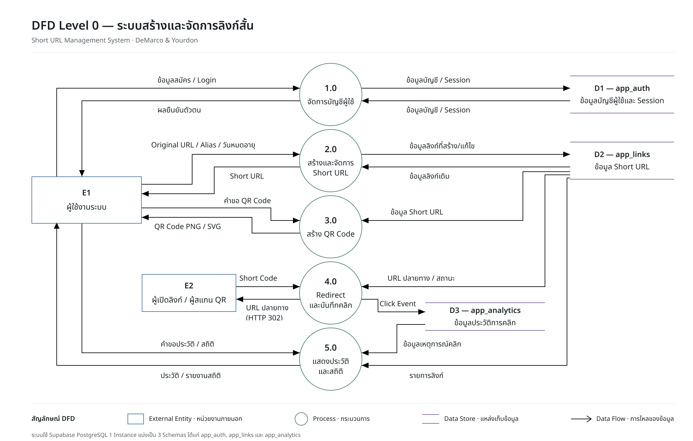

# DFD Level 0 — ระบบสร้างและจัดการลิงก์สั้น

[เปิดภาพขนาดเต็ม](diagrams/dfd-level-0-submission.png) · [เปิดใน Figma](https://www.figma.com/design/KWIrbon5NX18Yh3vvZBqPq/Short-URL-%E2%80%94-Microservices-architecture?node-id=0-1)

แผนภาพใช้สัญลักษณ์ **DeMarco & Yourdon** แสดงการไหลของข้อมูลระหว่างผู้ใช้ กระบวนการหลัก 5 กระบวนการ และแหล่งเก็บข้อมูล 3 แห่ง อ่านทิศทางจากหัวลูกศร โดยข้อความบนเส้นระบุข้อมูลที่ส่งผ่าน

## สัญลักษณ์

| สัญลักษณ์ | ความหมาย |
|---|---|
| สี่เหลี่ยม E1 / E2 | External Entity — ผู้ติดต่อกับระบบ |
| วงกลม 1.0–5.0 | Process — กระบวนการทำงานหลัก |
| เส้นขนาน D1–D3 | Data Store — แหล่งเก็บข้อมูล |
| ลูกศรที่มีชื่อข้อมูล | Data Flow — ข้อมูลที่ไหลจากต้นทางไปปลายทาง |

DFD แสดงงานและข้อมูลในระดับกระบวนการ ส่วนเครื่องมือที่ใช้และการเชื่อมต่อบริการดูใน [Architecture](architecture.md) และคอลัมน์/ความสัมพันธ์ของตารางดูใน [ER Diagram](diagrams/er.png)

## ผู้ติดต่อกับระบบ

| รหัส | ผู้ติดต่อ | สิ่งที่ทำ |
|---|---|---|
| E1 | ผู้ใช้งานระบบ | สมัครสมาชิก เข้าสู่ระบบ สร้างและจัดการลิงก์ ขอ QR Code ดูประวัติและสถิติของตนเอง |
| E2 | ผู้เปิดลิงก์ / ผู้สแกน QR | ส่ง Short Code ให้ระบบเพื่อไปยัง URL ปลายทาง โดยไม่ต้องเข้าสู่ระบบ |

## แหล่งเก็บข้อมูล

ระบบใช้ Supabase PostgreSQL หนึ่ง instance แยกข้อมูลตามสคีมาที่แต่ละบริการดูแล

| รหัส | สคีมา / บริการ | ตารางและข้อมูล |
|---|---|---|
| D1 | `app_auth` / Auth Service | `users`: บัญชีผู้ใช้และรหัสผ่านที่แฮช, `sessions`: Session Token ที่แฮชและวันหมดอายุ, `rate_limits`: ตัวนับการสมัคร/เข้าสู่ระบบ |
| D2 | `app_links` / Link Service | `links`: เจ้าของ URL ต้นฉบับ Short Code สถานะ วันหมดอายุ และวันสร้าง/แก้ไข, `rate_limits`: ตัวนับการสร้างลิงก์ |
| D3 | `app_analytics` / Analytics Service | `click_events`: รหัสเหตุการณ์ ลิงก์ เจ้าของ เวลาคลิก ประเภทอุปกรณ์ และแหล่งที่มา |

QR Code สร้างจาก Short URL เมื่อร้องขอ จึงไม่มีตารางเก็บไฟล์ QR แยก และยอดคลิกคำนวณจากเหตุการณ์ใน D3

## 1.0 จัดการบัญชีผู้ใช้

ผู้ใช้ส่งข้อมูลสมัครหรือ Login ระบบตรวจข้อมูล บันทึกหรืออ่านบัญชี/Session ใน D1 แล้วส่งผลยืนยันตัวตนกลับให้ผู้ใช้ กระบวนการนี้ครอบคลุมการตรวจ Session ออกจากระบบ และแก้ไขชื่อบัญชีด้วย

| ต้นทาง → ปลายทาง | ข้อมูลบนเส้น / หน้าที่ |
|---|---|
| E1 → 1.0 | ข้อมูลสมัคร / Login ได้แก่ ชื่อ อีเมล และรหัสผ่านตามประเภทคำขอ |
| 1.0 → D1 | ข้อมูลบัญชี / Session ที่ต้องบันทึกหรือเปลี่ยนแปลง |
| D1 → 1.0 | ข้อมูลบัญชี / Session สำหรับตรวจสอบตัวตน |
| 1.0 → E1 | ผลยืนยันตัวตน หรือข้อความแจ้งข้อผิดพลาด |

การสมัครสำเร็จยังไม่สร้าง Session ผู้ใช้เข้าสู่ระบบต่อเพื่อรับ Session Cookie

## 2.0 สร้างและจัดการ Short URL

ผู้ใช้ที่เข้าสู่ระบบส่ง Original URL พร้อม Alias และวันหมดอายุถ้ามี ระบบตรวจข้อมูลและสิทธิ์ บันทึกลิงก์ใน D2 แล้วส่ง Short URL กลับ กระบวนการนี้รวมการเปิด–ปิดลิงก์และการแก้วันหมดอายุของลิงก์ที่ตนเองเป็นเจ้าของ

| ต้นทาง → ปลายทาง | ข้อมูลบนเส้น / หน้าที่ |
|---|---|
| E1 → 2.0 | Original URL / Alias / วันหมดอายุ รวมถึงข้อมูลที่ต้องการแก้ไข |
| D2 → 2.0 | ข้อมูลลิงก์เดิมสำหรับตรวจ Alias เจ้าของ และสถานะ |
| 2.0 → D2 | ข้อมูลลิงก์ที่สร้าง/แก้ไข |
| 2.0 → E1 | Short URL หรือผลการจัดการลิงก์ |

รองรับ URL แบบ HTTP/HTTPS และ Alias ต้องไม่ซ้ำหรือชนชื่อหน้าจอที่ระบบสงวนไว้

## 3.0 สร้าง QR Code

ผู้ใช้ขอ QR ของลิงก์ตนเอง ระบบอ่าน Short URL จาก D2 แล้วสร้างภาพ PNG หรือ SVG ส่งกลับให้แสดงหรือดาวน์โหลด

| ต้นทาง → ปลายทาง | ข้อมูลบนเส้น / หน้าที่ |
|---|---|
| E1 → 3.0 | คำขอ QR Code พร้อมลิงก์และรูปแบบภาพ |
| D2 → 3.0 | ข้อมูล Short URL สำหรับเข้ารหัส |
| 3.0 → E1 | QR Code PNG / SVG |

QR เข้ารหัส Short URL เมื่อสแกนจึงเข้าสู่กระบวนการ 4.0 เช่นเดียวกับการคลิกลิงก์

## 4.0 Redirect และบันทึกคลิก

ผู้เปิดลิงก์ส่ง Short Code ระบบอ่าน URL ปลายทางและสถานะจาก D2 ตรวจว่าลิงก์เปิดใช้งานและยังไม่หมดอายุ จากนั้นบันทึก Click Event ลง D3 ก่อนตอบ HTTP 302 ไปยัง URL ต้นฉบับ

| ต้นทาง → ปลายทาง | ข้อมูลบนเส้น / หน้าที่ |
|---|---|
| E2 → 4.0 | Short Code จากลิงก์หรือ QR |
| D2 → 4.0 | URL ปลายทาง / สถานะ รวมถึงวันหมดอายุ |
| 4.0 → D3 | Click Event พร้อมลิงก์ เจ้าของ เวลา อุปกรณ์ และแหล่งที่มา |
| 4.0 → E2 | URL ปลายทาง (HTTP 302) หรือผลแจ้งว่าลิงก์เปิดไม่ได้ |

ลิงก์ที่ไม่พบตอบ 404 ส่วนลิงก์ปิดหรือหมดอายุตอบ 410 และไม่ส่งต่อ หากบันทึกคลิกไม่สำเร็จตอบ 503 การ retry ใช้ eventId เดิมเพื่อป้องกันบันทึกซ้ำ ส่วน HEAD ตรวจลิงก์ได้โดยไม่เพิ่มคลิก

## 5.0 แสดงประวัติและสถิติ

ผู้ใช้ขอดูประวัติหรือสถิติ ระบบอ่านรายการลิงก์ของผู้ใช้จาก D2 และเหตุการณ์การคลิกจาก D3 แล้วส่งรายการพร้อมยอดคลิกหรือรายงานสถิติกลับ

| ต้นทาง → ปลายทาง | ข้อมูลบนเส้น / หน้าที่ |
|---|---|
| E1 → 5.0 | คำขอประวัติ / สถิติ พร้อมตัวค้นหา ตัวกรอง หรือช่วงวันที่ |
| D2 → 5.0 | รายการลิงก์ของผู้ใช้ |
| D3 → 5.0 | ข้อมูลเหตุการณ์คลิกสำหรับนับและสรุป |
| 5.0 → E1 | ประวัติ / รายงานสถิติ ได้แก่ URL ต้นฉบับ Short URL ยอดคลิก รายวัน อุปกรณ์ และแหล่งที่มา |

ผู้ใช้ดูข้อมูลได้เฉพาะบัญชีของตนเอง สถิติใช้เขตเวลา Asia/Bangkok และนับเหตุการณ์เปิดลิงก์ รวมการเปิดซ้ำ ไม่ใช่จำนวนบุคคลที่ไม่ซ้ำ

## การเชื่อมกับระบบที่พัฒนา

| กระบวนการใน DFD | ส่วนที่รับผิดชอบ |
|---|---|
| 1.0 | Auth Service |
| 2.0 และ 3.0 | Link Service |
| 4.0 | Link Service อ่านลิงก์และ Redirect ร่วมกับ Analytics Service ที่บันทึกคลิก |
| 5.0 | Link Service ส่งประวัติ ร่วมกับ Analytics Service ที่สรุปยอดและสถิติ แล้ว Frontend แสดงผล |

Gateway รับและส่งต่อคำขอ ส่วนการตรวจ Session และสิทธิ์เป็นขั้นตอนประกอบในกระบวนการที่ต้องเข้าสู่ระบบ การอ่านข้อมูลข้ามบริการทำผ่าน API ของบริการเจ้าของข้อมูลตาม [Architecture Diagram](diagrams/architecture-submission.png)

[กลับสารบัญเอกสาร](README.md) · [วิธีทดสอบฟังก์ชัน](testing.md)
